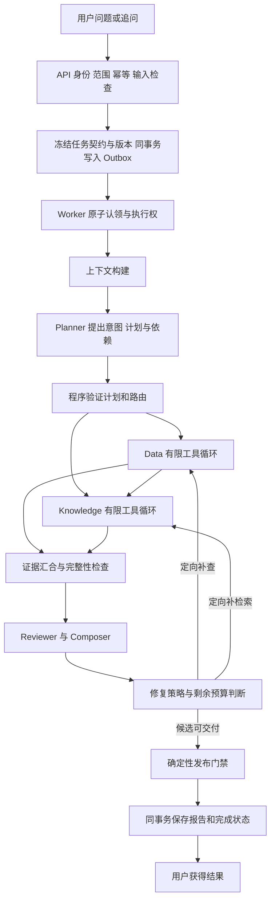

# 企业经营洞察助手：Agent 架构重构需求说明

日期：2026-10-07。状态：提案，未实施，未完成运行验收。

> 用户将最终目标明确提升为“具备真实上线条件的企业经营分析 Agent”。第 17 节 P0–P7 是本地验证里程碑；新增第 18 节定义完整上线架构、P8–P10 与上线门禁。既有“单节点、未上线”表述只描述 P7 结束时的中间状态，不再代表最终目标。所有上线指标仍须在选定客户、数据、部署区域和负载后冻结；本文不宣称当前系统已达到上线条件。

## 1. 本文要解决什么

把现有只读经营分析系统改造成“外层受控编排、内层模型驱动工具循环”的 Agent 应用。用户提出业务问题后，模型可以在授权范围内选择工具、生成参数、根据执行反馈补查或修正；程序负责权限、证据、预算、恢复和发布。

本文只交付架构与需求说明，不修改业务代码、不安装框架、不重跑真实业务评测。下面的接口名、工具名和默认上限均是目标设计，不代表已有实现或经过容量验证。2026-10-07 的复审把“结果不同但没有实际进展”、多工具调用完整续接及跨边界失败语义补为明确契约；本次文档修订仍不产生运行证据。

本提案细化现有 [核心优先计划](agent_core_first_execution_plan.md) 的 B1/B2/B4/B5/B6/B7；不自动替换原计划，不另建证据账本。最终约束仍见 [生产设计路线图](single_node_production_style_ai_application_roadmap.md)，运行证据统一进入 [evidence.md](evidence.md)。

### 1.1 需要纠正的前提

- 后端执行工具是正常机制。模型提出调用，受信任的运行时校验并执行；不是让模型直接获得数据库连接或进程执行权。
- 固定审核、权限检查和发布顺序是保护边界；把所有边界改成模型自由选择，不是升级。
- 现有系统并非只有长提示词：已经存在候选 SQL、有限修复、工具运行时、执行尝试、恢复及证据报告。需要重构的是模型交互契约、节点内部循环和工程衔接。
- Function Calling 是模型提出结构化调用的机制；MCP 是工具等外部能力的接入协议；LangChain/LangGraph/Deep Agents 是不同层次的构建工具。它们不是生产成熟度等级。

### 1.2 产品范围与不变量

面向已授权用户，提供公司经营数据分析、知识证据检索、连续追问和带来源的报告。保留受控自由 SQL、只读经营库、Schema Snapshot、公司隔离、RLS、Outbox、执行权保护和证据不足结果。

不增加交易、付款、发送邮件、任意代码执行、任意网址抓取或开放式通用助理。现有附件能力保持冻结，未达到可消费条件的附件拒绝进入分析。将来增加外部写工具时，另行定义确认、幂等与结果不确定处理。

“生产级设计”在这里指：明确适用范围，正常与失败路径均有契约，运行结果可追溯，错误影响有界且恢复可验证。不是零错误承诺，也不是上线、高可用或大规模吞吐证明。

## 2. 当前代码核查与重构依据

检查基准：HEAD `a0d8578a` 加当前大量未提交修改。以下为工作区源码事实；未把候选代码当作已验证基线，未运行测试。

| 位置 | 本次看到的实现 | 对目标的影响 |
|---|---|---|
| `backend/app/core/gateway/base.py` | `chat(prompt, system_prompt, json_mode) -> str` | 缺少统一的多消息、工具定义、调用项与工具结果契约 |
| `backend/app/core/gateway/openai.py`、`deepseek.py` | 构建 system/user 消息，读取 `message.content` | 已读路径未传工具定义、未处理原生 tool calls；JSON mode 不等于工具循环 |
| `backend/app/modules/analysis/data_agent.py` | `run` 调用 SQL 生成服务，有限尝试后执行受控 SQL | 有模型决策和修复，但动作集合、顺序主要由专用代码组织 |
| `backend/app/modules/knowledge/agent.py` | 先执行 RAGTool，再调用模型归纳 | 尚不是“模型选择检索动作、观察结果、继续检索”的通用循环 |
| `backend/app/modules/workflow/graph.py` | 用 StateGraph 注册角色和受控路线 | 适合作为外层编排，保留而非整体推倒 |
| `backend/app/modules/analysis/tool_protocol.py` | `parameters: dict`，结果以 success/data/error 表达 | 需补每工具输入输出 Schema、版本及机器可读失败语义 |
| `backend/app/modules/runtime/tool_runtime.py` | 工具白名单、冻结范围检查、预算和事件记录 | 应成为所有本地/MCP 工具的唯一执行入口；已有代码不等于所有保证均验收 |
| `backend/app/modules/memory/service.py` | Planner 记忆读取；报告事实与限制的幂等写入；读取过滤撤销/过期 | 保留，补来源有效性、冲突、删除传播及上下文选择契约 |
| `backend/app/modules/workflow/recovery.py` | 定义单节点和下游失效恢复策略，当前未跟踪文件 | 可复用思想，须以整图恢复测试验证 |

额外源码缺口：`_route_after_smart_router` 可以返回 `reviewer_node`，但对应条件边映射未列出它；路由单测能选出动作，不代表整图能执行该边。本文记录为待复现问题，不声称已经修复。

已阅读 `test_tool_runtime.py` 的越界、缺范围、预算拒绝测试，以及工作流路由/恢复测试。它们提供现有契约线索，不是本次通过证据。没有对全部文件完成安全审计。

## 3. 架构选择与技术定位

### 3.1 目标形态与采用门禁

目标形态采用 **LangGraph 外层编排 + 可替换的节点内工具循环 + 项目自己的执行与证据控制面**。LangChain Agent 是首选候选实现，不是未经实验证明的强制依赖；只有它在相同模型、工具、预算和案例下通过协议完整性、可恢复性、可观测性、时延/费用及维护复杂度门禁，才进入正式路径。否则保留框架无关的最小循环适配器，且最终只能存在一套生产执行路径。

LangGraph 明确阶段和允许的回边；Data、Knowledge 使用相同的框架无关循环契约但不同工具集、提示词和输出契约；Planner 使用结构化计划输出；Reviewer/Composer 输出草稿与审阅决定。不要强迫每个角色都使用工具循环。

LangChain 的 Agent 构建接口提供常见模型/工具循环，具体调用前后控制通过适配或中间件接入项目策略。它内部依赖 LangGraph，不是另一套独立的任务调度系统。[LangChain 官方概述](https://docs.langchain.com/oss/python/langchain/overview)

LangGraph 用于状态化编排，可混合确定性步骤和模型驱动步骤；外层用它不意味着内层必须写死。[LangGraph 官方概述](https://docs.langchain.com/oss/python/langgraph/overview)

### 3.2 比较与取舍

| 方案 | 收益 | 成本/问题 | 决定 |
|---|---|---|---|
| 继续全部自写工具循环 | 不新增框架，控制直接 | 自行维护多消息、调用关联、循环生命周期 | 作为对照或兼容性受阻时的备选，不重复造两套运行时 |
| LangGraph + LangChain 节点循环 | 外层边界清楚，内层可反馈调整，减少循环样板 | 要验证供应商、版本、中间件、持久化衔接及隐藏重试/并行行为 | 首选候选；通过采用门禁后才固化 |
| Deep Agents 统管调查 | 规划、文件和委派等能力预先组合 | 引入额外默认策略与能力面，当前收益未证明 | 不作为本轮默认重构方案 |

Deep Agents 的规划、文件系统、子 Agent 与上下文机制可供设计参考；本轮不安装其整套运行系统。[Deep Agents 官方概述](https://docs.langchain.com/oss/python/deepagents/overview)

本地工具循环不依赖 MCP；但本项目 P5 必须用现有只读业务能力完成一个受控 MCP 适配与等价验证，以满足已明确的最终交付要求。更多外部/共享工具仍按实际业务需求准入。直接函数调用与 MCP 调用接受同样的授权和结果校验。

### 3.3 依赖与权威状态

- 实施前锁定兼容的 LangChain、LangGraph、模型供应商适配包及 Python 版本；当前宽泛 requirements 不能当兼容性证明。
- 先冻结框架无关的 `ModelRequest/ModelResponse/ToolCall/ToolResult/LoopCheckpoint` 契约，再比较自有最小适配器与 LangChain 候选；不得把“引入 Function Calling”和“引入新框架”合并成一个无法归因的变量。
- 只保留一套模型调用计费/审计入口，不让框架直接绕过 Model Gateway 的治理。
- PostgreSQL 任务记录是业务状态权威；外层任务执行权控制内层所有写入。节点循环状态存入同一受保护的检查点体系。
- 若采用框架 checkpointer，必须适配到同一 execution/版本校验；不能同时存在一个可独立复活任务的框架 checkpoint 和一个业务 checkpoint。
- 首轮每次只执行一个工具调用；模型单轮提出多个调用时串行处理并完整关联回传，不隐式并发，也不引入多层后台调度平台。
- 模型调用前及恢复时由服务端选择任务已冻结且当前仍获准的工具版本；框架的自动重试、递归与工具执行默认关闭或纳入同一任务级账本，不能形成隐藏的第二套循环。

## 4. 目标调用链与决定权



图中是允许的路线集合，不表示每次同时运行所有分支。Data-only/Knowledge-only 只执行需要的分支；hybrid 默认 Data → Knowledge。明确无数据依赖的子查询才能并发；并发是独立候选变量，不在首次工具循环迁移时同时打开。

| 决定 | 谁提出 | 谁最终控制 |
|---|---|---|
| 用户意图、需要查什么 | Planner | 计划校验器检查范围、依赖及缺参数 |
| 查询/检索参数、是否补查 | Data/Knowledge 模型 | Runtime 检查工具白名单、参数、授权和预算 |
| 下一业务阶段 | Planner/Reviewer 提建议 | LangGraph 中受控路由 |
| 参数修复 | 模型提出新参数 | 原 Schema、范围和预算保持不变 |
| 身份、文档范围、执行权 | 后端 | 授权与数据库约束；模型无决定权 |
| 数字计算 | 模型可提出计算要求 | 确定性计算代码 |
| 审阅、解释和局限性 | Reviewer/Composer | 确定性门禁最终决定可否发布 |
| 停止、取消、降级 | 模型可建议停止 | Runtime 强制截止时间、总步数、权限与终态 |
| 登录、会话、角色与高风险审批 | 用户/管理员按产品流程申请 | 身份提供方、服务端 RBAC/ABAC、令牌状态、职责分离和审计最终控制 |

## 5. 角色与有限自主性

### 5.1 Planner

输入：当前问题、必要会话、可用能力目录、受控记忆摘要和参数来源。输出：`QuestionIntent + AnalysisPlan`，包含目标、指标/口径、时间/实体、route、步骤依赖、需要的证据、澄清项和停止条件。每项证据需求应标明 `required/optional`、可检验的完成条件及不满足时的结果语义；不能把“多调用几次工具”写成完成条件。

只允许现有角色与能力，不动态生成任意 Agent。模型不能设置公司授权或提高预算。信息不明确时返回澄清；用户说“下降”也必须允许后续数据推翻前提。计划仅代表待执行假设，不代表事实。
计划修订生成新版本，重新校验目标、依赖、范围及剩余预算；不能在每次修订中重置已尝试方向、无进展计数或下游失效关系。修订后不需要的旧步骤可以保留审计记录，但不得把旧证据当成新计划的自动完成证明。

### 5.2 Data

输入：验证后的计划、当前子任务、Schema Snapshot 引用、已有数据证据与修复反馈。模型可以查看必要 schema、提出受控自由 SQL、观察结果、修正口径、增加有依据的分组查询，并输出已确认事实或缺口。

不是任意 SQL 执行器。SQL AST、表列/Join/函数范围、公司约束、只读连接、查询时间、结果上限及业务口径校验保持生效。事实的金额/百分比由程序计算，记录输入证据、单位、舍入与零分母处理。

### 5.3 Knowledge

输入：问题、待解释的事实、计划中的证据需求、允许读取的证据引用。模型决定检索问题、允许的业务过滤条件、是否改写查询、是否读取相关片段上下文、是否进一步查反证。

检索返回证据而非预先拼好的 system/user prompt；提示词装配归 Context Builder。不可因检索无结果就扩大授权范围。达到预算仍无足够证据时输出不足，不补常识归因。

### 5.4 Reviewer/Composer

保留一个业务角色，内部先审阅后合成，不为命名再加 Agent。输入为版本化证据包，不读取其他 Agent 的完整聊天历史或长期记忆。

审阅结果区分支持、反驳、不足、无关，给出受影响 claim、缺什么证据、建议修复的角色。修复不是要求前面“直到给出肯定答案”，而是对明确缺口做有界补查。草稿中的每个核心数字必须可复算，因果陈述必须有足够支持，否则降级措辞或删除。

## 6. 模型交互与工具循环契约

### 6.1 统一模型接口

目标 ModelRequest：`messages + tool_definitions + output_schema + model_config + deadline + context_manifest_id`。

目标 ModelResponse：`content_blocks + tool_calls + finish_reason + usage + provider_response_id`。每个调用包含 `provider_call_id/name/arguments`；参数先视为未信任数据。保留供应商续接所需的原始内容块，不能为了统一接口丢失后续请求所必需的协议数据。内部另分配全任务唯一的 `tool_call_id`，保存与供应商调用编号、attempt、消息版本的一一对应，避免恢复或供应商切换时把不同调用混为一笔。

不再把所有交互降为字符串。Schema 合法不代表语义正确。空输出、拒绝、截断、未知工具、坏参数、多次调用和调用中断各有明确分支。供应商/模型能力需用真实契约样例验证：工具选择、参数、结果关联、续接、结构化输出、并发调用支持。

原生工具调用不支持时，不静默伪装支持。选择已验证支持的模型；确需兼容时使用显式标记的结构化动作适配器，并单独评测。模型切换需重建兼容消息，保留业务证据，不能盲目重放不兼容的供应商内容块。

### 6.2 每一轮执行

1. Runtime 检查任务仍运行、执行权/租约有效、当前授权和剩余预算。
2. Context Builder 生成有界输入，包含当前证据摘要、待解决缺口及本角色工具定义。
3. 调用模型并记录独立的 `model_call_id`。
4. 若模型提出工具调用：校验名称、参数、范围和依赖，先持久化调用意图并预留预算。
5. ToolRuntime 执行受控工具，保存结果/错误及证据引用，用原调用编号关联反馈。
6. 将调用及结果作为完整协议单元追加到当前角色历史，再请求模型。
7. 若模型提出结束：解析角色输出，程序检查必要证据与完成条件；不足则允许一次有界纠正或输出未完成。
8. 任意时刻硬限制触发即停止；不得因模型持续输出新话题而延长任务。

**进展契约**：计划经校验后建立版本化 `GapLedger`，每个待解决项有 `gap_id/required/acceptance_criteria/status/evidence_refs/conflict_refs/attempted_strategies`。模型每次提出工具调用时须指明目标缺口与预期能获得的证据；这只是申请，不构成进展。工具结果须先通过权限、范围、来源版本、类型及业务口径检查，再判断是否：(a) 用可核验事实关闭缺口；(b) 完成该缺口预先声明的必要前置步骤；(c) 在明确覆盖范围内排除一个候选方向，使下一步策略发生实质变化；(d) 新增可追溯反证或冲突，改变后续验证目标。不同片段、不同 SQL 行、不同检索词或模型自称“有帮助”本身都不算进展；同一事实的措辞变化也不算新证据。

结果不同仍可能零进展：连续取得三份互不相同但与下降原因无关的文档，不得因 `evidence_id` 不同而无限续查。相反，尚未关闭最终缺口、却完成必要指标口径确认的调用可算一次中间进展。中间进展必须绑定有限依赖路径，不允许模型每轮凭空创造新前置步骤。空检索仅证明本次授权范围和查询策略下未命中，不证明不存在证据。语义相关性或因果支持无法完全由确定性规则证明：可用有版本、有 rubric、计入同一预算的受约束复核辅助判断；复核不确定记 `unknown`，不能强行记 `resolved`，也不能递归调用自身直到通过。

**继续/停止决策**：每轮先检查取消、租约、当前授权、截止时间和跨节点/跨 attempt 总预算。必需缺口均已解决时可提交完整节点结果；未解决时仅在已无有依据且预算允许的策略、用户需澄清或业务已明确接受受限答案的条件下提交部分/不足结果。若仍有未尝试且有根据的策略，可在剩余预算内继续。连续无实质进展时向模型反馈具体缺口、已尝试方向与剩余额度，只给有限一次改变策略的机会；仍无进展则结束本节点为 `insufficient_evidence` 或相应技术失败，而非强迫产出肯定结论。每缺口/每策略/任务总轮次均有上限，计划修订、Reviewer 回边、Worker 重试不得清零；阈值由冻结案例及成本/时延实验确定，不在本文假定已验证。完全相同工具/规范化参数/输入版本是可提前拦截的特例，不是唯一无进展定义。若支撑已解决缺口的证据过期、撤权或因上游重跑失效，须把该缺口重新标为待核查，不能只清掉报告引用而保留“已解决”状态。

若一个模型响应包含多个 tool call，首版先对整批做工具/参数/权限/相互依赖与预算检查，再按顺序执行允许的相互独立调用，并逐项为原 `provider_call_id` 生成匹配结果；依赖前一调用结果才能构造参数的动作必须等下一轮模型观察后再提出。先按整批调用槽位及可估计费用上界做原子预留，实际费用后续结算、未知费用单列，不能把未知视作零。某项被拒绝、取消或预算耗尽也必须形成可关联的结构化结果，或按供应商协议明确中止该轮，不能带着孤立调用记录继续下一次模型请求。未来并发只在无依赖且通过独立并发验收后开启；不得让框架自动并行绕过 Runtime。所有隐藏重试和语义复核成本计入同一任务级上限，禁止多层上限相乘。

### 6.3 演示轨迹（合成数据，不是已运行证据）

```text
用户：分析 8 月相对 7 月的销售下降。
Planner → plan_v1：先验证净销售额变化，再调查主要区域。
Data 模型 → sql_query：两个月净销售额候选 SQL + QueryContract。
Runtime → 校验/只读执行 → evidence e1：100 万、80 万。
Data 模型 → sql_query：按区域分组的补充 SQL。
Runtime → evidence e2；程序计算变化率与区域贡献。
Data → DataResult：确认下降 20%，列出贡献事实与口径。
Knowledge 模型 → rag_search：针对主要下降区域检索经营材料。
Runtime → evidence e3：相关但不足；模型决定补检索反证。
Knowledge → KnowledgeResult：支持的事实、冲突和仍不足的解释。
Reviewer → draft_v1 + ReviewDecision。
程序门禁 → 通过才发布；不足则发布明确受限的部分报告。
```

可观察的自主性是第二次查询/检索由模型根据前次反馈选择，而非预先固定执行每个工具；这些轨迹必须在真实评测中展示收益。

反例轨迹：针对“销售下降的原因”，模型连续检索到市场活动、人事通知和办公采购三份不同片段；若它们均不支持任何原因 Claim、不能缩小待核查范围，也不是计划中的必要前置步骤，`GapLedger` 的原因缺口仍为 `open`，无进展次数增加。模型可在有限一次反馈后采用有根据的新检索策略；仍无进展即停止检索，保留已核实销售数字，原因标为未证实。此轨迹也是设计例子，尚未运行。

## 7. 工具注册、执行与 MCP

### 7.1 ToolSpec 与 ToolResult

每个 ToolSpec 定义 `name/version/description/input_schema/output_schema/allowed_roles/read_only/timeout/result_limit/retry_policy/concurrency_policy/data_classification/egress_policy`。工具描述写清适用范围和限制，不含权限秘密。工具输出 Schema 不只是给模型看的说明，Runtime 必须校验返回类型、大小、来源和必要字段；不合约的远端返回按失败隔离，不能进入证据包。

业务输入与受信任执行上下文分开：模型只能提供 SQL、检索词等业务参数；Runtime 注入 task、attempt、company、scope、deadline。若允许模型选择文档子集，必须验证它是有效范围的子集，空集合不转为全量。

统一 ToolResult：`call_id/status/data/evidence_refs/error_code/retryable/truncated/source_versions/duration`。状态至少区分 `succeeded/no_records/insufficient_evidence/invalid_arguments/denied/timeout/dependency_error/cancelled/unknown`。禁止把异常转换成“成功但空结果”。

### 7.2 初始工具集合

| 工具 | 角色 | 参数/返回要点 |
|---|---|---|
| `schema_lookup` | Data | 读取冻结快照中的表列与口径；不得发现未授权数据源 |
| `sql_query` | Data | SQL + 查询契约；返回有范围、时间和类型的查询证据 |
| `rag_search` | Knowledge | 检索词 + 受限业务过滤；返回片段摘要、版本与证据 ID |
| `evidence_read` | Knowledge，必要时 Reviewer | 读取当前任务允许的证据上下文；再次授权，不接受任意路径 |

确定性指标计算优先作为查询结果处理环节；只有真实需要模型选择计算动作时才另暴露有限计算工具。任务状态、日志、检查点、计费、审核和发布不是模型可自由跳过的工具。

### 7.3 MCP 适配

启用路径：配置可信服务 → 协商能力 → 获取工具定义 → 审核并固定 Schema/版本 → 按角色公开 → 模型提出调用 → ToolRuntime → MCP Adapter → Server → 统一 ToolResult。

MCP 的 `tools/list` 与 `tools/call` 用于发现和执行工具；不因此开放任意服务或把远端工具描述当可信指令。[MCP 工具规范](https://modelcontextprotocol.io/specification/2026-07-28/server/tools)。服务端可能返回非最终结果、要求补充输入或提供其他协议能力；未经过产品与安全评审的能力默认不启用，不能由远端服务借此向用户索要凭证、扩大数据外发或绕开当前任务审批。选定 SDK/传输后须以其实际协议行为做兼容测试。

凭证保存在服务端，最小权限，限定服务地址及数据外发范围。工具目录变化必须重新验证，禁止自动获得新权限。远端宣称 `read_only` 只是元数据，不足以证明无副作用；接入前按真实行为、服务所有权和可接受风险审核。远端返回的 URI/链接不得自动抓取或作为可信内部路径使用。本地与 MCP 相同工具需通过相同契约测试。P5 的业务 MCP 适配不能以“没有其他外部工具需求”延期；不得用接入天气工具冒充业务改进。

## 8. Agent 间数据契约与证据

| 契约 | 最小字段/约束 |
|---|---|
| `TaskSpec` | task/user/company、问题与参数来源、冻结资源/文档版本、权限引用、预算、运行版本、hash；均由后端构建 |
| `AnalysisPlan` | plan_id/version、route、steps、depends_on、输入/输出需求、预期证据、澄清项；无环、角色白名单 |
| `GapLedger/ProgressDecision` | plan_version、gap_id、required、验收条件、状态 `open/resolved/blocked/unknown`、证据/冲突引用、已尝试策略、可继续理由、无进展次数和判定策略版本；后端持久化并审计，模型不能单独写 `resolved` |
| `AgentInput` | task_id、step_id、plan_version、目标、允许证据引用、输入版本、剩余预算视图；不含密钥或 DB Session |
| `AgentResult` | schema_version、step_id、status、output、evidence_refs、limitations、error、input_fingerprint、output_version |
| `Evidence` | ID、company/scope、来源版本、查询/片段与内容 hash、采集时间、业务时间、单位口径、关联 call_id |
| `ReviewDecision` | draft_hash、claim 评审、缺口、修复目标、是否可交付建议；无发布授权 |
| `PublishDecision` | 程序门禁结果、拒绝原因、当前授权及执行权版本、草稿 hash |

下游仅使用通过 Schema、来源与范围校验的输出；未知状态拒绝消费。结果交换采用共享持久化证据引用和结构化 DTO，不让 Agent 任意聊天传递“我认为的数据”。区分“未执行检索”“执行后没有匹配结果”“冻结可引用范围为空”和“依赖故障”；不得仅用 `None`、空列表或空字符串推断四种不同状态。各节点的 `required/optional` 来自已验证计划；可选分支失败可形成有局限的部分结果，必需分支失败不能伪装完成。

依赖绑定到具体版本：Knowledge 引用 data_result_v2，报告引用 data_result_v2/knowledge_result_v3。Data 更新后，依赖旧版本的输出标为失效并重算；不能仅因 task_id 相同就混合新旧结论。

数据源没有可回放快照时，保留查询时间、水位和不可变查询结果。若多次查询期间数据变化影响一致性，应使用可用的数据库快照/版本能力，或明确记录时点差异并重跑受影响链路；不能宣称跨模型调用共享了同一事务快照。

## 9. 上下文管理

设置统一 Context Builder，所有角色通过它获得模型输入；不在 RAGTool、节点和 Agent 内分别拼一套长 Prompt。

装载优先级：可信系统规则 → 当前任务及参数 → 当前角色职责/工具 → 已验证的必要证据 → 相关会话 → 获准的记忆提示。文档与工具文本始终标为资料，不授予指令优先级。

每次生成 ContextManifest：来源 ID/版本/hash、选入或舍弃原因、摘要来源、Token 数、工具定义版本、输出预留、截断与压缩策略版本。保留否定条件、时间、范围、单位和证据 ID；摘要不能替代原始证据用于验证。

工具调用请求与对应结果成对保留；不能留下孤立 tool message。大结果保存为受控证据，给模型摘要和 evidence_read 入口；被截断必须显式标记，不能把展示子集当完整聚合。

压缩发生在安全轮次边界。优先删除无关历史，再对已完成步骤摘要，再减少非关键证据；关键输入仍放不下时澄清或稳定失败。完整请求预算包含工具 Schema、系统文本与供应商协议开销；Token 估计误差采用保守余量，不能仅计算用户 prompt。

## 10. 记忆生命周期

| 类型 | 内容 | 读取者/生命周期 |
|---|---|---|
| 工作记忆 | 当前计划、工具观察、证据引用、未解决问题 | 当前任务对应角色；随任务版本与检查点恢复 |
| 会话记忆 | 用户明确指定的实体、口径、指代与交互摘要 | Planner 优先；继承字段带来源消息 ID，跨主题不盲目继承 |
| 长期记忆 | 有来源的偏好、经验证的历史报告索引/限制 | 本期保持 Planner 受控读取；事实和数字必须重新取证 |

写入链：已验证产物 → 记忆候选 → 类型/来源/权限/敏感性检查 → 幂等写入。记录 owner、scope、来源、有效期、适用业务时间、版本、撤销状态和冲突关系。不把模型猜测、工具错误和原始攻击文本记为事实。

读取链：当前授权 → 来源仍有效 → 未过期/撤回 → 与当前问题相关 → 冲突处理 → Token 配额 → Context Builder。近期记忆不自动优先于用户明确输入；公司间和用户私有偏好严格隔离。

删除/撤回需要传播到后续读取、派生记忆和缓存；备份恢复后应用失效记录，防止恢复旧数据重新启用记忆。旧记忆无法补齐可信来源时迁为不可自动使用，不永久关闭整个记忆模块后宣布完成。

验收比较无记忆/有记忆的任务质量、错误继承率和费用，不能只看命中率。

## 11. 状态、恢复、并发与资源控制

### 11.1 分开四个维度

- 执行生命周期：queued/running/waiting_clarification/awaiting_review/retrying/finished/failed/cancelled（目标命名；实施时与现有 API 显式映射）。
- stage：当前节点与轮次，不代替生命周期。
- 分析结果：completed/partial/insufficient_evidence/failed；completed 不自动等于已发布。
- 发布决定：pending/published/withheld；撤权或校验失败可终止但不发布报告。

等待澄清时保存已知参数与问题，不持有 DB 事务。用户回答形成有来源的新任务契约版本；若范围/问题改变，派生新任务并关联父任务，不覆盖旧快照。人工审批绑定草稿 hash 和版本，发布前再次授权，旧批准不能授权新草稿。

### 11.2 持久化与恢复

API 在同事务写消息、任务与 Outbox；Worker 原子认领。所有检查点、节点结果、终态及报告写入校验 execution_id、租约、任务状态和契约 hash。重复投递不能产生两个有效执行者。

检查点保存可序列化输入/输出与调用状态，不保存 Session、回调或密钥。每次工具调用记录 planned/running/succeeded/failed/unknown、供应商调用编号、内部调用编号、结果是否已回传及进展判定；崩溃后先核对调用记录，不能一律重做。只读调用可以按策略重试，但数据变化时生成新证据版本。恢复点必须落在完整模型响应与其全部工具结果的协议边界上；无法证明供应商消息序列兼容时，用持久化业务证据重建新会话，不能续接半截对话。

模型超时不代表没有费用。预算不随 attempt 重置；费用未知单列。超时线程/外部请求可能继续执行，不能把停止等待说成已停止工具；使用依赖超时、可取消执行及迟到结果拒写共同限制影响。

Data 重试使依赖它的 Knowledge/报告失效；Knowledge 重试保留有效 Data；Reviewer 重试保留有效证据并重新走发布门禁。局部重试和下游重放由输入/输出依赖版本决定，而非固定按节点名称猜；计划变更也必须重新计算受影响边。保留可信上游事实、未解决缺口和失败分类，但失败标记不得成为下一次直接返回旧失败结果的恢复点。每次重试先核对权限、预算、已尝试策略与无进展计数；仅业务范围未变、版本兼容、授权有效才恢复，否则安全结束或派生新任务。

### 11.3 并发

初始不增加 Worker 并发。后续只对已证明无依赖的只读调用并发，并限制每任务、每工具、每数据源以及进程总并发。不同调用使用独立参数与 DB Session，不共享可变结果字典或活动事务。

先为整个调用批次原子预留预算，再调度；重复 provider_call_id、跨节点结果错配和晚到分支均需拒绝。汇合按 step_id/input_version，而非按谁先返回。一个分支失败必须显式进入部分结果或恢复策略，不能静默漏掉。

### 11.4 初始实验上限

以下是候选实验配置，不是性能承诺；须结合基线实测冻结后才能验收：每任务模型调用最多 12 次、工具调用最多 12 次、单角色模型轮次最多 4 次、外层修复最多 2 轮、全任务截止时间 180 秒。全局限制优先于局部限制；终态持久化预留时间不再发模型调用。

模型与工具超时应小于剩余任务时间；付费调用还需按实际模型价格配置任务费用上限、调用前预留与事后结算。价格未知不按零费用处理。默认工具并发 1，只有并发候选通过后才提高。

## 12. 安全与报告发布

冻结任务范围 ∩ 当前授权是每次读取/工具执行/恢复/发布的有效范围。撤权时 fail closed；授权服务故障不是允许访问。检索、SQL、证据读取、记忆与缓存均遵循相同边界。模型或 MCP 外发前紧邻发送时重新核对当前授权和外发策略；若发送与撤权并发，记录已发生外发并尽力取消后续处理，但不能声称已经撤回数据。撤权或取消后要拒绝新的模型/工具调用及最终发布，并阻止迟到结果写入；已发送给模型供应商或 MCP 服务的数据无法被程序“撤回”，故外发前须按数据分类最小化并有供应商/服务协议、保留期与删除处理。撤权后的历史审计保留按既定合规策略执行，不再作为未来回答的可用证据。

身份与授权不能只靠 `company_id` 字段：上线前选择并验证一种完整认证方案，定义用户、服务账号、管理员、审核人及运维支持角色；令牌有效期、撤销、会话失效、高风险操作再认证和租户启停均有确定语义。任务冻结 `auth_epoch` 或等价授权版本；撤权提交、调用准入和发布检查定义可测试的事务顺序。用双连接屏障制造“检查后撤权、调用前撤权、发布前撤权”等交错；普通管理员不能同时修改策略并批准自己的高风险变更。紧急 break-glass 必须限时、最小权限、双人或事后强制复核，并产生不可由使用者删除的审计。

数据库隔离必须用实际应用角色验证：应用/Worker/只读经营库角色不得拥有 superuser 或 BYPASSRLS，表所有者与运行角色分离，连接归还池前清除租户会话变量；API、Worker、报告读取、导出、记忆和支持工具分别做跨用户/公司/行/列/文档及派生内容反例。敏感数据按分类执行字段最小化、列/行策略和必要的最小群体/聚合披露规则；若业务数据不含相应类别，须记录不适用依据，不能默认所有经营数据均可逐行外发。

禁止将检索文档、工具描述中的不可信指令提升为系统策略；工具名白名单、参数 Schema、SQL 校验和凭证隔离在模型之外生效。敏感字段进入模型前最小化/脱敏；新供应商接入先确认可外发的数据类别。

关键审计与动作使用同一事务或可证明的先审计后执行协议：授权准入、预算预留、工具调用意图、审批和发布的审计持久化失败时，相应动作必须 fail closed。普通 trace/指标导出故障可有界缓冲，但缓冲有容量、落盘/丢弃策略和告警，不能无限占内存，也不能把关键审计降级成普通遥测。审计采用唯一事件 ID、受限写入与保留策略；上线前验证未授权修改/删除被拒绝并能被发现，不把“日志存在”当作防篡改证明。

发布顺序：草稿 Schema → 证据归属/当前授权 → 数字与口径复算 → 引用及证据版本有效性 → 语义审阅结果 → 执行权/取消检查 → 唯一持久化。确定性代码不能证明所有自然语言因果；语义审阅通过只表示按版本化 rubric 未发现问题，不能替代数字/范围硬校验。审阅不确定或证据相互冲突时不得发布强因果结论，应降级为假设、待核查方向或保留缺口；是否必须提供建议由具体问题与 Gold 决定，不设全局强制字段。

模型和 Reviewer 均无直接发布工具。报告与任务终态在受保护事务中一致提交；失败不留“completed 但没报告”的半成品。前端可流式展示安全进度，需审核的报告正文校验前不当作最终结果外发。

所有展示和导出均将模型、文档及工具内容视为不可信输出：Web/Markdown 按上下文转义并限制链接协议，外部链接不自动访问；CSV/表格防公式注入；下载、导出和分享在读取时重新授权并记录。CSP 等浏览器防护是纵深措施，不能替代服务端范围与输出编码。

## 13. 追踪、成本、配置与运行

记录 task → attempt → node/step → model_call/tool_call → evidence → draft → publish 的关联链。记录简短决定、工具参数摘要、状态与原因，不要求或保存模型私有思维链。

运行版本包括模型/供应商及参数、Prompt hash、工具 Schema/策略、workflow、检索/索引、任务契约、上下文/记忆策略。回放是可追溯输入与结果，不承诺模型逐字重现。

数据质量也属于运行契约：每个数据源记录 Schema/指标目录版本、数据时点、完整性、重复、空值、单位、时区及新鲜度检查。发生不兼容 Schema 漂移、指标口径冲突或超出冻结阈值的数据质量问题时，在查询/发布前阻断或降级为明确的 `data_quality_unknown`，不能让模型自行猜测列含义后继续。数据修正、映射和归一化产物版本化并进入证据血缘。

日志脱敏、原始证据与审计分开授权；Token/费用按 reserved/settled/unknown 记账。失败、重试、Embedding 和付费重排都计入相关成本。数据库连接池、队列长度、内存和模型限流纳入背压。

保留模块化单体与现有数据库/队列；不因框架重构拆微服务。支持健康检查、配置校验、密钥轮换、失败任务查看、取消与派生重跑。运行控制至少能按全局、租户、workflow 版本、模型供应商、工具及 MCP Server 分级停用；停用版本化、传播可观察、默认拒绝新动作且不篡改既有审计/费用，恢复启用须重新校验任务当前授权和版本。持久化/备份恢复、Outbox 对账和容量演练仍是原计划后续工作，不由此文宣称完成。

## 14. 验收矩阵与成功标准

先选基线，再评价是否值得迁移。比较同一冻结数据、模型、提示词目标、预算与版本；第一轮只改变工具循环，暂不同时优化 RAG 算法、模型或并发。

| Case | 必须观察到的行为 |
|---|---|
| 普通经营问题 | 模型提出调用，Runtime 执行，调用结果正确关联，数字与证据可追溯 |
| 需要补充区域分析 | 第二次查询根据前次结果生成；轨迹证明不是固定全部查询 |
| 用户错误前提 | 数据上涨时纠正“下降”前提，不编造原因 |
| 缺时间/口径 | 明确澄清或使用有来源的业务默认；不默默猜测 |
| 未知工具/坏 JSON/非法参数 | 执行前拒绝，有限修复，不任意代码执行 |
| 跨公司/空文档集合 | 无越权数据、无无范围查询；空集合不变成全部 |
| 文档提示注入 | 不扩大工具能力或外发秘密，攻击文本不成为规则 |
| 循环无进展 | 不同工具结果但同一业务缺口始终未缩小；同义改写、换片段、换 SQL 参数不能无限续查；进展反馈后有限改变策略，达到上限诚实停止 |
| 必要的中间探索 | 指标口径确认或可核验反证虽未关闭最终缺口，仍可在有限依赖路径内继续；不得过早停机或借“前置步骤”无限循环 |
| 模型一次请求多个工具 | 每个调用均关联对应结果或明确中止整轮；部分拒绝、取消、预算耗尽、崩溃后无孤立消息、重复执行或预算超卖 |
| 计划/Reviewer/Worker 跨层回环 | 新计划与局部重试不清零已尝试策略、无进展次数或总预算；依赖变化使下游失效，停止条件在真实整图成立 |
| 工具超时/模型限流 | 分类恢复，预算不重置，未发生结果不伪装成功 |
| 没有记录/证据不足 | 与技术失败区分；部分答案明确局限 |
| 检索未运行/空范围/无命中 | 三者加技术故障在节点契约、报告及评测中状态不同；不能把空列表或 `None` 当作万能含义 |
| MCP 服务谎称只读或返回危险链接 | 只读声明不替代准入和运行边界；链接不自动抓取；未批准的补充输入/扩展能力明确拒绝 |
| Data 修正后继续 | 旧 Knowledge/报告失效，依赖版本一致 |
| Reviewer 重试 | 保留有效证据，真实整图返回 Reviewer，再通过发布门禁 |
| 并发与重复投递 | 无结果串线、共享 Session 问题、预算超卖或重复发布 |
| 取消/租约失效/撤权 | 停止后续动作，迟到结果不复活任务 |
| 中断后恢复 | 从兼容检查点恢复，调用状态 unknown 被核对或明确处理 |
| 长历史/压缩 | 关键参数和调用结果配对保留，来源可追溯，无静默超限 |
| 记忆冲突/删除/过期 | 不把历史事实当当前证据，不重新启用已撤销来源 |
| 审批草稿变化 | 旧批准失效，新版本重新走审批/发布检查 |
| 版本回退 | 旧新任务按版本隔离，不用旧代码解释不兼容检查点 |

硬门禁：适用的越权、经营库写入、重复发布、取消后完成、旧 Worker 覆盖、绕过门禁及无证据确定数字/归因等反例集，必须全部执行且违规数为零。未执行记 unknown，阻止晋升；测试零违规不等于对任意输入的数学保证。

质量指标：任务成功率、参数/工具选择正确率、数字正确率、引用支持率、恰当拒答/澄清率、恢复成功率；资源指标：P50/P95、调用/Token/费用、每可信成功任务成本、无进展调用比例。进展判定还须报告误停率与无效续查率：用冻结案例区分“不同结果却无用”和“尚未闭合但确有必要中间进展”。检索召回与最终答案质量分开。语义 Judge 不得读取隐藏 Gold 推理或被测 Agent 的私有答案；上线使用前以人工双标样本校准一致性和偏差，报告重复运行波动、样本量及适当的置信区间。Judge 不一致或证据不足记 `unknown`，不能靠同一模型自评把候选晋升。

沿用 23 开发 + 7 冻结留出业务集，并单列确定性安全/故障用例；不能只用新增工具循环的 happy path 验收。真实运行前冻结业务质量阈值和可接受 P95/成本增幅，当前没有实测数据，不伪造数值承诺。新增自主性至少在补查/修复类开发场景显示可解释收益，并在留出集不突破既定质量和资源阈值；否则保留原基线。30 例不足以证明生产总体错误率。

## 15. 实施切片、迁移与回滚

每个切片不超过一周主动工作；超过则拆分。不是承诺总工期。维持度量 → Agent 核心 → 治理 → 基础设施的顺序；每个开放能力所必需的安全边界随切片完成，不等后期补。

| 切片 | 范围 | 可审查交付 |
|---|---|---|
| S0：事实与基线（A 系列） | 重现路由缺口、记录当前模型/工具轨迹与评测 | 基线 manifest、真实 case、未证明项 |
| S1：协议、供应商与实现选型（B0/B2） | 框架无关 ModelRequest/Response、ToolSpec/Result；真实工具调用最小闭环；LangChain 与最小适配器对照 | 参数错误、关联、多调用、续接、恢复与费用证据；采用/拒绝 ADR；不改业务路线 |
| S2：Data 循环（B2/B5） | 按 S1 ADR 选定的节点循环接既有 SQLTool/Runtime | 候选与旧 Data 单变量比较、口径/越权/修复测试 |
| S3：Knowledge 循环（B2/B3） | 工具返回证据与检索动作选择；保持检索算法 | 二次检索、无证据、注入、引用测试 |
| S4：上下文（B1） | 统一构建、manifest、压缩与预算 | 长历史、关键字段、协议成对保留对照 |
| S5：记忆（B4） | 来源、冲突、过期与删除传播 | 有/无记忆评测及迁移反例 |
| S6：协作与交付（B6/B7） | 版本化交接、审核反馈、整图停止/恢复 | 错计划、漏审、超步数、耗尽预算、失败传播证据 |
| S7：治理（C 系列，必要时分周） | 总账本、故障注入、候选回退 | 真实全链对照、费用 unknown、回退记录 |
| 后续 D 系列 | Outbox、租约、备份、容量的完整演练 | 原计划基础设施验收，不重复另建项目 |

迁移采用按任务冻结 `workflow_version` 的候选开关；已有任务仍由匹配旧版本的执行器完成。工具循环新旧适配器只在过渡期共存，不双写同一报告或同时驱动同一任务。

数据库契约先做增量字段/表和约束，再切候选。旧 TaskSpec/记忆/检查点缺少来源或版本时标记 legacy_unverifiable，不静默补默认并继续。新状态对旧 API 使用明确映射，不让客户端把等待/不足误判为成功。

回滚先停止新候选任务进入，取消或排空候选在途任务；已持久化证据和费用保留。旧执行器不能消费新检查点；需要时以当前授权创建关联的新任务。数据库迁移先保持向后兼容，不能用删列实现紧急回退。验证通过并超过保留期后再删除旧路径，避免永久兼容层。

用户亲自承担至少一个高价值切片：解释工具输入/结果契约、设计失败反例、实现小段校验或恢复逻辑并独立定位一次故障。模型可以协助机械工程工作。项目验证与用户掌握程度分开记录。

## 16. 完成判定与第一步

本文完成表示需求与候选架构可供审查，不表示重构已实现或可上线。只有真实模型、SQL、RAG、Worker、持久化、权限和恢复证据齐备，且本期适用门禁通过，才能采用候选；更高规模与长期稳定性仍须另证。

第一步不是安装所有框架，而是执行 S0/S1：用一个真实只读工具证明“模型提出调用 → Runtime 校验 → 工具执行 → 结果回传 → 模型根据反馈决定下一步”，并验证非法参数、越权、超时和停止四条失败路径。此后再把同一机制落进 Data 节点。

需要在实施时用证据解决的事项：选用模型的工具调用能力、依赖兼容版本、单例耗时与成本、数据源快照能力、任务预算数值、外部 MCP 的真实业务需求。本提案已给出默认方向；这些未知量不允许被写成已经验证的事实。

## 17. 全项目实施计划（2026-10-07 补充）

本节响应用户的明确要求：先给出完整、详细、可执行的工程化改造计划，而不是先开始零散练习。第 1–16 节定义目标架构，本节定义执行次序、工作包和验收。当前仅编制计划，没有实施授权之外的业务改动。

本节比第 15 节的切片摘要更详细，执行拆分以本节为准。旧核心优先计划保留为阶段顺序来源，本节对应更大的改造范围，不能继续沿用旧六周总工期。上传仍在基础设施阶段，不提前做新功能；更高可用性、合规平台等原路线图长期目标保留，不能将本节完成表述为那些目标全部完成。

MCP 范围在本节明确为：必须完成一个基于现有业务证据读取的受控适配及本地/MCP 等价验证，以补齐用户要求的实际理解和工程证据；新增外部服务和更多工具仍按业务需要。本条细化第 7 节“有需求再接入”，不扩大现有业务数据权限。

### 17.1 总体阶段与依赖

| 阶段 | 目标与结束时应看到的结果 | 依赖 | 主动工时预算 |
|---|---|---|---:|
| P0 基线度量 | 当前真实任务、缺口、质量/成本/失败可复现 | 无 | 36h |
| P1 契约与上下文底座 | 可信任务、版本化消息/工具、最小有界上下文 | P0 | 48h |
| P2 模型驱动执行与提示词 | Data/Knowledge 能原生提工具调用并根据反馈调整 | P1 | 64h |
| P3 多 Agent 协作与报告 | 计划、交接、补查、审核、发布闭环可运行 | P2 | 48h |
| P4 上下文深化与记忆 | 连续追问、压缩、受控记忆及失效传播 | P3 | 48h |
| P5 MCP 与横向治理 | 业务 MCP 适配、完整账本、故障与候选回退 | P3；整体退出还需 P4 | 48h |
| P6 恢复与本机运行 | 交付对账、崩溃恢复、附件边界、干净重建与备份 | P4/P5 | 64h |
| P7 调优与最终验收 | 单变量收益、留出集、性能/费用与运行交付包 | P6 | 24h |
| 原始合计，待 P0-3 重估 | 25 个原始工作包，不含新增拆包、机器等待及每周缓冲 | 仅供比较的首稿估算 | 380h |

每个工作包原估 12–16h，最多一周主动工作，超过预算拆分而不降低门禁。每包含设计、实现、相关测试与结果分析；基础语法补课和学习者额外反复练习不隐藏在预算中。该预算是 2026-10-07 首稿估算；本次补齐进展契约与多工具续接后，380h/约 27 周不再作为可靠交付预测。P0-3 必须据试做耗时重估 P1/P2/P3/P5，列出新增工作包或调整工期，不得以压缩验收保持旧合计。

按每周 20h、其中 18h 主动工作和 2h 缓冲计算，原稿名义主动工期约 22 周、加 25% 不确定性约 27 周；新增契约后这两个数字仅是历史估算，不再作为计划承诺。可以跨周拼接工作包，不能把 25 个原始包机械当成恰好 25 周。P0-3 及此后每两周依据实际完成量重估余下工期。

机器评测单列：P0 测得单例耗时 t 和费用 c，每次基线/候选全量对照的串行窗口约 60t、费用约 60c，重复 r 次乘 r。最多并发多少由 P6 实测决定；无人值守运行可以与文档分析重叠，资源冲突或需要值守时计入日历/主动工时。没有 t、c 前不承诺具体交付日期或模型总费用。

### 17.2 每个工作包的执行模板

所有包按相同顺序交付：冻结本包基线和唯一主要变量 → 定输入/输出/状态/权限/失败表 → 写会失败的关键反例 → 实现 → 契约/集成/真实依赖验证 → Bad Case 分类 → 候选采用或回滚。不是先把 25 个包代码全写完再统一测试。

唯一证据入口为 evidence.md，按工作包记录：commit/工作区指纹、数据与模型版本、命令/退出码、真实或模拟依赖、指标与未知项、故障记录、回滚方式、用户独立完成的部分。可以有评测 JSON/trace 等机器产物，通过该文档索引，不新建平行证据台账。

每包进入实现前必须有可验证预期。下表的“通过条件”是最低场景，不能替代第 14 节全部适用门禁。路径为定位入口，不要求把每项职责建成一个新模块。

### 17.3 P0：现状、缺口与评测基线（36h）

| 编号/工时 | 具体工作和代码入口 | 交付物与通过条件 |
|---|---|---|
| P0-1 / 12h | 审计 API→Outbox→Worker→Graph→报告；核对当前 diff、依赖、迁移、身份/授权入口、数据质量检查和启用配置。入口：identity、organizations、conversations、workflow、runtime、reporting | 逐要求列已实现/候选/缺失/未验证；最少正常、失败各一条真实 trace；重现 reviewer 回边问题；核对关键审计失败行为，不能仅凭单测名称判断 |
| P0-2 / 12h | 打通 evaluation CLI 的真实持久化 Observation；整理 23 开发+7 留出 Gold；补协作、工具调用和记忆 case 标签 | 运行结果能追到真实任务和版本；缺证据记 unknown；数据泄漏检查；留出冻结后不用于修提示词 |
| P0-3 / 12h | 测单例 t/c、任务正确性、Token/延迟；确认模型供应商真实调用能力；冻结候选比较规则 | 基线可重跑、失败原因可解释；费用未知单列；模型不是以 LocalGateway 模拟冒充真实本地推理 |

P0 不要求先修好全部旧问题才能建立基线；必须记录坏例。阻断测量或存在实际越权的入口先修复/隔离，不把隔离算为模块完成。

### 17.4 P1：契约、授权与最小上下文（48h）

| 编号/工时 | 具体工作和代码入口 | 交付物与通过条件 |
|---|---|---|
| P1-1 / 16h | 固化 TaskSpec、计划、角色交接、required/optional 证据需求、GapLedger/ProgressDecision 和结果状态；任务创建幂等与身份/公司/空范围/auth_epoch 契约。入口：identity、organizations、conversations/service、workflow/models/task_spec/state | 字段、Schema、错误码、状态表与必要增量迁移；同 key 同请求复用、异请求冲突；令牌撤销、双连接授权竞态、伪身份/跨公司/空文档集反例通过；未执行/无命中/空范围/依赖故障可区分 |
| P1-2 / 16h | 先冻结框架无关 ModelRequest/Response、ToolSpec/Result/LoopCheckpoint；Provider 能力矩阵；工具白名单、服务端授权注入、结果验证和版本；用同一小闭环比较 LangChain 候选与最小适配器。入口：core/gateway、analysis/tool_protocol、runtime/tool_runtime | 不再只暴露字符串接口；未知工具、坏参数、拒绝、截断、多个调用与逐项结果关联、供应商不支持各有稳定处理；本地工具无法绕过 Runtime；形成采用/拒绝 ADR，不允许两套生产循环长期共存 |
| P1-3 / 16h | 最小 Context Builder，按角色提供当前任务/必要历史/证据/工具定义；完整请求预算、输出预留与 manifest | 超长工具结果不撑爆上下文；关键口径、否定和范围不可静默丢失；输入输出脱敏；调用与结果关联可追溯 |

P1 的 Schema/范围/预算是后续开放模型工具调用的前置边界；不会把安全补齐延期到“治理阶段”。长期记忆和复杂压缩留到 P4，但最小上下文预算先具备。

### 17.5 P2：Function Calling、循环与提示词工程（64h）

| 编号/工时 | 具体工作和代码入口 | 交付物与通过条件 |
|---|---|---|
| P2-1 / 16h | 按 P1-2 ADR 锁定被采用的循环实现及 LangGraph/供应商兼容版本，接一个真实只读工具；模型消息→调用项→Runtime→结果→续接；接共享总步数、取消、超时、GapLedger 与无进展停止 | 真实模型完成至少两轮反馈；不同结果但零缺口进展会停、必要中间步骤不会误停；伪造工具/参数被拦；费用和失败均可关联；执行路径不会绕过网关/Runtime；另列升级回退证据 |
| P2-2 / 16h | Data 节点迁入有限循环，暴露 schema_lookup/sql_query；保留受控自由 SQL、Schema Snapshot、数据质量门禁、AST、只读经营库、业务计算与血缘 | 除一次查询外，至少有模型依结果补查/修复的真实 case；Schema/指标漂移、新鲜度、重复/空值、金额/单位/分组/时间/零分母反例；越权及写语句拒绝；旧 Data 作基线 |
| P2-3 / 16h | Knowledge 节点迁入有限循环；RAGTool 返回证据，统一 Context Builder 装配；允许相关性不足时改写查询、读取上下文和查反证 | 真实二次检索、空结果、冲突、注入、无授权片段 case；检索算法先保持不变；错误不包装成无证据 |
| P2-4 / 16h | 提示词工程：按 Planner/Data/Knowledge/Reviewer 分离目标、规则、工具描述、输出契约和少量反例；记录模板 ID/hash；逐角色做基线/候选实验 | 至少一次工具描述或角色提示词单变量对照，记录错用工具、参数错误、无依据结论；候选无收益可拒绝，不以提示词更长判优 |

提示词工程不等于手工润色：从 Bad Case 分类出发，冻结评价口径，一次修改一个原因相关变量，用开发集选择，用保留的留出评估验证。工具 Schema、业务口径和权限仍由代码决定。

### 17.6 P3：真正可验证的多 Agent 协作（48h）

| 编号/工时 | 具体工作和代码入口 | 交付物与通过条件 |
|---|---|---|
| P3-1 / 16h | Planner 输出计划版本、角色目标、depends_on、required/optional 证据需求、验收条件及澄清；路由校验。入口：analysis/planner_agent/planner_decision、workflow/graph/router | 有 Data-only、Knowledge-only、hybrid 和澄清四类实跑；非法角色/环依赖/修改范围被拒；计划修订不清零全任务循环账本；不能凭用户说下降就假定下降 |
| P3-2 / 16h | AgentInput/Result 与 Evidence 引用传递，输入指纹和依赖失效；Reviewer 定向反馈；补齐所有重试边。入口：workflow/nodes/recovery/execution | Data v2 不配 Knowledge v1；工具失败传播到正确角色；只重试审核时保留有效证据；整图实际执行回边，不只测试 choose_next_action |
| P3-3 / 16h | Reviewer/Composer、Claim 支持关系、确定性发布、人工审批版本、客户端状态与安全输出/导出。入口：reporting、reviews、workflow/tasks | 错数字/越权引用/无证据因果不能发布；partial 显示缺口；旧审批不能批准新草稿；绕过审核和重复发布反例通过；HTML/Markdown/危险链接/CSV 公式及未授权下载被转义或拒绝 |

协作的验收是“任务和证据正确交接、反馈可修复、依赖变化可传播”，不是要求 Agent 互相说自然语言。若某问题无需多个角色，不强制多跑一轮以展示多 Agent。

### 17.7 P4：上下文深化与记忆（48h）

| 编号/工时 | 具体工作和代码入口 | 交付物与通过条件 |
|---|---|---|
| P4-1 / 16h | 会话指代与跨主题隔离、可追溯摘要、长工具结果外置、按安全边界压缩 | 短/长历史、改公司/时间/指标、否定条件、孤立 tool message、压缩后反证丢失测试；记录摘要来源与 Token/质量变化 |
| P4-2 / 16h | 工作/会话/长期记忆写入门禁、owner/scope/source/version/TTL/冲突；读时授权及相关性筛选。入口：memory/service/models/sources | 偏好可复用，历史业务数字必须重新取证；错误/猜测不写为事实；有记忆与无记忆对照；旧来源缺失不静默补真 |
| P4-3 / 16h | 纠错、删除、撤回传播至派生记忆/缓存/未来上下文；记录 tombstone/处理水位；记忆与 checkpoint 恢复版本检查 | 跨用户/跨公司不泄漏；过期/撤权即失效；备份恢复后在失效记录重放到安全水位前保持读取关闭，演练接 P6；不以禁用记忆代替完成 |

### 17.8 P5：MCP 与治理（48h）

| 编号/工时 | 具体工作和代码入口 | 交付物与通过条件 |
|---|---|---|
| P5-1 / 16h | 以现有 evidence_read 业务能力建立一个 MCP Server/Client 适配，调用仍经过 Runtime；锁定协议/SDK/传输版本、逐请求客户端元数据与授权上下文，固定服务、Schema 与角色能力，保留本地等价入口 | tools/list→tools/call→结果关联可演示；目录缓存按授权主体/范围/协议版本隔离并遵守 ttl/listChanged；相同授权/非法输入在本地与 MCP 均拒绝；无状态请求、断连、工具目录漂移、坏结果、input_required/未批准的补充输入/资源链接分支受控。可先采用受控本机连接，不因此声称远端认证已完成 |
| P5-2 / 16h | 完整模型/工具关联追踪和跨 attempt 总预算；价格表、reserved/settled/unknown、失败计费、数据脱敏；关键审计 fail-closed 与普通遥测有界缓冲。入口：runtime/model_governance、workflow/model_call/tool_call/events | 同一调用不重复结算，超时不归零，工具/模型重试不重置预算；能从报告追至证据与调用；未知费用阻止费用达标声明；注入审计写失败、遥测断开和缓冲溢出后无未审计敏感动作 |
| P5-3 / 16h | 10 类故障注入、模型/Prompt/工具策略/workflow 版本切换和回退；全局/租户/版本/模型/工具/MCP 分级 Kill Switch；复验 P2 的无进展策略在 Reviewer/Worker/供应商隐藏重试下仍有效，统一限流与依赖异常停止策略 | 错误不伪成功；停用传播可观察且不复活旧任务；回退后同例恢复，候选在途任务与旧版本隔离；无法撤销的外部事实/费用保留；新增并发时复测预算原子性 |

首次 MCP 接入只验证同一业务能力跨协议不丢失契约，不新增业务权限。将来开启远端 HTTP 接入，必须额外完成该传输对应的认证、授权、网络出口与部署测试，不能复用本机演示结论。

### 17.9 P6：恢复与单节点运行保障（64h）

| 编号/工时 | 具体工作和代码入口 | 交付物与通过条件 |
|---|---|---|
| P6-1 / 16h | Outbox 交付对账、重复投递、Worker 认领、独立心跳、取消/撤权/迟到写入。入口：workflow/outbox/execution/tasks | 真正中断测试 Worker 后恢复；旧执行不能覆盖；发布失败可重投且不重复报告；不停止用户业务数据库 |
| P6-2 / 16h | Checkpoint 版本/输入指纹/工具执行状态、读查询变化与下游失效、任务恢复/派生重跑 | 在模型返回后、工具返回后、报告提交前分别中断；各阶段状态一致；unknown 调用不当成成功；不兼容版本明确拒绝 |
| P6-3 / 16h | 现有附件 ready/版本/范围闭环，解析器网络/目录/CPU/内存/时间沙箱，内容→解析→chunk→index 原子可见；数据库/原件/证据备份与恢复及 tombstone 水位重放。入口：input_artifacts、documents、现有迁移与运维脚本 | 未 ready 或半索引附件不消费；恶意/超限文件影响有界；实际恢复后在失效水位安全前不开放读取，报告来源可追、已撤销记忆不复活；先冻结本地 RTO/RPO 目标再记录实测；复杂缺口超预算则拆包，不能删除验收范围 |
| P6-4 / 16h | 干净重建、依赖/迁移/readiness、配置/密钥管理、队列背压、磁盘/时钟/连接池边界、低并发容量；独立只读调用的受控并发候选 | 新环境可复现；并发 1 建立基线，再测 2；无 Session/租户变量共享、串结果或预算超卖；磁盘不足、时钟偏差、DB/Redis/对象存储中断安全停止；记录内存、P95、超时和队列增长；不承诺超出实测容量 |

本阶段把已在前面使用的可靠性机制做真实故障验收，不表示前面允许取消后写入或无授权工具执行。高风险保护在启用相关能力时已经必须满足。

### 17.10 P7：系统调优与最终交付（24h）

| 编号/工时 | 具体工作 | 交付物与通过条件 |
|---|---|---|
| P7-1 / 12h | 按 Bad Case/trace 排序，执行三组单变量对照：检索策略（固定语料/切分）、上下文策略、模型或工具预算策略；已有 P2 提示词实验独立记录 | 每组列假设、唯一变量、预期收益、质量/延迟/成本、Bad Case、回退；三组不代表必须三组晋升；需更多优化时另估工时 |
| P7-2 / 12h | 最终候选冻结、一次留出评价与硬门禁回归；真实 E2E、运行说明与恢复证据交叉检查；能力演示 | 指标满足预先冻结值、无 unknown 冒充通过；独立启动/故障诊断可演示；明确单节点/未上线/已测容量，不写企业级生产已验证 |

如果留出集失败，不能在同一留出集上反复调到通过。保留失败，回到开发集修复；后续确认评估需保留独立未用于调参的数据或扩充新的冻结集。

### 17.11 指标、阈值与发布判定

以下是计划建议的验收阈值，不是已达到的结果。P0-3 必须在候选开发前冻结最终值；如果基线不满足，则保留缺口，不能在看到候选结果后降标。数值只适用于冻结测试范围，不外推真实用户总体准确率。

| 维度 | 建议的判定方法 |
|---|---|
| 权限/执行正确性 | 适用安全与恢复反例 100% 执行、违规为 0；unknown 为 0；任一失败阻止候选采用 |
| 业务可信成功 | 30 例总体至少 27 例达成各自 Gold 目标，7 例留出至少 6 例；明确 partial/澄清/拒答本来就是 Gold 时可成功，意外 partial 不冒充完整成功 |
| 核心数字与引用 | 被发布的核心数字在测试范围内全部可复算；引用全部合法且支持对应陈述；错误前提、无证据因果等反例必须全部通过 |
| 自主性收益 | 至少 3 类场景真实观察到依反馈补查/修复/停止：SQL 补查、RAG 改写或反证、证据不足停止；不是以调用次数更多为收益 |
| 恢复 | 每个规定故障点至少重复 3 次，均无重复发布/迟到覆盖/状态不一致；报告恢复耗时，不将少量通过当长期可用性证明 |
| 上下文/记忆 | 关键参数丢失、跨域记忆污染、撤销后复用在反例集为 0；有记忆的目标场景质量不退化，并报告成本变化 |
| 延迟与成本 | 与冻结基线同模型/数据配置比较；初始建议 P95 与每可信成功任务费用均不劣化超过 20%；确有业务收益需放宽时，在新一轮实验前重新定义权衡，不能事后掩盖 |
| 停止条件 | 所有超步数/超预算/取消/无进展 case 在配置边界内终止；跨节点重试不清零；不同结果却无实际进展会停，必要中间进展不会误停；终态提交保留时间；unknown 费用不按免费 |
| 追踪与版本 | 验收任务 100% 可关联调用、证据、版本与最终决定；模型私有推理不作为必需审计字段 |
| 本机资源 | 在声明的并发与数据量内完成测试，无 OOM、连接池持续耗尽或队列失控；声明值取 P6 实测，不预填生产 QPS |

指标需同时报告分母、失败数和 unknown 数。总体通过率不能抵消某个越权或发布门禁失败。成本上限还需按实际预算设置绝对值，否则只有相对变化不足以限制一次昂贵任务。

### 17.12 改造后的具体演示与交付清单

最终至少能演示六条完整链：正常销售分析；用户前提错误；跨轮追问并继承明确口径；RAG 不足后补检索仍不足的诚实输出；工具超时/Worker 中断后恢复；跨公司或文档注入被拒绝。每条演示可从 API 追到持久化报告或稳定终态，不以单独调用 Agent.run 代替全链。

交付内容为：锁定版本的可重建代码与迁移、任务/工具/证据契约、角色 Prompt 版本、业务 MCP 适配、评测数据与结果、脱敏 trace、成本报告、故障/备份恢复记录、版本回退步骤、已知限制。文档随工作包产出，不在每阶段另起一套总路线图。

学习能力采用同一任务做证据，避免另开教学项目：至少独立设计并完成一个跨接口/业务/数据库功能，一个工具或 Agent 契约与测试，一个恢复/并发故障定位，以及一次单变量优化复盘。可由模型协助的机械性工作明确标记；这些证据支持能力判断，但不自动授予“中级”结论。

本计划完成后的准确表述是：“具备明确边界与本地验证证据的单节点 Agent 应用”。真正上线仍需针对部署环境、真实数据、运维责任、流量及适用合规要求再次评审；不要求本项目为了这句话先部署公网或建设高可用集群。

## 18. 最终上线蓝图与完整交付计划（2026-10-07 新增）

### 18.1 范围、前提与完成语义

最终产品仍是多租户、只读的企业经营分析服务：用户通过会话提问，系统在其公司、数据源和文档授权内查询经营数据、检索知识证据，生成可追溯的分析报告。模型可以规划、提出工具调用、观察反馈后补查、建议修复或停止；所有读取、工具执行、状态迁移、人工审批和发布由服务端校验。新增写入、发信或修改外部系统的工具属于新的产品权限范围，必须重新设计确认、幂等、未知写入状态与审计，不能借 MCP 自动进入现有任务。

“本地验证完成”表示 P0–P7 的固定场景和本机依赖有证据；“上线就绪”表示在选定部署环境完成 P8、冻结服务目标并通过 P9 演练；“已上线”表示 P10 受控放量并完成观察。三个状态不得相互替代。单区域或多区域、实例数、云平台和具体可用性目标按真实客户与负载确定；先使用可替换的模块化单体、无状态 API/Worker 与托管基础设施，不预设微服务或 Kubernetes。

实施 P8 前，产品与运维负责人须冻结一页部署画像：目标租户及并发、提问频率和峰值、任务截止时间、数据规模和更新频率、所需业务正确性、可接受费用、数据驻留/保留要求、上线区域、运营时段、RTO/RPO、人工审核责任与模型供应商数据处理边界。未给定时标记 `TBD`，不能以任意数值宣称生产容量或 SLA。

### 18.2 全系统决定权与一条真实请求

| 主体 | 可以提出或执行的决定 | 服务端必须强制的边界 |
|---|---|---|
| 用户/管理员 | 提问、选择自身有权资源、取消；管理员审核草稿和准入可信 MCP 服务 | 不能提交任意公司身份、权限快照或执行密钥 |
| Planner 模型 | 提出意图、澄清、能力需求、顺序、依赖和停止条件 | 计划 Schema、角色/工具白名单、范围、预算、无环依赖和参数来源 |
| Data/Knowledge 模型 | 在获准工具集内提出调用、查看结果、补查、停止并提交结构化节点结果 | Tool Runtime、SQL/RAG 约束、总步数、总费用、证据归属与版本 |
| Reviewer/Composer 模型 | 对证据支持关系给出意见、定位缺口、请求有限补查、撰写草稿 | 不能授权工具、改写证据、批准人工审核或直接发布 |
| 工作流与控制平面 | 核实计划、路由、执行权、依赖版本、局部重试、下游失效、报告发布 | 数据库事务/约束、当前授权、租约、fencing、确定性校验 |
| 外部 MCP Server | 在受信任连接和限定凭证下提供工具结果 | 描述和返回值均不成为权限规则；不得绕开本地 Runtime |

标准请求链（字段名是目标契约，尚非现有代码全部实现）：

1. `RequestEnvelope` 接收消息、会话、附件、显式选择范围和幂等键；API 从服务端认证主体，校验公司成员身份、输入限额、附件 ready 版本及请求去重。
2. 同一事务保存用户消息、不可变 `TaskSpec`、冻结的可访问资源版本、任务状态和 Outbox 事件；API 返回 task 标识及可查询状态，不把模型输出直接作为成功响应。
3. Outbox 可重投；Worker 原子认领并创建 `ExecutionAttempt`，取得租约/fencing token，加载任务版本、当前授权和共享预算。
4. `ContextBuilder` 选择必要历史、有效记忆、指标口径和工具 Schema，保存 `ContextManifest` 与输出预留；不可信文档/工具文本保持资料级信任。
5. Planner 返回 `QuestionIntent + AnalysisPlan`；程序校验字段来源、依赖和权限。缺关键期间/口径且无唯一默认时进入澄清，用户补充后产生有来源的新任务契约版本。
6. Data/Knowledge 每轮向模型发送消息与本角色可用 ToolSpec；模型可返回零个或多个结构化 tool call。先持久化调用意图、预留任务预算，Runtime 校验执行权、当前授权、Schema、范围、Deadline 和工具策略。
7. 本地工具或 MCP Adapter 执行，保存 `ToolResult`、源版本和不可变证据引用；按 provider call ID 将每项工具结果送回兼容的模型会话。后端更新版本化 GapLedger：新结果是否解决或缩小当前问题的特定缺口、形成有限前置进展或有界排除；不同结果不自动算进展。模型可基于观察补查、纠错、检查反证或结束；无进展、取消、预算或截止时间强制终止。
8. Data 输出有口径和计算血缘的 `DataResult`；Knowledge 输出证据支持、冲突和不足的 `KnowledgeResult`；每个结果绑定所消费的计划、输入和上游结果版本。
9. Reviewer/Composer 消费版本化证据包，返回逐 Claim 的审阅决定与草稿。有限补查由工作流选择目标节点；改变上游结果时失效所有依赖旧版本的下游。
10. 发布前程序重新检查草稿 Schema、数字、引用、来源有效性、当前授权、执行权、取消状态和唯一发布约束；需人工审核时草稿 hash 与审批绑定。
11. 报告、终态和审计在受保护事务中提交；API 只读取当前用户可见的发布结果或安全进度；已验证事实可形成有来源的记忆候选。
12. 真实运行记录经 Observation Adapter 进入评测、追踪、成本账本与告警；生产问题可定位到输入版本、节点、模型和工具调用、证据及发布决定。

### 18.3 每层的最终契约、扩展入口与故障语义

| 层 | 输入/输出与可扩展入口 | 强制运行语义与验收重点 |
|---|---|---|
| 用户入口与会话 | `RequestEnvelope/MessageVersion`；新增渠道转为同一服务端任务契约 | 身份、公司、速率、大小、幂等、取消、澄清与错误语义；伪身份及跨租户拒绝 |
| 附件与数据源 | `InputArtifactVersion/DocumentVersion/ChunkVersion/SchemaSnapshot`；解析器与只读数据源 Adapter | 隔离扫描、MIME/大小/资源上限、ready 后可引用；版本、出处、删除与撤权传播 |
| 任务权威 | `TaskSpec` 的 scope、资源版本、Prompt/model/tool/workflow 版本及总预算；增量迁移 | 创建原子性、旧版本兼容或拒绝、范围冻结 ∩ 当前授权、结果不得覆盖新执行 |
| 模型网关 | `ModelRequest(messages, tools, output_schema, deadline)` 与 `ModelResponse(content, tool_calls, usage, finish_reason)`；供应商 Adapter | 真正续接工具结果，处理拒绝、空输出、多调用、截断、限流、未知费用；显式能力矩阵和切换策略 |
| 上下文与记忆 | `ContextManifest`、来源/version/hash、Token 预算；记忆候选与读取策略 | 保留关键实体/时间/否定条件，调用与结果配对；记忆冲突、过期、撤销及删除传播 |
| 规划与编排 | `AnalysisPlan/Step/Dependency`；版本化能力目录与角色输出 | 模型提计划，程序验无环/能力/预算；有限回边、明确停止；新增角色须有独立收益评测 |
| 工具与 MCP | `ToolSpec/ToolCall/ToolResult`；本地 Tool Adapter 或受信任 MCP Adapter | 服务端注入身份范围；独立 Schema、超时、预算、错误码、审计、版本；MCP 更新不能自动授予新权限 |
| SQL 与计算 | `QueryContract/QueryEvidence/CalculationResult`；受控业务指标目录/数据源 Adapter | 自由 SQL 经 AST/只读/RLS/结果限额；金额精度、单位/期间、空值/零分母与数字血缘可复算 |
| RAG 与文档证据 | `DocumentEvidence`；版本化解析、切分、索引和检索策略 | 先授权后检索；空范围禁止引用；检索不足、冲突、技术故障各有独立状态；引用绑定真实返回的片段 |
| Agent 交接与报告 | `AgentResult/Claim/EvidenceEdge/ReportDraft`；版本化审阅和合成策略 | 下游只消费受检证据引用；事实/推断/建议/限制分开；无法证实的归因降级 |
| 审批与发布 | `ReviewDecision/PublishDecision`；人工审核工作台及发布策略 | 审批绑定草稿版本；当前授权与执行权重查；幂等唯一发布和未通过门禁不发布 |
| 恢复与队列 | `ExecutionAttempt/Checkpoint/RecoveryDecision/OutboxEvent`；可替换队列实现 | 重复投递、租约过期、旧 Worker、调用 unknown、局部重试与下游重放有确定状态 |
| 观测、评测与费用 | trace/span、脱敏事件、`EvaluationObservation`、reserved/settled/unknown 费用 | 请求到证据/报告全关联；质量和安全分维度；开发/留出集隔离；费用未知不得视为零 |

新增一种业务能力的横向准入流程：登记业务用途与数据分类 → 版本化 Adapter/ToolSpec/指标或证据契约 → 安全和权限矩阵 → 角色可见工具集 → 任务冻结版本 → 端到端正常/越权/故障/成本案例 → 候选放量。只接上一个 MCP Server 不构成业务能力完成。

### 18.4 模型工具循环与 MCP 的上线约束

模型服务支持原生工具调用时，后端发送当前角色允许的工具定义，接收带调用编号、名称和参数的结构化申请；Runtime 先执行校验，再将真实结果以供应商兼容的消息单元回传模型。Gateway 负责协议与供应商能力，模型负责选择；模型结果只能请求动作，不能授权动作。逐轮保存调用意图、调用状态和已回传消息；崩溃恢复必须避免孤立的 tool result、重复高风险动作或丢失费用。每轮的继续/停止由持久化 GapLedger、证据校验、无进展次数与共享硬预算共同决定；语义复核不确定时按未知处理，不允许它靠反复自评变成通过。

工具注册表记录来源、服务器、Schema/hash、风险、数据外发范围、允许角色、审批人和版本。MCP Client 只能连接已配置的可信 Server；工具清单发现后的变更先隔离审核，再进入下次任务版本。生产部署锁定经兼容性测试的 MCP 规范/SDK 版本和传输方式，按该版本为每个请求携带并校验协议版本、客户端身份/能力及授权上下文，不依赖隐藏连接会话状态；工具目录缓存键至少包含服务、授权主体/范围和协议版本，并遵守 `ttlMs/cacheScope/listChanged`，不能把一个租户可见目录复用于另一个租户。提供连接超时、健康/限流、凭证轮换、出站限制、工具目录变更告警、故障降级与停用开关。跨多个 Server 的同名工具采用确定性命名空间。远端返回的自然语言、资源链接和元数据均按不可信内容处理，模型最终可见内容经最小化和脱敏。`input_required`、异步任务、补充输入、跨轮请求、资源链接或其他扩展能力必须逐项批准；没有经过审批的协议分支明确拒绝并记录，不默默转成成功或向用户索取秘密。

当前官方 MCP 工具规范定义了工具发现与调用接口，也指出工具可由模型控制且工具元数据存在信任边界；因此“能够发现”与“获准执行”是不同状态。[MCP Tools 规范](https://modelcontextprotocol.io/specification/2026-07-28/server/tools)；授信与认证方案在选定传输和服务后按[官方授权规范](https://modelcontextprotocol.io/specification/2026-07-28/basic/authorization)锁定。权限不由 MCP 协议自动提供给本项目，仍由业务后端逐次执行。

### 18.5 部署、运维、治理与事故响应

部署形态以一个可水平复制的模块化单体为默认：无状态 API 实例、独立 Worker 实例、Outbox 投递器、托管事务数据库与独立只读经营库、Redis/队列、对象存储、模型供应商连接和经审核的 MCP Server。服务数和是否需要高可用/跨区域由冻结 SLO 与故障域决定；单机可作开发/预发布环境，不能以单机实验推断线上可用性。开发、预发布、生产环境使用分离的账户、密钥、数据库、MCP 凭证和数据；测试数据不得误连生产。

上线基础设施包包含：IaC 或等价可复现配置、不可变制品、供应链与依赖检查、数据库前滚兼容迁移、密钥管理和轮换、入口认证/TLS、网络出站限制、按租户的限流和并发、业务库只读账户/RLS、对象和索引的访问控制、备份/PITR 与恢复演练、容量和降级规则。单区域初次部署仍需定义该区域或依赖故障时用户看到什么、何时停止接新任务以及数据恢复责任。

生产可观测性将 HTTP/Outbox/Worker/模型/工具/MCP/证据/发布链接到同一 trace；业务事件另留持久审计，trace 采样不得使审计丢失。遵循 [OpenTelemetry 的跨服务上下文传播原则](https://opentelemetry.io/docs/concepts/context-propagation/)，但不记录模型私有思维链。建立任务成功率、可信数字/引用率、安全拒绝、队列积压、工具超时、模型限流、P50/P95、每可信成功任务费用和费用 unknown 的仪表盘与告警。另按版本监测输入/数据质量、工具选择、拒答/partial、费用和延迟分布漂移；用户反馈是待审信号，不自动改 Prompt、Gold、记忆或训练数据。达到事前阈值时停候选、降级或触发重新评测，而不是等事故后解释。

发布和值守必须有明确责任人：谁批准模型/Prompt/工具/MCP 变更，谁接收权限和泄露告警，谁处理卡住任务、供应商故障、数据纠错与删除请求，谁决定停用新候选。运行手册包含停止入口、排空在途任务、保留审计、回退候选、修复后再评测。按照 [OWASP Excessive Agency](https://genai.owasp.org/llmrisk/llm062025-excessive-agency/) 所描述的过度能力/权限/自主性风险，工具默认最小可见与最小授权；Prompt Injection、数据外泄、错误归因和越权引用加入持续回归。

### 18.6 P8–P10：从本地证据到真实上线

| 阶段/依赖 | 必须交付 | 阶段退出条件 |
|---|---|---|
| P8-1 部署画像、身份生命周期与 SLO；P7 后 | 客户/数据/隐私/成本/负载/区域/RTO/RPO、认证与 RBAC/ABAC、租户开通/暂停/销户、管理员/审核/运维职责分离、break-glass、运营责任与风险接受记录 | 指标及分母在见到上线候选结果前冻结；身份和责任矩阵获批准；缺失项列阻断，不凭空填数 |
| P8-2 部署与数据环境；P8-1 | 分环境配置、网络/密钥、数据库/队列/对象存储、只读业务库、MCP 白名单、迁移与制品链 | 全新预发布环境可自动化重建；生产凭证与测试隔离；真实依赖的 readiness 可观察 |
| P8-3 安全、供应链与数据治理；P8-2 | 威胁建模、实际 RLS/只读角色与连接池清理、租户/撤权竞态、供应商/MCP 数据外发审核、输出/导出安全、保留/删除、备份访问；SBOM/依赖与镜像扫描、制品来源/签名或等价完整性、密钥轮换和严重漏洞处置 | 越权、注入、写入、脱敏、输出注入和删除反例无未关闭高风险缺口；旧凭据失效；上线制品可追到已审源码/依赖且未缓解严重漏洞有明确阻断或风险接受 |
| P8-4 容量/恢复/值守；P8-2 | 声明负载下的压测、故障注入、RTO/RPO 实测、告警、值班人及操作手册 | P95/排队/成本在冻结 SLO 内；备份真实恢复；核心依赖失效有可观察终态 |
| P9 灰度验证；P8 全部 | 真实用户或授权试点流量、逐租户放量、影子/候选比较、人工复核抽样、漂移监测、分级 Kill Switch 与回退演练 | 完整观察窗口与样本量按 P8-1 事前规定；安全硬门禁全过；业务质量、成本、漂移与运维指标达标；用户反馈不未经审核自动进入 Gold/Prompt/记忆 |
| P10 上线决定与持续运营；P9 后 | Go/No-Go 记录、发布版本与值守安排、事故/变更制度、定期备份恢复及重新评测 | 批准后才扩大流量；每次模型/工具/索引/Prompt 变更沿版本与评测门禁重新晋升 |

P8–P10 的工时和日历期不能沿用第 17 节 380h/约 27 周原稿估算；P0–P7 本身也须在 P0-3 重估。P8–P10 依赖选定的客户、部署平台、可用性与审查要求，需在 P8-1 冻结后估算。阶段可以并行准备文档和环境，但任何门禁不因进度压力跳过。

### 18.7 上线 Go/No-Go：不可互相抵消的门禁

| 门禁 | 必须拿出的证据；无法证明时的处理 |
|---|---|
| 授权与安全 | 跨公司/跨文档/空范围/动态撤权/提示注入/MCP 越权/经营库写入反例在真实部署相同策略下执行，违规为零；未知阻止上线 |
| 身份与职责 | 令牌撤销、auth_epoch 竞态、租户停用、高风险再认证、管理员/审核人职责分离和 break-glass 均有反例与审计；实际应用角色无 superuser/BYPASSRLS，连接池不残留租户上下文 |
| 业务正确性 | 核心数字逐项可复算，引用支持对应 Claim；错误前提能纠正，证据不足能诚实给出部分结果；真实业务 Gold 与人工抽检报告分母 |
| 数据质量与生命周期 | Schema/指标漂移、数据新鲜度/完整性和半索引被门禁识别；删除/撤权 tombstone 在恢复后重放到安全水位才开放读取；数据质量未知不伪装业务结论 |
| 工具自主性 | 真实模型至少在 SQL 补查、RAG 改写或查反证、发现无证据而停止的场景按反馈决策；调用顺序从轨迹可证，不把额外调用数当收益 |
| 有限循环 | 不同结果但无业务进展、必要中间步骤、跨角色回边、计划修订、多工具调用部分失败和 Worker 重试均在共享边界内终止或正确继续；误停与无效续查各有分母和 Bad Case，未知不能冒充通过 |
| 完整链路 | API→Outbox→Worker→模型→本地/MCP 工具→证据→Reviewer→门禁→持久化→用户读取可复现；同步故障、取消、重复投递、人工审批均有终态 |
| 恢复与一致性 | Worker 崩溃、供应商超时、工具 unknown、数据库/队列中断和备份恢复均演练；无重复发布、旧执行覆盖或预算重置；RTO/RPO 有实测 |
| 服务目标与容量 | 指定负载/数据/观察窗口下的可用性、任务 P95、队列等待、费用上限、供应商限流与背压达到事先冻结 SLO；不能从 30 个案例推断线上错误率 |
| 漂移与止血 | 输入/数据质量、业务结果、工具选择、拒答、费用和延迟按版本监测；达到阈值可按租户/版本/模型/工具/MCP 停用并验证传播，恢复启用重新检查授权和版本 |
| 运维与发布 | 脱敏 trace 与不可变审计、有效告警、值守责任、事故手册、灰度/回退演练、迁移兼容和密钥轮换均有记录；有明确 Go/No-Go 责任人 |
| 软件供应链 | 可重建制品、SBOM/依赖和镜像检查、来源完整性、秘密扫描与轮换均有证据；未缓解严重漏洞、来源不明组件或未批准 MCP/模型版本阻止上线，除非责任人留下有期限的显式风险接受 |

每一门禁单独判定 `pass/fail/unknown`；任何安全硬门禁失败或未验证都阻止晋升。业务质量门槛、可用性、P95、费用上限和 RTO/RPO 必须在 P8-1 事前确定，依据客户损失、实际负载和基线测量，不能事后挑选有利阈值。[Google SRE 的 SLO/错误预算方法](https://sre.google/workbook/implementing-slos/)可用于设定服务目标和发布决策，但本文不虚构已经达到的 SLA。

## 19. 本轮架构复审记录与停止边界（设计审查，不是运行验收）

本轮采用多次独立反查，而非等待用户逐项指出：先按 API→任务→模型→工具→证据→报告→发布追踪正常链，再按拒绝、超时、取消、撤权、重复投递、崩溃和恢复追踪失败链，最后从 P0–P10 工作包与 Go/No-Go 反查每条目标契约是否有验收入口，并核对主路线图是否与新要求冲突。发现的跨层缺口已回写相应章节：结果不同但无进展（§6/14/17/18）、多调用完整续接（§6/11/14/17）、计划版本与跨层循环预算（§5/11/17）、未执行与无命中等结果状态（§8/17）、撤权后的外发不可逆边界（§12）、MCP 未批准协议能力（§7/18）、原工期估算失效（§17）。第二轮又从身份/授权竞态、关键审计失效、实际 RLS 角色、数据质量、输出注入、解析/索引隔离、恢复水位、评测校准和供应链反查，补入相应契约、反例、工作包与上线门禁；同时把 LangChain 从既定结论改为有采用/退出门禁的候选，避免把框架迁移和工具循环收益混成一个变量。第三轮反查持续运营路径，补充分级 Kill Switch、版本化漂移监测和反馈污染边界。主路线图原“MCP 条件引入”与 P5 必做一个业务适配相冲突，已同步更正；更多外部工具仍需业务准入。

**本轮停止准则**：每个已识别的重大系统风险至少具备一个契约条款、一个失败/反例场景、一个工作包和一个上线门禁或明确的“不适用”理由；再按上述三条审查路径回读，没有发现新的、尚未归属的重大设计缺口，才结束文档复审。这只是对当前已知需求和源码快照的有界审查，不能证明“绝对没有缺口”。仍未证明的不是可偷偷放过的小项：真实模型多调用协议与计费、进展判定误停/漏停阈值、远端 MCP 的副作用与认证、客户实际负载/服务目标，以及真实故障恢复效果均须在对应阶段取证，未验证前保持 `unknown`。若后续选定客户画像、模型供应商、远端 MCP、真实数据源或上线环境揭示新约束，须重新审查并更新设计、测试和发布门禁；实现完成与运行证据仍另行判定。
