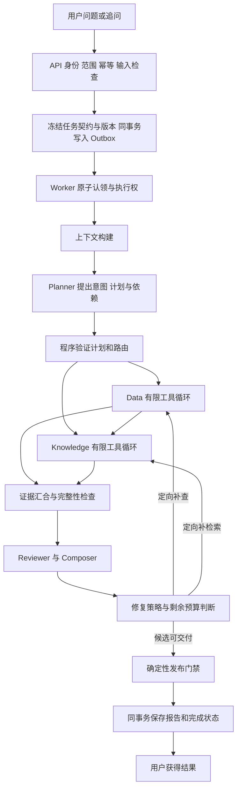

# 企业经营分析 Agent 项目 — 外部评审资料包（拼接版）

> 生成时间：2026-10-13
> 用途：一次性喂给独立分析模型，评估「当前项目现状 + 目标 + P0–P10 计划」是否匹配、是否可执行。
> 内容来源：本仓库根目录与 `docs/` 下文档，原文未删改；仅新增本头部说明与各节分隔标题。

---

## ⚠️ 分析前必读：文档时间线与可信度

这组文档**不是并列关系**，存在明确的「覆盖 / 替代」链。请先理解以下 6 点，否则会读到互相矛盾的内容：

1. **第六部分 `agent_architecture_refactor_requirements.md` 是最新权威计划**：第 17 节 P0–P7 是本地验证里程碑，第 18 节 P8–P10 是 2026-10-07 新增的「真实上线」目标。
2. **第七部分的「核心优先计划」五层任务已被覆盖**：它是旧计划，仅保留作演进背景；旧 M0–M5 编号只是历史映射，不再决定实施顺序。
3. **「单节点 / 未上线」只是 P7 结束时的中间状态**，最终目标是 P8–P10 上线；不要把中间表述当成最终定位。
4. **工时估算已失效**：文档里的 380h / 约 27 周、六周日程，均已明确标注「须在 P0-3 后重估」，不可当作可靠承诺。
5. **第三部分的审计是 2026-09-15 快照**，可能滞后于最新提交（HEAD `a0d8578a` + 大量未提交改动）。
6. **可信度分层**：不要把文档里写的「目标 / 计划」当成「已实现」。三层可信度：已验证现状（审计）< 计划（重构需求第 17/18 节）< 目标设计（路线图 / 确认设计 / 重构需求第 1–16 节）。

---

## 分析任务（请回答四个问题）

1. **当前现状**：项目实际实现了什么、已验证了什么、关键缺口在哪？
2. **目标是否清晰**：P0–P7 本地验证 → P8–P10 上线的目标边界是否明确、可衡量？
3. **计划是否合适**：P0–P10 的阶段顺序、依赖、工时、验收门禁是否合理？是否与现状匹配、可执行？哪些阶段明显高估 / 低估？
4. **风险与矛盾**：计划里是否有自相矛盾、过于乐观、缺验收标准、或把「目标」当「已完成」的地方？

约束：严格区分「目标设计 / 计划 / 已验证现状」三者的可信度；优先指出问题，不要客套；最后给一份按优先级排序的行动建议。

---

---

# 第一部分：项目概览与系统边界（README.md 全文）

# Enterprise Insight Assistant（企业经营洞察助手）

面向中小型公司的证据驱动经营分析系统。用户用自然语言提出经营问题，系统在当前公司授权范围内查询只读经营数据库、检索内部文档，并生成可追溯的结构化报告。

本项目目标是全模块符合明确适用范围的生产级设计与工程要求，并在单电脑与存储服务环境完成真实验证，不要求上线。当前实现尚未通过整体生产级验收；目标与进度分开记录。

**查看计划与进度，从 [文档阅读导航](../docs/README.md) 开始。**

## 已有模块与能力基础

以下是实现构成，不代表各项已通过完整生产级门禁；当前缺口与验证范围见 [项目审计](../docs/audits/project_core_audit_20260915.md)。

- 公司级身份与权限：JWT 登录、成员角色、资源隔离和管理审批。
- 文档知识库：TXT、Markdown、PDF 上传，异步解析、分块、向量化和 pgvector 检索。
- 受控经营查询：Schema 快照、查询契约、`sqlglot` AST 校验、只读事务和结果约束。
- Agent 工作流：Planner → Data / Knowledge → Reviewer，支持条件路由、澄清和证据不足分支。
- 可信报告：事实、假设、建议、数据证据、文档引用和限制分别建模并交叉校验。
- 异步可靠性：Celery、Redis、Outbox、执行租约、Checkpoint、分类重试、取消和幂等发布。
- 人工审核与治理：待审核报告、模型调用记录、Tool 调用审计、任务事件和运行指标。
- React 工作台：经营问答、证据范围、文档库、数据源、成员管理和任务状态展示。

## 系统边界

系统只接受经营问题，不接受用户提交的原始 SQL，也不允许 LLM 决定权限或写入经营数据库。

```text
React / TypeScript
        │ HTTP + JWT
        ▼
FastAPI ── PostgreSQL + pgvector
        │ commit + Outbox
        ▼
Redis ── Celery Worker ── LangGraph
                           ├─ Planner
                           ├─ Data Agent ── 只读经营数据库
                           ├─ Knowledge Agent ── 当前公司文档
                           └─ Reviewer + 确定性校验器
                                      │
                                      ▼
                              持久化结构化报告
```

关键约束：

- API 只负责校验、鉴权、持久化和任务投递，不在 HTTP 请求中执行长分析。
- Worker 只接收 `task_id`，从数据库恢复冻结的公司、数据源、Schema 和文档范围。
- Data Agent 生成的候选 SQL 必须通过查询契约、Schema、AST 和只读执行边界。
- Knowledge Agent 只能引用本次任务允许访问的文档分块。
- Reviewer 只能组织已验证证据，最终发布仍由确定性校验和持久化门控制。
- 数据确认的是事实；文档支持的是原因假设。证据不足时返回限制或澄清，不伪造归因。

## 技术栈

| 模块 | 技术 |
| --- | --- |
| API | Python 3.10+、FastAPI、Pydantic |
| 数据与迁移 | PostgreSQL、SQLAlchemy 2、Alembic、pgvector |
| 异步执行 | Celery、Redis、Outbox |
| Agent 编排 | LangGraph、结构化模型输出 |
| 检索 | sentence-transformers、向量检索、Reranker |
| 经营查询 | `sqlglot`、Schema Snapshot、只读 PostgreSQL |
| 认证 | JWT、Argon2、角色权限 |
| 前端 | React、TypeScript、Vite |
| 本地部署 | Docker Compose、PowerShell 运维脚本 |

## 快速开始

### 前置条件

- Docker Desktop（推荐）
- 或 Python 3.10+、Node.js 20+、PostgreSQL、Redis

### Docker Compose

```powershell
Copy-Item backend/.env.example backend/.env
# 编辑 backend/.env：至少设置模型 Provider/API Key，并更换生产环境密码与 JWT_SECRET。

docker compose up -d --build
docker compose ps
```

Compose uses a lightweight core image for the API, migrations, Beat, and report
Worker. The analysis Worker uses a separate CPU-only local-model image because
document embedding and reranking require PyTorch. A GPU embedding service is
not enabled by default; it requires a separately versioned internal call
contract and is not substituted by `gpus: all`.

服务入口：

- 前端：http://localhost:5173
- API：http://localhost:8000
- OpenAPI：http://localhost:8000/docs
- 平台 PostgreSQL：`localhost:5433`
- Redis：`localhost:6380`
- 演示经营库：`localhost:5434`、`5435`、`5436`

首次使用可通过 `POST /auth/bootstrap-owner` 创建首个公司所有者；请求结构以 OpenAPI 页面为准。

停止服务：

```powershell
docker compose down
```

`docker compose down -v` 会删除本地数据库卷，不应作为普通停止命令使用。

### 本地开发

```powershell
python -m venv .venv
.\.venv\Scripts\Activate.ps1

Set-Location backend
pip install -e ".[dev]"
# 仅在本机运行真实 RAG/slow 测试时安装本地 CPU 模型依赖；普通 API
# 开发和测试不需要它。
pip install --index-url https://download.pytorch.org/whl/cpu torch==2.6.0
pip install -r requirements-ml.txt
Copy-Item .env.example .env
python -m alembic upgrade head
python -m uvicorn app.main:app --reload
```

新终端启动 Worker：

```powershell
Set-Location backend
..\.venv\Scripts\python.exe -m celery -A app.core.celery_app:celery_app worker --loglevel=INFO
```

新终端启动前端：

```powershell
Set-Location frontend
npm ci
npm run dev
```

## 验证

```powershell
Set-Location backend
..\.venv\Scripts\python.exe -m ruff check app tests
..\.venv\Scripts\python.exe -m pytest tests -q -m "not e2e and not slow"

Set-Location ..\frontend
npm test
npm run build

Set-Location ..
docker compose config --quiet
```

普通单元/集成测试不能证明真实 Redis、独立 Celery Worker、经营数据库和模型 Provider 的完整链路。需要真实依赖时，按测试标记和 [单机运行与恢复 Runbook](../docs/operations/single_node_runbook.md) 执行对应 E2E。

## 主要 API

- `/auth/*`：登录、当前用户、密码和成员申请。
- `/documents/*`：文档上传、编辑、处理状态和分块查询。
- `/conversations/*`：会话、消息、分析任务创建与结果读取。
- 任务操作位于会话主链；旧 `/tasks/*` 路由当前未在 `backend/app/api/router.py` 挂载。
- 附件输入接口由 `input_artifacts` 模块提供，实际路径以 OpenAPI 为准。
- `/company/*`：公司、成员、邀请、数据源和 Schema 快照。
- `/review-requests/*`：报告审核。
- `/observability/*`：任务指标。
- `/health/live`、`/health/ready`：存活与就绪检查。

完整契约以运行时 OpenAPI 为准。

## 仓库结构

```text
backend/
  app/                  FastAPI、领域模型、Agent、Tool、工作流与 Worker
  migrations/           Alembic 迁移链
  scripts/              数据初始化和端到端验证脚本
  tests/                单元、集成、E2E 与评测测试
frontend/
  src/                  React 工作台
docs/
  business_knowledge_base/  可复现演示语料
  single_node_runbook.md     单机运行与故障恢复
scripts/ops/            备份、恢复、队列和权限检查
docker-compose.yml      本地服务编排
```

## 项目文档

- [阅读导航：目标、计划、当前进度与操作资料](../docs/README.md)
- [全项目生产级改造路线图](../docs/plans/single_node_production_style_ai_application_roadmap.md)
- [已确认目标设计](../docs/architecture/confirmed_production_design.md)
- [当前代码审计与验证边界](../docs/audits/project_core_audit_20260915.md)

- [产品定义与边界](../PRODUCT.md)
- [前端设计系统](../DESIGN.md)
- [单机运行与故障恢复](../docs/operations/single_node_runbook.md)
- [贡献指南](../CONTRIBUTING.md)
- [安全策略](../SECURITY.md)

## 许可证

当前仓库尚未声明开源许可证。除非仓库所有者补充 LICENSE，否则默认不授予复制、修改或分发许可。

---

# 第二部分：产品边界与目标用户（PRODUCT.md 全文）

# Enterprise Insight Assistant 产品说明

> 本文维护产品用途与业务边界。生产级目标与验收以 [主路线图](../docs/plans/single_node_production_style_ai_application_roadmap.md) 为准；当前实现证据见 [项目审计](../docs/audits/project_core_audit_20260915.md)。

## 产品定位

Enterprise Insight Assistant 是面向中小型公司的经营分析 Web 应用。它把公司授权的只读经营数据和内部文档组合为可追溯证据，输出事实、原因假设、行动建议和明确限制。

系统不是通用聊天机器人，也不承诺自动发现唯一真实根因。

## 目标用户

- `owner`：管理公司、成员、数据源和最终权限边界。
- `admin`：维护成员、文档、数据源、Schema 快照和审核流程。
- `analyst`：选择证据范围并发起经营分析。
- `viewer`：查看其权限范围内的资料和结果。

公司上下文由后端根据认证用户的成员关系确定，客户端不能通过提交 `company_id` 切换租户。

## 支持场景

产品模型围绕以下经营问题设计：

1. 区域销售下降。
2. 毛利下降。
3. 客诉上升。
4. 应收风险。
5. 数据存在但原因资料不足时拒绝确定归因。

仓库中存在通用工作流能力，不代表每个场景都已经通过真实客户数据和完整 E2E 验收。

## 用户流程

```text
登录
→ 选择只读经营数据源与当前 Schema 快照
→ 选择允许检索的内部文档
→ 创建会话并提出经营问题
→ 后端冻结公司、数据源、Schema 和文档范围
→ Worker 异步执行 Planner / Data / Knowledge / Reviewer
→ 校验并持久化结构化报告
→ 前端展示任务状态、证据、结论和限制
```

## 可信度契约

- 事实必须来自受控经营查询，并保留数据证据。
- 原因只能作为假设，且必须关联当前任务允许访问的文档引用。
- 建议必须指向事实或假设，不能成为无依据的通用建议。
- 引用、数字、状态和依据关系由确定性代码复核。
- 证据不足与技术故障分开表达；部分证据可形成 `partial`，不可恢复故障才形成 `failed`。
- LLM 不决定身份、权限、数据范围或最终发布资格。

## 明确不做

- 用户原始 SQL 或无约束自然语言 SQL。
- 写入经营数据库或自动执行经营动作。
- 未经明确授权的跨公司数据访问。双边审批的显式跨公司授权是目标设计，当前未验收前不得宣称支持。
- 多 Agent 自由辩论。
- 把文档陈述当作已经验证的数据事实。
- 在没有真实测试或运行证据时宣称大规模、高可用或生产 SLA。

## 当前交付边界

当前仓库提供 FastAPI、React、PostgreSQL/pgvector、Redis/Celery、LangGraph、模型网关、受控 SQL、RAG、报告校验、审核和单机运维脚本。它适合本地演示、自动化回归和内部试用前验证。

本次不上线，但密钥管理、权限、容量、监控告警、备份恢复、模型成本、业务评测和故障演练均属于当前全项目改造的验收范围；不能推迟到上线前才做。

---

# 第三部分：当前现状与审计快照（project_core_audit_20260915.md 全文，2026-09-15）

# 当前项目审计：Agent 底座与五项核心工程能力

> 本文主体为先前快照，不代表最新候选。当前复查见 [新执行计划现状](../plans/history/agent_core_first_execution_plan.md#1-实查现状)：507项收集；modules 433通过、1失败、3跳过；Observation候选已存在，空范围修复已进入工作区；真实业务全链未验证。原M1-IN独立里程碑已取消，以下历史阶段说明不再决定执行顺序。

> 整体范围最终澄清：各模块生产级改造与评估、追踪、权限、回滚、成本是同一个目标。以主路线图第 0.4 节全项目矩阵联合验收；阶段只决定先后，不允许部分收口。

日期：2026-09-15。范围：当前源码、测试、工作区差异、主路线图、设计账本及本机只读状态检查。

> 用户澄清后的范围：全部现有及主线模块向生产级设计与实现演进；五核心贯穿各模块。上下文和记忆的完整目标见主路线图第 0.3 节，不能将长期记忆治理降为可选项。

## 1. 总判断

现有架构适合继续改造成“单节点验证、未上线的生产级 Agent”，不需要换框架或推倒重来。当前是有执行与治理骨架、部分模块有测试证据，但真实业务评估—追踪—权限—回滚—成本尚未统一验收的阶段。不能给一个没有分母的完成百分比。

旧计划的主要问题：环境状态过时；完整多模态排在权限止血前；评测、成本、回滚虽写成横向能力，实际工作包过晚；新增功能与现有模块工程改造没有明确区分；上传/附件摄取只停留在矩阵与设计包，未作为可验收实施链；整体 Ready 条件容易阻塞修复测量工具本身。路线图现调整为 M0 -> M1-IN -> M1–M5，上传模块是主线中的独立交付阶段，不是额外启动第二条主线。

“生产级设计”要求明确不变量、失败行为、资源预算、恢复方式及验证证据。单机足以验证这些机制，但不能证明高可用、企业流量或长期线上可靠性。

## 2. 本轮验证与证据边界

- HEAD：`a0d8578`，`Remove obsolete code and simplify project structure`。仅作为代码参照，不称已验证业务基线。
- 工作区已有附件解析/OCR/版本绑定/引用等修改与未跟踪代码、迁移和测试，另有简历文件；均保留，未提交或合并为基线。本轮仅调整项目文档。
- 在 backend 目录运行 `../.venv-py313/Scripts/python.exe -m pytest tests/unit -q --disable-warnings --maxfail=2`：**427 passed, 3 skipped, 1 warning，11.91s，退出码 0**。
- 测试收集 `../.venv-py313/Scripts/python.exe -m pytest tests --collect-only -q`：**499 tests collected，退出码 0**。收集不等于执行。
- 上述模块测试含 FakeDb、模型替身等；未运行全量集成、真实业务 Worker E2E、迁移/恢复/回滚演练，未产生当前冻结业务质量基线。
- `docker compose ps` 显示 API、Worker、Beat、PostgreSQL、Redis、ClamAV 在运行；数据库/Redis/扫描服务显示 healthy。运行状态不能证明容器镜像与当前未提交代码一致，也不能证明业务链路完整。
- 本机：16 逻辑处理器，约 15.8 GiB RAM。未测本次负载峰值、吞吐或存储服务能力。
- 最小只读反例运行确认：空 `allowed_chunk_ids` 的 Case 接受返回 chunk；数值与确定性校验失败的 Case 仍可获得汇总 `hard_gate_passed=True`；RAG 首条 4000 字符证据在 `max_chars=3000` 时完整进入 Prompt。这些行为未在本轮修复。
- 历史审计目录存在，不等于其产物适用于当前 HEAD/候选。历史文档 `backend_product_delivery_plan.md`、`multi_agent_workflow_decision_flow.md` 已不存在，遵循当前 AGENTS 与主路线图。

## 3. 五核心当前进度

| 能力 | 当前已有 | 当前关键缺口 | 判定 |
|---|---|---|---|
| 评估 | EvaluationCase/Observation、确定性 evaluator、CLI 和 fixture | CLI 接收外部 Observation；未找到实际持久化任务到业务 Observation 的自动适配闭环；空白名单与汇总硬门禁有反例；substring 不能证明语义 | 测量雏形，先修测量契约再谈优化收益 |
| 追踪 | request_id、attempt、WorkflowEvent、ToolCallRecord、ModelCallRecord、公司指标聚合 | 完整输入/Prompt/资源版本、授权决定、证据与发布关联未统一证明；普通 SQL 日志仍有正文 | 有基础审计，未验收完整 trace |
| 权限 | 公司成员、冻结文档 ID、SQL 表范围、公司向量过滤、RLS相关测试、只读经营库 | 空范围在 Worker 变 None；ToolRuntime 对 None 跳过子集检查；动态撤权与文档版本不完整；候选附件最终发布范围参数未接通 | 架构方向正确，有优先阻断项 |
| 回滚 | Git、租约/Checkpoint、执行权条件、备份/恢复脚本 | Checkpoint 未按版本兼容筛选；Outbox published 不等于认领；恢复脚本只校验表数；没有本轮三类回退/恢复证据 | 有部件，未形成演练闭环 |
| 成本 | 任务级模型/工具预算、调用预留、usage、Fallback轨迹、聚合 | DeepSeek 费用默认 0；OpenAI 固定价格未按模型/版本选择；没有最大输出费用预留；usage 丢失可能归零；真实并发/崩溃结算未证明 | 已实现基础治理，尚不能声称严格费用控制 |

### 上传与附件摄取的当前判定

候选工作区已经有三个入口层（普通 multipart 上传、直传会话创建、直传完成确认）、quarantine 对象存储接口、扫描/解析 Celery Job、处理 Outbox、不可变 `InputArtifactVersion`、任务冻结版本和受限附件上下文。它说明设计方向可继续，不说明模块已经完成：本轮没有运行真实对象存储 + ClamD + Celery 的从上传到最终引用闭环；附件引用范围也尚未接通最终正常/审批发布调用。解析器当前主要按文件后缀路由，计划要求的 extension/MIME/magic 三者一致性和完整隔离资源证明仍须以源码与真实反例补齐。

因此，上传模块的正确状态是“已有候选部件，未通过 M1-IN 验收”，不能写成已完成或仅剩 UI。M1-IN 的唯一入口在主路线图第 16 节；其中的状态、授权、恢复、追踪与成本验收同样适用五项治理，不等到后续阶段才补。

### 优先问题的连续调用链

1. `create_conversation_task_service` 冻结 `document_ids` -> `process_analysis_task` 仅在列表非空时传入 `run_analysis` -> 默认 None -> `RAGTool` / `retrieve_evidences` -> `search_similar_chunks` 省略文档过滤。与此同时 `_frozen_allowed_chunk_ids` 对空列表返回 None -> `validate_report` 跳过 chunk 子集检查。公司过滤仍存在；这里不能把“任务范围扩大”直接夸成已实测跨公司泄露。
2. 候选 `validate_report` 增加 `allowed_attachment_citation_ids` -> Worker 正常发布和审批发布调用只传 `allowed_chunk_ids`。因此不能凭附件校验器单测通过，宣称最终发布已接通附件范围保护。
3. Gateway -> `reserve_model_call` 预留调用次数和输入估计 -> 模型调用 -> `record_model_call` 累加 Token/费用。预留不包含最大输出成本；DeepSeek 成功记录未传费用；当前账本不能支撑可信财务比较。修复需统一入口，不是只改聚合展示。

## 4. Agent 基础设计逐项判断

### 4.1 架构与模块：保留模块化单体，局部重构契约

依据：`workflow/graph.py` 已用 LangGraph 串联 Planner、Data、Knowledge、Reviewer 和确定性 Router；`workflow/execution.py` 管认领、租约、Checkpoint 和终态；平台库负责权威状态。这种受控工作流适合只读经营分析。

改法：API/Application 管身份与创建事务；Workflow 管路线；Runtime 管授权、执行权、预算和调用；Data/Knowledge 返回证据；Reporting 管草稿与确定性发布；Evaluation 只读取结果评估，不掌握生产发布权。保持当前目录为主，不因逻辑边界而拆微服务。

`WorkflowState` 的大量 dict、ORM 对象、回调与运行时对象混合只适合执行期；当前 `_checkpoint` 已选择白名单快照，不能误称所有对象都被持久化。补一个版本化持久化 DTO，与执行期 context 分开；边界使用现有 Pydantic 结构，不给每个函数建抽象类。`task_spec.py` 当前只有 id，不能当作不可变任务契约已完成。

验收：节点输入/输出契约、非法路由/恢复节点、Checkpoint兼容、终态一致性、取消和迟到结果。M1/M2 完成。

### 4.2 Planner / Data / Knowledge / Reviewer：职责保留，收紧决定权

- Planner：已有 analyze/direct_response/scope_exit/needs_clarification/refuse 等结构化分支和语义复核。保留；补关键时间/实体/指标来源和冻结运行版本。语义复核是候选意见，不能批准权限。复核调用的质量收益和费用需做消融比较，不凭“多一个 Reviewer”认定更可靠。
- Data：保留候选 SQL 与受控执行、有限修复；模型负责提出候选，代码负责 QueryContract、只读与数值。统一内部 repair 与外部 replan/attempt 的总预算，不允许每层各自有界但总量失控。
- Knowledge：返回版本化、授权、限量证据及缺口；若已有 RAG 回答和最终 Composer 重复生成，先测是否能只传 EvidenceBundle 减少一次生成，不能未测就删除必要语义判断。
- Reviewer/Composer：可提出支持关系、冲突、草稿；确定性代码验证数字/引用/范围/状态并唯一发布。保留语义判断和确定性门禁的区别，不声称代码能完全证明自然语言因果正确。

验收：每个节点有失败/不足/拒绝输出，所有循环有总步数与费用上限，重试只重跑必要节点；错误路线与证据不支持的回答进入 Bad Case。M1–M3 完成。

### 4.3 上下文：已有有界方案，但需要统一 Token 预算

依据：`build_conversation_context` 按最近消息选择、单条与总字符限制并记录截断；Planner 接收冻结 context、记忆和反馈。`knowledge/rag/engine.py::build_prompt` 首条证据即使超过上限仍保留。

改法：建立统一 Context Builder 契约，输出片段来源、版本、角色/可信度、Token 用量和舍弃原因；优先保留系统规则、当前问题、冻结范围，再装相关历史/证据。为模型最大输出预留空间，最后在 Gateway 对实际完整输入再次检查硬上限。保留字符上限作为廉价前置保护，但不能把字符当 Token。长文本分块或拒绝，截断不得留下失真的数字/引用。

不需要先增加复杂摘要 Agent。短历史、长历史、指代、旧时间、冲突信息和恶意历史使用同一组 Case 比较。上下文大小是 M1/M2 必做，不属于可无限推迟的长期记忆扩展。

### 4.4 记忆：已有基础，工作/会话/长期记忆均须完成治理改造

依据：`memory/service.py::planner_memories` 检查成员 approved、company/user、revoked/expiry，限 8 条；写入只保存报告 confirmed_facts 与 limitations，有来源与幂等键。并非完全没有记忆治理。

缺口：8 条不等于 Token 有界；写入没有默认 expires_at；读取没有逐条验证原始证据当前权限、版本和任务相关性；已有报告“校验通过”也不代表事实计算已经足够强。

改法：区分工作状态（本次执行）、会话上下文（理解省略）、长期记忆（历史线索）。当前数值和归因必须重新取证，历史记忆不能直接升格为当前证据。长期记忆补来源资源版本、失效/删除传播、时效、冲突与选择 manifest；未补齐时关闭其 Planner 注入或仅限无敏感业务内容的偏好，历史记录保留。先对比无记忆与有记忆质量/成本，不能先上额外记忆框架。

验收：成员撤权、来源文档撤回、记忆过期/冲突、任务跨公司/跨用户、注入、超长内容、历史数字冒充当前数字。M1 实现契约和来源隔离，M3 评测实际价值，M4 验证失效/删除/恢复传播；临时禁用不是最终完成方案。

### 4.5 工具：保留 ToolRuntime，必须成为不可绕过边界

依据：现有 `ToolInput.parameters` 是任意 dict，`ToolOutput.data` 是 Any；Runtime 有白名单、任务预算和元数据审计；Agent 可以使用注入工具，构造器也存在直接工具默认值。

改法：每个已用工具明确输入/输出 Schema、版本、结果大小、timeout、错误分类；授权字段不进入模型可填写参数，服务端注入 AuthorizedExecutionContext。生产节点只能拿到 Runtime 包装工具；测试替身明确隔离，不能因构造器默认值而旁路授权。SQL 结果和 RAG 证据分别用已有结构强化，无需通用插件平台。

验收：伪造/缺失公司范围、空文档范围、未知工具、坏参数、畸形/过大返回、超时、预算耗尽、旧 attempt；本地工具和未来 MCP 工具必须通过同一组契约。M0–M2。

### 4.6 MCP：适合扩展接入，不是当前生产化前置条件

当前 backend/app 搜索未发现运行时 MCP 接入实现。不要把开发环境能调用 MCP 工具当作业务 Agent 已接入 MCP。

MCP 是工具发现/调用与结构描述协议，不替代应用授权、预算、结果验证和审计。官方协议要求工具输入校验、访问控制，并明确工具 annotations 的信任边界。[MCP 工具规范](https://modelcontextprotocol.io/specification/2025-06-18/server/tools)

目前 SQL/RAG 都在同一后端，内部调用最合适。出现真实外部系统接入或多客户端共享需求时，先接一个只读 MCP 工具：固定服务器与工具 allowlist、版本/Schema 指纹、最小凭据、超时、结果上限、费用与 trace；工具列表变化不能自动获得权限。不把任意服务器地址、系统 shell 或本机全盘暴露给模型。

若目标包含 MCP 工程学习，可在 M3 后做独立小切片，用相同业务 Case 比较内部调用与 MCP Adapter；其失败不得绕开 Runtime。无需为简历把全部内部函数包装为网络服务。

### 4.7 Skill：可作为版本化业务流程包，不能代替代码门禁

Skill 是可复用的指令、资源及可选脚本包；Tool 是实际执行动作的接口，两者职责不同。[Agent Skills 官方概览](https://agentskills.io/home)

当前业务运行时未见独立 Skill 加载/治理实现；现有 Prompt 与业务配置不自动等同标准 Skill 体系。开发用 SKILL.md 与产品运行时 Skill 也不是同一层。

单一经营分析主线先保留版本化 Prompt/指标配置；出现两个以上真实不同分析流程或明确复用需求，再拆如“销售变化分析”流程包。最小清单可含 skill_id/version、适用条件、输入输出契约、引用 Prompt/指标版本和所需工具。服务端策略与工具权限取交集，Skill 不能授予自己新权限。仅装可信包、记录内容 hash、按需加载，不允许运行用户上传脚本。

验收：选错 Skill、版本回退、缺工具、超预算和恶意指令不能改变权限/发布门禁。它可提升复用性，不作为当前核心完工条件。

### 4.8 RAG：保留 pgvector 与重排，优先证据/权限改造

依据：向量候选检索后有字符重叠混合评分和重排模块；按 company 与 document_ids 查询；证据有页/段落信息；充足性使用条数与平均相关分。这些可做检索启发式，不能证明支持业务结论。

改法：不可变 document/chunk 版本与内容 hash -> 当前 ACL + 冻结范围前置过滤 -> 限量召回/重排 -> 统一上下文预算 -> EvidenceBundle（稳定引用、来源、时效、冲突、缺口）-> 逐条 Claim 支持判断 -> 发布。先修空范围，不换向量库；先以困难样本决定切块/混合召回/重排参数，每次只改一个变量。原始召回指标和最终回答指标分开。

验收：越权/撤回/重新摄取/版本切换/注入/无匹配/证据冲突；Recall@k/MRR 等检索指标，加人工校准的支持正确率、无依据声明率、答案质量与成本。M1/M3；嵌入/重排版本回退纳入 M4。

### 4.9 SQL：保留受控自由 SQL，校验与计算需明显加强

依据：`sql_validator.py` 当前强制单 SELECT 与表范围，明确允许 wildcard/flexible joins；`sql_executor.py::_apply_row_limit` 只要 SQL 字符串含 LIMIT 就不加上限，连接无显式 connect_timeout；`query_contract.py` 已有列/结果类型等结构，`query_validation.py` 主要查列和行形状；`facts.py` 主要把前 5 行渲染成事实句。

改法：自然语言 -> 结构化意图/时间口径 -> 版本化指标与 QueryContract -> SQL 候选 -> AST 只读、范围、列/关联/函数/复杂度和硬 LIMIT -> 独立只读库 -> typed result -> Decimal 计算 -> 数值/公式/来源证据。模型不能以自填 expected_columns 自证业务正确；关键口径与公式由服务端指标定义和 Gold 约束。补连接/语句/任务三层时间边界与结果字节上限，SQL 普通日志改为 hash/结构元数据。

不把所有 Join 禁掉，也不改成固定查询-only；围绕被支持业务定义必要规则。测试不同数据分布下的结果等价性，覆盖重复 Join、漏状态过滤、错误日期列、空值、零分母、单位/币种、超大 LIMIT 及写入拒绝；SQL 可执行不算业务正确。M1 权限、M2 资源限制、M3 业务正确性。

## 5. 当前适合的目标架构

```text
API / Application（身份、幂等、冻结输入）
  -> PostgreSQL Task + Outbox
  -> Worker（认领、当前授权、租约、Deadline）
  -> Context Builder（来源与 Token 预算）
  -> Planner -> Data / Knowledge -> Reviewer / Composer
                  |          |
                  +-- ToolRuntime -- 本地 SQL / RAG / 可选 MCP Adapter
  -> 确定性 Publish Gate -> 报告、消息、事件事务

横贯执行：版本、授权、trace、任务级调用/费用账本
执行之后：持久化 Observation -> 评测/Bad Case -> 候选采用或回滚
记忆：只提供受控历史线索；当前事实重新取证
Skill（条件启用）：版本化流程配置；不持有权限或发布权
```

trace 的事件关联采用清晰父子/调用关系，复用现有持久化记录；可参照 [OpenTelemetry 追踪模型](https://opentelemetry.io/docs/concepts/signals/traces/)，不要求立即部署 Collector 和多个观测产品。备份/恢复使用现有 PostgreSQL 工具，按 [官方备份说明](https://www.postgresql.org/docs/17/backup-dump.html) 选择明确方式，并补应用与对象一致性验证。

## 6. 修改与下一步

主路线图已改为：M0 测量契约与权限阻断 -> M1 权限/版本/上下文/追踪 -> M2 成本/工具/故障控制 -> M3 SQL/RAG/业务评测 -> M4 回退/恢复演练 -> M5 本机完整验收。设计账本同步声明条件能力边界。

第一个用户实现切片：给评测器空白名单和硬门禁写失败测试，修复后通过；解释为什么“未知/没有事故记录”不能当作通过。再接一个真实持久化字段到 Observation。模型负责审查、解释与机械工作，不包办所有核心代码。

本轮结论是“已完成分析与计划修订”，不是“上述生产代码缺口已修复”。后续每个切片记录工程结果和用户独立完成的证据。

## 7. 再审结论与修订（2026-09-15）

原计划模块覆盖较完整，但不能通过严格的生产级实施审查：授权竞态、审计故障、预算崩溃对账与取消后费用、删除后恢复、供应链/数据外发/输出处理缺少具体门禁；部分已确认目标未落阶段，SLO/RTO/RPO 缺少冻结时间。

主路线图第 0.5 节已补强这些要求；设计账本过时的 InputArtifact 状态已纠正，全局目标同步为生产级设计与工程要求。该轮验证仅包含文档一致性、关键门禁覆盖和差异检查，未重新运行业务测试或生产级演练。前文 427/499 是当日先前执行证据，不是本次计划修订带来的新验证。

结论：修订后的计划可作为全项目生产级改造的实施依据；每个模块仍需在自身实现前完成契约与具体阈值，随后通过真实验证。计划完整不等于实现合格，更不能保证未上线的系统已有线上成熟度。

---

# 第四部分：已确认的目标契约（confirmed_production_design.md 全文）

# 已确认的生产级设计决策

> 整体范围最终澄清：各模块生产级改造与评估、追踪、权限、回滚、成本是同一个目标。以主路线图第 0.4 节全项目矩阵联合验收；阶段只决定先后，不允许部分收口。

> 状态：持续维护的决策账本。  
> 作用：记录已经由需求讨论确认的目标契约；它不是当前实现清单，也不替代
> `single_node_production_style_ai_application_roadmap.md` 的阶段、证据和验收要求。  
> 规则：未明确标为“已实现并验证”的内容，都只属于目标设计。

## 0. 当前交付范围修订（2026-09-15）

按用户当前目标，本期交付为单电脑 + 存储服务可验证、不上线的生产级 Agent，主轴为评估、追踪、权限、回滚、成本。实施顺序与完成定义以主路线图 M0–M5 为准。

本文其余内容保留为能力启用时的设计契约，不意味着本期必须实现整个目录。新增格式、复杂审核界面、新缓存和完整合规平台按需扩展。现有上下文、工作/会话/长期记忆及其他主线模块必须完成生产级改造，不能只补横向治理。临时隔离或禁用入口仅是止血，不算完成；共同门禁和上下文/记忆目标以主路线图第 0.3 节为准。

当前已实现与未证明范围见 [项目审计](project_core_audit_20260915.md)。TaskSpec 等目标字段不能因为本账本列出或已有同名文件而记为实现完成。

## 1. 总体边界与决定权

- 产品是多租户、只读的企业经营分析系统。它保留
  `API/Outbox -> Worker 原子认领 -> Planner -> Data/Knowledge ->
  Reviewer/Composer -> 确定性校验 -> 持久化发布` 主链。
- LLM 只能提出意图、计划、工具候选、语义归纳和报告草稿；服务端代码决定
  身份、公司范围、资源范围、权限、预算、重试、指标计算和最终发布。
- LangGraph 可以是一个受控工作流实现，MCP 可以是工具接入协议；二者都不是
  权限来源，也不是唯一架构。模型不能自行发现隐藏工具、传入授权范围或扩大权限。
- 不退化为用户原始 SQL、无限自主 Agent、固定查询-only、自由辩论式多 Agent，
  或由 Reviewer/LLM 代替确定性发布门禁。

## 2. 输入、附件与不可变版本

### 2.1 输入边界

- 文本、文件和图片都是用户输入；每个请求绑定服务端解析出的用户、当前公司、
  会话、请求 ID、幂等键和规范化内容。
- 空白输入、超长输入、恶意输入和 Prompt Injection 在模型前被拒绝、隔离或标记为
  不可信数据。附件内容永远不是系统指令。
- 有附件时，分析必须等待附件达到 `ready`；解析未完成、失败或被拒绝的附件不能
  进入 Prompt、索引或任务范围。
- 没有问题时返回 `QUESTION_REQUIRED`，不创建分析任务，也不调用模型；系统可以
  提供固定操作建议，但用户动作必须形成明确问题。

### 2.2 资源模型

```text
InputArtifact                 资源身份、公司归属、上传者和种类
  └─ InputArtifactVersion     某次上传的不可变字节与处理结果
       ├─ TaskAttachmentRef   任务使用的明确版本
       ├─ DatasetVersion      可重算明细数据的版本
       └─ KnowledgeDocumentRef 知识文档投影
```

- `InputArtifact` 不是文件内容；它表示“这份资源属于谁、是什么用途”。
- 每次重新上传或修正都创建新的 `InputArtifactVersion`，绝不覆盖旧版本。
- 任务冻结具体版本 ID，而不是资源 ID。新版本 `ready` 后不得自动切换正在运行或
  已完成任务；任务发起者选择保留旧任务、停止后以新版本重跑，或创建关联新任务。
- `InputArtifactVersion` 保存当前可查询的处理状态；`ArtifactProcessingAttempt` 追加保存每次
  扫描/解析的开始、结束、错误和退避历史。前者用于快速阻止非 `ready` 输入，后者避免用
  更新覆盖故障审计。
- 原始二进制、解析产物、chunk 与 embedding 生命周期不同，不能互相替代。

### 2.3 文件处理状态与失败规则

- 已确认的语义是：上传成功不等于可分析；只有扫描和解析都通过的版本才是 `ready`。
- 目标内部状态为：`received -> scanning -> parsing -> ready`，以及终态
  `rejected`、`failed`。其中隔离区（quarantine）首先是原始文件的安全存放边界，
  不是把“文件已隔离”误报为“发现恶意文件”的用户状态。
- `rejected` 保存稳定 `rejection_code`，例如 `malware_detected`、
  `unsupported_format`、`size_limit_exceeded`、`mime_mismatch`。前端按原因分别展示；
  后端不把每个原因膨胀成一套生命周期状态。
- 恶意、格式不支持、大小超限等 `rejected` 版本不能重新解析或重试；用户只能重新
  上传，生成新版本。原始内容按安全保留策略删除或隔离，只保留最小审计信息。
- `failed` 表示处理未正常完成，例如解析失败、OCR 质量不足、解析器超时或依赖故障。
  文件本身的问题（损坏、确定性解析失败、OCR 质量不足）不自动重试，用户需上传修正版；
  瞬时基础设施故障（扫描服务不可用、存储瞬断、解析超时、Worker 崩溃）最多执行三次：
  首次立即执行，后续两次分别在 2 秒、10 秒后重试。无论如何，失败版本在 `ready` 前都不能使用。
- 自动重试处理同一份原始字节，不创建新 `InputArtifactVersion`；后续以独立的
  `ArtifactProcessingAttempt` 记录每次处理、错误和退避。重试继承相同内容 hash、权限、
  大小限制和扫描门禁，不能绕过任何安全检查。
- 解析/OCR 低质量不被当成事实；需要重新上传或返回可操作说明。扫描服务不可用时
  fail closed，原件保持隔离，不能绕过扫描进入后续环节。

### 2.4 实现状态说明（2026-09-15 纠正）

旧条目“仅未迁移 ORM、无测试/上传/Worker”已过时。当前 `backend/app/modules/input_artifacts/` 已有模型、处理链、迁移与测试，并存在未提交解析/OCR/任务附件候选。具体已验证范围见当日审计，不能把旧状态或候选实现写成当前通过的基线。

## 3. 数据集、表格与修正

- 用户选择数据集类型；默认作为报告/证据而非自动可重算明细表。
- CSV/XLSX 安全扫描后，系统建议列映射，用户确认或修改后冻结
  `DatasetMappingVersion`。映射无效进入 `needs_correction`，不静默猜测。
- 公式、宏及其计算结果不能被信任或执行；公式相关内容最多作为未验证任务输入，
  不能成为 `ConfirmedFact`。
- 数据质量问题产生 `DataQualityReport`，显示修复项，不能静默丢行。
- 修正是不可变覆盖层 `DatasetNormalizationVersion`，不修改原文件。上传者或同时拥有
  数据集访问和 `dataset:correct` 权限的人员可以提交新版本。
- 新数据集版本不会静默改变任务；撤权优先于发起者的版本选择权。

## 4. 请求、幂等与时间

- 客户端提交会话、附件引用、问题和幂等键；服务端解析 actor、公司、成员身份、
  权限、请求 ID、canonical payload hash 和时间。
- 唯一幂等作用域是 `user + company + conversation + idempotency_key`：相同 payload
  返回原结果；同一键但 payload hash 不同返回稳定 409，不创建新任务。
- 用户修改问题时产生新的幂等键并替换请求意图，不要求用户额外确认。
- 前端禁止纯空白输入并限制长度；后端再次验证，绝不依靠 UI 截断。
- 使用统一业务时区，服务端记录 UTC、IANA 时区和 reference time；无法安全解释的
  时间要求澄清，不能自行猜测。

## 5. 意图、计划、上下文与记忆

- 冲突槽位、低置信或多意图进入澄清；意图切换创建关联新任务，不污染父任务。
- 复杂请求拆为有界 DAG；仅独立的步骤可并行，合并顺序确定。计划、重试和修复共享
  同一任务预算，不能无限循环。
- 数据足以确认“下降”等事实、但不足以确认原因时，发布可复算事实和数据缺口，结果
  可为 `partial`；不能把猜测包装成归因。
- 上下文按相关性、当前授权、来源和预算选择，形成 `ContextSelectionManifest`；不能
  把所有历史消息或文件全文塞给模型。
- 长期记忆与审计记录分离。模型只能提议记忆候选；系统以来源、授权、保留规则和
  冲突检查决定写入。失败、撤权、无来源或未验证内容不能进入可检索记忆。
- 摘要必须与原文比对校验；有限次重试仍失败时使用受限摘录、澄清或部分结果。

## 6. 工具、MCP 与执行控制

- 每个任务由服务端生成 `TaskToolManifest`。工具注册项需要身份、版本、输入输出
  Schema、权限、超时、成本/预算、幂等语义和 Kill Switch。
- MCP Server 进入注册表后才可使用。模型只能选择 manifest 中已授权的工具候选；
  服务端注入 `AuthorizedExecutionContext`，包括公司、资源、行列、操作和时间范围。
- 模型参数先经过类型、格式、业务规则和权限校验；工具结果统一封装、分页/裁剪、
  脱敏和保留 provenance，API 200 不等于任务完成。
- 对只读工具实施超时、限流、并发、预算、有限重试、熔断和预批准 fallback。权限、
  撤权、Kill Switch 或未知外部结果不能由模型重试绕过。

## 7. 多公司授权与资源范围

- 用户可以拥有多个公司 Membership，但每次正常请求只能有一个服务端确认的 active
  company。公司层级本身不自动授予数据访问权。
- 角色授权与直接授权同时支持；直接授权有强制有效期且只增加许可，撤权规则始终可否决。
- 跨公司访问通过不可变 `AuthorizedResourceScope` 表达资源、字段、行、聚合、操作和
  有效期。双方管理员独立审批；修改申请生成新修订，不能覆盖原申请。
- 任一方管理员可立即撤销；系统在创建、认领、工具、审核和发布五个检查点重新检查
  当前授权。撤权后旧报告保留审计，但无权者不可见；混合撤权证据的报告隐藏并要求重跑。
- 授权自动执行仅限原申请、当前范围和八小时有效期；范围扩大、敏感聚合或权限不足
  必须让用户选择扩大授权、降低任务目标或取消。

## 8. 结果、审核与发布

- 报告由结构化事实、证据、限制、假设、建议和状态组成，再渲染为用户可读文本。
- 因果、高影响、跨公司、敏感或低证据结果需要 HITL。审核绑定冻结的 draft hash、
  TaskSpec、证据和策略版本；审批时重新验证当前权限和确定性发布门禁，审批不重跑分析。
- 作者可以自审，但不计入独立审核人数；至少一名同级或更高级的独立审核人。风险决定
  审核人数、领域资格和级别。
- 文字修订只能基于已冻结证据；证据变化必须创建关联的新分析。已发布错误使用
  withdrawn/corrected 链接处理，不能覆盖历史报告。

## 9. 运行状态、恢复与外部写操作

- 运行持久化链为：

  ```text
  OutboxEvent -> DeliveryAttempt -> Worker 原子认领
    -> ExecutionAttempt / Checkpoint -> retry | dead letter | terminal
  ```

- 每次执行有 fencing token、冻结 TaskSpec 和剩余预算。恢复只在当前授权、版本和预算
  仍有效时进行；未知外部结果先对账，不能盲目重试。
- 任务执行状态、执行阶段、分析结果和报告发布状态分离。业务结果仅有
  `completed`、`partial`、`insufficient_evidence`；技术失败和取消不伪装为业务结果。
- 当前产品默认只读。未来发生邮件、工单等外部写操作时，必须另走：

  ```text
  ActionProposal -> server validation -> awaiting_confirmation
    -> execution -> external verification / reconciliation
  ```

  模型不可直接写外部系统；所有外部写操作需要授权、用户确认、幂等、状态查询和审计。

## 10. 安全、治理、可观测性与评测

- SSO/OIDC/SAML 是认证首选；认证不等于授权。高风险动作需要 step-up MFA；紧急账户
  必须严格审计。
- Secret 不进入 Prompt、日志、数据库或错误响应；日志保存脱敏元数据、hash 与 trace，
  原文进入受控存储。审计记录具有受保护的不可篡改链和独立审计查看权限。
- 分类、字段级策略、导出权限、水印、二次验证、保留/删除和 legal hold 都必须由确定性
  策略控制；不确定分类按更严格路径处理。
- 每次请求可关联 request、task、plan、model call、tool call、证据、状态、耗时、Token、
  成本和最终结果。稳定错误响应包含安全的错误码和 request ID。
- 模型、Prompt、工具、指标、策略和 Schema 都要版本化；安全撤权和 Kill Switch 立即生效，
  普通策略由任务快照冻结。
- 评测须区分单元/契约、真实依赖集成、真实 Agent E2E、业务开发集与冻结留出集。任何候选
  只改一个主要变量，保留 baseline、成本、P95、Bad Case、回滚和未证明边界。

## 11. 指标与可重算事实

```text
MetricDefinitionVersion -> QueryContract -> QueryEvidence
  -> CalculationResult -> ConfirmedFact
```

- 指标公式由公司业务数据负责人维护并版本化，模型不能自行发明或修改公式。
- 歧义、冲突或缺少指标定义时进入澄清或维护流程；不使用常识填补。
- SQL 可执行、工具返回 200、检索命中或 RAG 召回提升，都不等于业务正确或报告可发布。

## 12. 目标落点与当前验证

当前实施顺序和已确认扩展契约的落点以主路线图第 0.5 节为准。InputArtifact 等历史“未开始”表已失效，不再用它判定进度。TaskSpec/文档版本/授权等以当前源码、测试、迁移与真实主链证据分别判断；文件存在不代表契约完成。

目标是生产级设计和工程要求，单节点真实验证；本账本不是已通过的验收报告。权限竞态、审计失效、取消后计费、删除后备份恢复、供应链及冻结 SLO/RTO/RPO 必须按第 0.5 节实施验证。

---

# 第五部分：主路线图 — 目标架构与门禁（single_node_production_style_ai_application_roadmap.md 全文）

# 企业经营洞察助手：全项目生产级设计与工程改造路线图

> 2026-10-07 最终范围更新：用户要求交付目标扩展到“具备真实上线条件的系统”。本文的单节点本地验证作为中间里程碑继续执行；完整上线架构、部署画像、P8–P10、灰度及 Go/No-Go 门禁见 [Agent 架构重构需求说明第 18 节](../plans/agent_architecture_refactor_requirements.md#18-最终上线蓝图与完整交付计划2026-10-07-新增)。按用户新要求，P5 须完成一个现有只读业务能力的受控 MCP 适配与本地等价验证；新增其他外部工具仍按需准入。下文早期“MCP 条件引入”以本条修订为准。本补充不代表当前代码或本机证据已达到上线条件。

> 最新执行约束：本文件保留最终设计范围；本期目标、阶段及退出标准以 [Agent核心优先执行计划](../plans/history/agent_core_first_execution_plan.md) 为准。全文旧M编号及“本期必做”是被重排的设计来源，不再作为核心学习前置要求；上传无独立里程碑，企业完备要求在第5层。

> 本文档是项目唯一主路线图，也是架构约束、阶段顺序和验收证据的最高项目规则。
> 目标是在单节点可验证环境中，建设一个可测量、可比较、可恢复、可解释、可审计的企业经营分析 AI 应用。
> 当前交付目标：现有 Agent 各模块的生产级设计与工程实现；评估 + 追踪 + 权限 + 回滚 + 成本贯穿所有模块。单电脑与存储服务完成本地真实验证，不要求公网部署。
> 最终范围：全项目模块改造与五项治理能力统一验收。第 0.3–0.5、16、18.1、21 节共同约束实施；分阶段不缩减最终范围。

---

## 0. 计划审计结论与使用规则

本路线图已经按“用户输入 + 19 个纵向处理环节 + 横向生产能力 + 当前源码/测试/差异”重新核对。审计中修正了以下会造成返工或错误安全结论的问题：

1. 原阶段顺序与 Work Package 顺序冲突，现统一以第 16 节和 18.1 的同一依赖图执行；
2. task status、工作流 stage、分析结果和报告发布状态原本混用，现拆成四套互斥语义；
3. 评测原本放在后期，现由 P0-0 先建立可运行基线和 smoke，P0-H 再完成真实业务晋升体系；
4. TaskSpec 原先依赖尚不存在的文档版本，现先做 InputArtifact/DocumentVersion/ChunkVersion，再冻结任务资源；
5. 空文档范围、Outbox 审批事件、公开 Retry、幂等和旧任务迁移原本存在含糊或实际风险，现拆成独立契约与验收；
6. 文本/文件/图片、意图/参数、上下文/记忆、路由/规划、工具、结果验证、HITL、持久化、观测和评测已逐项映射到第 5.1 节，不再只是泛化名词；
7. 安全、权限、稳定性、性能、成本、持久化、版本化、测试和运维已映射到阶段与工作包，不留到开发末期补做。

以上为早期计划审计记录，不是当前进度。2026-09-15 已重新验证测试环境；当前事实与执行顺序见下文，不能继续以历史环境故障阻塞实施。

允许删除或重构旧设计、契约和兼容层，但每次必须同时写出受保护不变量、失败行为、数据/API 迁移、验证证据、回滚路径和未证明边界。缺任一项不得以“更生产级”为名开始重写。

---

## 0.1 当前交付范围与裁剪规则（2026-09-15）

目标是有生产级设计依据和本地工程证据的只读经营分析 Agent。不上线不等于只写设计：真实数据库、Worker、模型、检索、权限与恢复仍需跑通；不要求公网域名、云服务器、7×24 值守或高可用 SLA。

五项核心是一套闭环：真实任务 -> trace/证据/成本 -> 评测 -> 候选决策 -> 采用或回滚。权限和确定性正确性是不可折抵的硬门禁。

- **本期必做**：只读 SQL + RAG + 证据报告主链；真实结果评估；关联追踪与脱敏；任务范围与动态撤权；幂等/fencing/恢复；版本回退与备份恢复；预算、费用核算和本机容量说明。
- **按需扩展**：新增图片/OCR/更多格式、新的自动多模型回退、新缓存、复杂人工审核界面、完整 legal hold/隐私导出平台。它们是新增产品范围的选择，不豁免现有模块的完整工程改造。已纳入主线的输入、记忆、审批等能力均须按整体目标验收。
- **不可借裁剪绕过安全**：附件未达到 ready、范围不可信或最终发布未验证时必须拒绝；缺安全闭环的候选可以隔离或关闭入口，不能开放后标为“以后修复”。已完成附件候选保留，不自动删除。
- **保持不变**：受控自由 SQL、独立只读经营库、Schema Snapshot、RLS/公司范围、Outbox、租约、Checkpoint、结果边界与确定性发布权。不以固定查询替代 Agent 核心。
- **资源边界**：本机约 15.8 GiB RAM、16 逻辑处理器（本轮读取）；初始分析并发 1，评测串行，按需启用扫描/OCR/额外演示库。先测资源峰值，再决定是否并发 2；这不是已测容量。
- **存储边界**：外部存储用于原件、版本化证据包和备份；记录校验和、对象版本/不可覆盖 key、保留和访问控制。实际服务的版本化、耐久性和删除能力需单独验证，不默认已经具备。

现有模块及已经纳入主线的能力都须完成生产级改造，包含上下文、工作/会话/长期记忆、输入、Agent 节点、工具、SQL、RAG、发布与运行控制。阶段顺序只决定先后，不缩减最终验收范围。临时关闭不安全入口是止血措施，不算该模块改造完成；新增且无业务需要的能力仍可不引入。

本轮进度、代码证据及验证限制见 [2026-09-15 项目审计](project_core_audit_20260915.md)。系统工程验收与用户独立能力验收分别记录，不能相互冒充。

---

## 0.2 Agent 底座的改造判断（2026-09-15）

五核心建立在业务 Agent 底座上，不能只加审计表而忽略上下文、工具和证据正确性。详细代码依据、调用链与验收 Case 见 [当前审计第 4 节](project_core_audit_20260915.md#4-agent-基础设计逐项判断)。

| 模块 | 决策 | 最小必要改造 | 对应阶段 |
|---|---|---|---|
| 架构/模块 | 保留模块化单体与 LangGraph 受控工作流 | 分开持久化 State DTO 和运行 context；补版本兼容；不拆微服务 | M1/M2 |
| Planner/Data/Knowledge/Reviewer | 保留角色、收紧决定权 | 结构化输入输出、参数来源、有限重试；语义复核不能取代确定性权限/发布 | M1–M3 |
| 上下文 | 局部重构为统一有界构建 | 来源、选择 manifest、完整输入 Token 与输出预留；修首条 RAG 超限 | M1/M2 |
| 工作/会话记忆 | 保留 | 版本、来源、范围与当前问题优先；恢复不能加载不兼容状态 | M1/M2 |
| 已有长期报告记忆 | 必须完成治理改造 | 写入/读取/冲突/失效/删除/版本/预算/评测全生命周期；历史数字重新取证 | M1 契约与隔离、M3 质量、M4 生命周期演练 |
| ToolRuntime | 保留并作为唯一执行边界 | 每工具 Schema、服务端授权注入、结果上限、Deadline、总预算、审计 | M0–M2 |
| MCP | P5 完成一个现有只读业务能力的受控适配；其他外部工具按需 | 复用 Runtime，固定可信来源、工具版本、权限和数据外发边界；本地/MCP 等价验证 | P5，更多外部工具有明确需求再做 |
| Skill | 条件引入 | 多种真实流程复用时做版本化流程包，不执行用户脚本、不授予权限 | M3 后有明确需求再做 |
| RAG | 保留 pgvector 与现有检索/重排 | 空范围拒绝、当前 ACL、不可变证据、支持/冲突/不足判断；检索与回答分别评测 | M0/M1/M3 |
| SQL | 保留受控自由生成，强化校验计算 | 指标/时间口径、AST 范围/列/Join/函数/硬 LIMIT、结果类型、Decimal 计算与血缘 | M1–M3 |

MCP 是接入协议，Skill 是可复用流程知识，Tool 是执行接口；三者均不是权限或发布的决定者。现有业务 backend 未发现 MCP/Skill 运行时接入，不以开发工具支持替代产品实现证明。

---

## 0.3 全模块生产级改造要求（用户澄清后修订）

目标是提升现有各模块的设计和实现标准，五项核心是横向验收维度，不是只改五个模块。保留某组件/框架不等于保留其不合格的契约或实现。现有设计不满足要求时，可以替换内部设计，并给出迁移、回滚和证据；不能只补文档、日志或把功能关掉后宣布完成。

### 全模块共同门禁

每个模块须明确：职责与不变量；结构化输入输出及版本；状态、权限与数据归属；超时、预算和失败语义；可观测事件与证据；迁移、恢复和回滚；测试、真实依赖验证和未证明范围。标为不适用的项须给出具体理由。一个模块通过单测而缺少其关键集成/故障证据，只能标记部分验证。

### 上下文目标设计

调用链：冻结任务 + 当前授权 + 当前问题 -> Context Builder -> ContextManifest + 有界模型输入 -> Gateway 复核完整输入和输出预留 -> 持久化选择记录。

- 分类装载系统规则、当前问题、冻结范围、会话历史、记忆和证据；不可信内容不能改变规则与权限。
- 每个片段关联来源 ID/hash/版本、业务时间、可信度、用途、Token 计量和选入/舍弃原因；摘要必须保留来源，不把模型摘要当权威事实。
- 完整输入预算覆盖系统 Prompt、工具描述、历史、记忆、证据及协议开销，并预留最大输出；上限约束覆盖首条证据和失败重试。
- 关键时间/实体/否定条件不能被静默截断；无法安全容纳时缩小证据、要求澄清或稳定失败。
- 快照复现仍受当前授权否决；复现指相同版本与选择过程可审计，不承诺远程模型逐字相同。
- 验收：长短历史、跨主题、指代、冲突、恶意历史、关键字段截断、Token 超限、版本重放、撤权；比较任务质量、错误补全率、Token 和时延。

### 记忆目标设计

调用链：已验证报告 -> Memory Candidate -> 写入策略与来源检查 -> 版本化记忆 -> 当前授权/有效期/相关性选择 -> Context Builder；撤回/纠错/删除事件必须传播到后续读取和派生内容。

- 工作记忆保存执行状态并受 Checkpoint 版本与执行权保护；会话记忆用于指代与连续交互；长期记忆保存有来源和明确适用范围的历史信息。
- 写入绑定 company/user、来源任务/报告/证据版本、内容类型、适用业务时间、失效条件、策略版本和幂等键；禁止把假设或未经证明的数字写为确定事实。
- 读取同时检查当前授权、来源可用性、时效与当前问题相关性，再进行 Token 限额选择；有记忆不代表必须使用。
- 冲突记录分别保留版本和适用时间，不能自动采用最新一句话；无法消解时明确缺口。记忆只帮助规划，当前业务数字与归因重新取证。
- 纠错/撤回/删除可追溯，传播到派生记忆和后续上下文；备份恢复不得重新激活已撤回内容。正文保留与最小审计分离。
- 旧记忆不能可信回填来源时标为不可验证并停止自动使用，保留迁移记录；新机制须实际恢复受控记忆能力后才能验收。
- 验收：幂等写入、撤权/过期、来源删除、冲突、错误事实污染、跨租户、注入、恢复后失效仍生效；用无记忆/有记忆对照衡量收益与费用，不以命中率单独证明价值。

阶段落点：M1 完成上述契约、授权、来源和版本；M2 完成预算与异常控制；M3 完成上下文/记忆与 SQL/RAG 的真实质量评测；M4 完成迁移、删除与恢复演练；M5 对全部模块逐项验收。后续教学一次只实施一个可解释切片，不一次替用户重写全项目。

---

## 0.4 全项目统一改造矩阵与总验收

用户要求的是整体改造：纵向各模块的生产级设计与横向评估、追踪、权限、回滚、成本共同构成一个交付目标。不得将前者当作可选增强，也不得只完成横向治理后宣布项目完成。第 0.1 节按需项仅指新增且尚未纳入产品的能力，不包括现有模块的必要工程治理。

| 模块域 | 必须完成的目标设计与工程改造 | 主要阶段 |
|---|---|---|
| API、身份、公司、会话 | 服务端身份与范围、唯一幂等、输入契约、原子任务创建、稳定错误与取消/重跑语义 | M0/M1 |
| 输入与附件摄取 | 已支持格式的隔离/扫描/解析、不可变版本、资源上限、状态与失败恢复、出处和删除；当前冻结 | 新第4层D1，无独立里程碑 |
| 上下文 | 来源/可信度分层、关键参数保护、统一 Token 预算、选择记录、截断/摘要验证与复现 | M1/M2/M3 |
| 工作、会话、长期记忆 | 来源与写入门禁、版本/时效/冲突、当前授权、相关性选择、失效/删除传播与恢复 | M1/M3/M4 |
| Planner、Agent 节点、Router | 结构化意图/计划/节点结果、受控路由、明确停止条件、总重试预算与错误传播 | M1/M2/M3 |
| 工具与模型运行时 | 唯一执行入口、Schema、服务端权限、供应商适配、版本、超时、预算、失败与降级策略 | M0/M1/M2 |
| SQL、指标、计算 | 受控自由 SQL、只读和范围约束、指标/时间口径、结果类型、硬资源上限、可重算数字与血缘 | M1/M2/M3 |
| RAG、文档、向量索引 | 授权前置、不可变证据、摄取/索引一致性、检索与答案分开评估、冲突/不足/时效 | M0/M1/M3/M4 |
| 报告、Reviewer、审批 | Claim 与证据、确定性校验、草稿版本绑定、当前授权、唯一发布与可解释拒绝 | M1/M3/M4 |
| 任务、Outbox、Worker、Checkpoint | 状态与业务结果分离、原子认领、心跳/fencing、交付对账、兼容恢复、取消/迟到处理 | M1/M2/M4 |
| 数据、存储、配置与版本 | 迁移、保留/删除、备份一致性、秘密管理、运行版本冻结、候选切换与回退 | M1/M4/M5 |
| 评估、追踪、审计与成本 | 真实 Observation、分层评测、关联事件、脱敏、硬门禁、完整调用账本与可信费用状态 | M0 起贯穿全部阶段 |
| 本机运行与交付 | 干净重建、真实依赖 readiness、低并发容量、背压、故障演练、运维步骤与独立演示 | 逐阶段验证，M5 总验收 |

每行都按五个横向维度记录证据：

- **评估**：契约/故障 Case；涉及模型语义时有业务质量对照；缺证据不记通过。
- **追踪**：谁以哪个任务/执行/配置/输入版本触发，产生何种结果及失败。
- **权限**：该模块的数据、动作及其派生结果是否始终受当前授权与冻结范围约束。
- **回滚**：版本或状态改变失败时，如何恢复兼容状态、停止或派生重跑；不会撤销的事实明确保留。
- **成本**：涉及模型时核算调用/Token/费用，其他模块核算时间、CPU/内存、结果大小、存储等相关资源；不生造无意义的模块美元价格。

所有模块采用同一进度记录：目标设计明确 -> 契约/失败场景明确 -> 候选实现 -> 模块验证 -> 真实集成/故障验证 -> 全链非退化 -> 采用。当前源码已满足的部分按证据复用，不为“整体”而重写正确代码；不满足的内部设计允许替换，须携带迁移和回滚。

M0–M4 是交付切片，不是范围删减。M5 必须逐行检查本矩阵：有未通过模块时，只能报告阶段进展，不能宣布整体生产级改造完成。用户已明确要求 P5 完成一个受控业务 MCP 适配；更多外部 MCP 工具及 Skill 是否引入仍由实际业务接入/流程复用需求决定，有需求且纳入后同样接受全部门禁。

单机限制只裁剪高可用、多区域、线上流量和公网交付等证明范围，不裁剪模块正确性、授权、失败恢复、可观测性和资源控制要求。不上线的完成声明必须明确为本地生产级工程验证，不冒充线上生产成熟度。

---

## 0.5 生产级要求复审与强制验收补充（2026-09-15）

### 复审结论与证据声明

此前版本覆盖面基本完整，但对授权竞态、审计失败、预算崩溃对账、删除后恢复、供应链、外部数据发送与服务目标的要求不够具体，因此不能仅凭原计划宣称模块或治理达到生产级。本节补充是强制实施约束，不是可选增强。

统一目标是“符合明确适用范围的生产级设计与工程要求，并完成单节点真实验证”。生产级不是一份统一的 Agent 认证或名词清单；本项目采用具体风险、约束、契约、测试与运行证据验收。计划通过代表实施依据可用，不代表代码已合格。未上线意味着真实用户流量、持续可用性及长期运营仍未证明，而不是降低应用工程要求。

### 治理贯穿全链时必须成立的细则

| 领域 | 必须落地的机制和失败行为 | 必须提供的验证 |
|---|---|---|
| 授权竞态 | 冻结许可与当前授权取交集；授权变更和调用准入/发布定义事务顺序与 auth epoch。撤权提交后不得准入新调用或发布；已在撤权前准入的外部调用可能无法召回，记录在途边界并拒绝其结果进入后续业务使用 | 双连接屏障制造检查/撤权/调用/发布交错；连接池租户上下文清理；禁止只靠测试前后串行撤权 |
| 只读与隔离 | API、Worker、检索、导出、记忆、报告读取均按资源授权；数据库应用角色不得拥有 superuser/BYPASSRLS，表所有者与应用角色分离；受控查询限制危险函数、系统目录及外部连接 | 分别用实际应用角色验证 RLS 与只读；跨用户/公司/行列/文档/派生内容反例；不只用管理员连接跑通过测试 |
| 原子副作用 | 发布、任务终态、消息与关键发布审计同事务；报告有唯一约束和执行权检查。Outbox 至少一次交付与业务去重分开，不承诺外部模型调用 exactly-once | 在事务提交前后、Broker 确认前后、模型响应前后杀进程；重复消息只有一个可见报告，所有可能付费调用保留账目 |
| 审计失效 | 授权准入、预算预留、发布等关键审计持久化失败时禁止对应动作；普通遥测导出故障允许有界缓冲和告警，不允许无限占内存或默默丢关键记录。调用审计使用唯一 ID，不只依赖 max(sequence)+1 | 注入数据库写失败、遥测后端断开、缓冲溢出、并发事件；证明业务事务与关键审计一致 |
| 成本结算 | 调用前持久化 call_id、预留量与 execution；账本有 reserved/settled/unknown。模型、Embedding、重排、OCR、扫描及存储分别标明收费或资源口径；SDK 隐式重试必须计入或禁用 | 预留后崩溃、收到响应后未结算、超时后迟到费用、重复结算、跨 attempt 并发；unknown 不退款、不计零，供应商可查则对账，不可查则保守封账 |
| 取消后账目 | 取消/旧 Worker 不得更新业务结果，但已发生调用的结算/拒绝审计允许按 call_id 幂等追加；不得因此清空取消状态或重启执行 | 取消与响应同时到达、恢复旧执行后迟到结算；任务不复活且账本不漏计/双计 |
| 数据外发与输出 | 发给模型的数据先经过分类、字段最小化及允许的供应商策略；不允许模型决定目的地址。报告展示转义不可信 HTML/链接，导出与下载执行授权；附件解析进程限制网络、CPU/内存/时间与可访问目录 | 敏感字段诱导、外部 URL/私网访问、恶意 HTML/Markdown、CSV 公式注入、解析器超限；验证拒绝/降级与审计 |
| 索引与生命周期 | 文档发布在内容/解析/chunk/index 版本一致后才 ready；失败摄取不能切换可见索引；删除/撤回有 tombstone 与处理水位 | 摄取中断、重复处理、索引半更新、重建、删除；SQL/RAG/记忆/报告均不能混用不同资源版本 |
| 恢复后的权限与删除 | 恢复快照后，先重放截至允许服务时点的授权/撤回/删除记录并校验水位，再开放读取；相关记录须独立于旧快照保存。水位未知或对象 hash 不符则保持不可用 | 在备份之后撤权/删除，再恢复旧备份；旧内容仍不可读；记录数据库、对象与删除日志的实际恢复点 |
| 供应链与秘密 | 依赖/镜像/模型与解析器版本可重建；记录漏洞审查与处置，阻断适用的未缓解严重漏洞；Secret 最小权限、轮换与泄露响应可执行；MCP/Skill 启用时固定可信来源/版本 | 干净构建、依赖与镜像扫描、秘密扫描、凭据轮换、旧凭据失效、工具/Skill 内容变化拒绝未批准版本 |
| 运行控制 | 单用户/公司及全局请求、队列长度、并发、连接池、磁盘、对象大小和日志保留都有上限；依赖故障有超时/背压/隔离；存活检查不等于就绪检查 | 队列洪峰、模型 429、DB/Redis/存储断开、磁盘不足、时钟偏差与长调用；安全停止/恢复，不能无限排队或重试 |

以上属于本项目的设计要求。Prompt Injection 的目标是约束攻击影响、阻止越权和无证据发布，不承诺所有攻击都能被文本过滤器识别。语义真实性依赖 Gold、人工校准、拒答/降级和持续评测，不冒充确定性数学证明。

### 指标契约与禁止事后降标

每个工作包在 ready 时写明：指标定义、分子/分母、适用 Case、样本/重复数、环境、阈值、超限动作、证据路径与负责人；验收时不得留 TBD。性能和语义阈值允许由先行基线测量确定，但必须在候选实现/留出评测前冻结，不能看到候选结果后下调。无真实基线时可以实施测量工具或安全修复，不得宣称效果优化成功。

- 所有适用安全/确定性正确性反例零违规；unknown/缺审计/缺范围证明不计通过；零违规只指声明测试集，不代表未知攻击不存在。
- 所有声明支持的状态转换、并发/故障反例必须通过；每次验收模型/工具调用及发布/拒绝均有完整关联与结算状态。
- 业务质量按问题类型报告成功率、数值正确性、支持正确性、拒答/不足状态准确性；正常回答和安全拒绝使用不同期望，不能要求取消或拒绝任务也必须持久化报告。
- 开发/留出严格分离；语义 Judge 与被测 Agent 不共享答案，Judge 对人工标注校准；报告样本量、重复运行波动及适当置信区间，不用几十例百分比冒充总体保证。
- 服务目标明确成功率、队列等待、任务/节点 P95、超时与资源上限；恢复目标明确 RTO（恢复服务最长目标时间）与 RPO（允许丢失的数据时间窗口）。在 M1 设计初值，M2 首轮故障/容量基线后冻结，M4/M5 实测验收；不能只在演练后记录耗时而没有事先目标。
- 成本报告含全部尝试、失败与拒绝调用的总费用/估计/unknown、每可信成功任务费用、资源峰值；单任务和单次评测运行总预算均受控。

### 阶段依赖与既有目标对齐

- M0：真实测量闭环与紧急范围修复；不等待全域重构。
- 上传：当前冻结，完整摄取闭环改为新第4层D1，不前置于Agent核心。
- M1：任务/资源/授权/上下文/记忆契约、审计 Schema、数据分类与保留、RTO/RPO 初值、迁移策略；版本身份先于可靠重放。
- M2：基于 M1 实现并发授权、调用账本、心跳/Deadline/对账、背压、关键审计失效处理；用真实事务与杀进程验证，不能等 M4 才第一次测故障。
- M3：在以上边界内改进完整 Agent/上下文/记忆/SQL/RAG/报告质量；数据集修正与指标口径、审核机制一并进入业务 Case。
- M4：全模块版本回退、备份/删除/授权恢复、事故处置；M1 的生命周期设计在此完整演练，不是到这里才定义。
- M5：全矩阵回归、干净重建、容量和运行观察；任何必须项没有证据，整体不通过。

设计账本的已确认能力必须有落点，不因漏写阶段而被静默删除：DatasetMapping/Normalization 与 DataQualityReport 在 M1 定契约、M3 实现验证、M4 演练；角色/直接授权及双边跨公司审批在 M1 明确范围、M2 验证竞态、M3 验证业务；独立审核与草稿 hash 在 M1/M3/M4 验证；认证选择一种适合本项目的完整方案，SSO/OIDC/SAML 是替代接入选项，不要求堆三套协议，令牌撤销、有效期、高风险操作再认证与审计必须验证。

跨公司目标仅允许服务器持有双方批准且未过期/撤销的明确资源授权；“跨公司硬门禁为零”指未经授权的跨公司读取。当前普通任务保持单 active company。跨公司分析须使用显式授权任务和逐数据源隔离的上下文，不关闭 RLS 或扩大普通工具范围；未实现前明确拒绝，不伪称现有支持。

### 参考依据与采用边界

- [OWASP Prompt Injection](https://genai.owasp.org/llmrisk/llm01-prompt-injection/)：支持不可信输入隔离、最小权限和对抗测试；不能据此声称注入绝对消除。
- [OWASP Excessive Agency](https://genai.owasp.org/llmrisk/llm062025-excessive-agency/)：用于约束工具能力、权限和自主动作范围。
- [Google SRE 服务目标](https://sre.google/sre-book/service-level-objectives/)：用于指标/目标的定义与先行约定，不提供本项目可直接照抄的 SLA 数值。
- [PostgreSQL 16 RLS](https://www.postgresql.org/docs/16/ddl-rowsecurity.html)：据实际角色验证策略；超级用户、BYPASSRLS 与表所有者边界必须核对。

这些参考用于设计审查，不是认证或“生产级已达标”的证明。

---

## 1. 目标边界：生产级不等于部署复杂

本项目追求的“无限接近生产级”，不是堆更多 Agent、框架、微服务和部署组件，而是让系统具备以下性质：

1. **行为可预测**：相同输入、数据快照、权限和版本，应产生可解释的等价业务结果。
2. **权限不可绕过**：模型、Prompt、用户输入和历史上下文都不能扩大服务器确定的公司、数据源、表、字段和文档范围。
3. **数字可重算**：确定性数字、公式、单位、时间口径和来源可以由代码复算。
4. **声明有证据**：事实、假设、建议和限制使用不同契约；引用存在不等于引用支持声明。
5. **失败可恢复**：重复投递、Worker 崩溃、超时、取消、撤权和旧执行回写不会破坏最终状态。
6. **决策可审计**：能够回答谁在何时基于哪个快照、版本、工具和证据生成结果。
7. **质量可比较**：任何优化都必须与冻结基线、冻结留出集和成本/延迟一起比较。
8. **系统可演进**：工作流、Prompt、模型、工具、指标、Schema 和评测集都有版本与兼容边界。

最低部署要求只有：干净环境可启动、迁移可执行、真实依赖 E2E 可复现、备份恢复可验证。Kubernetes、多区域、高可用集群和复杂编排不是当前主线。

### 1.1 完成后可以与不可以宣称什么

证据充分时可以宣称：

- 具备生产级的单节点系统设计；
- 具备严格权限、证据、状态恢复、评测和审计闭环；
- 适合受控内测、低并发试运行或作为进一步生产化的可靠基线。

不能仅凭本路线图宣称：

- 多节点高可用、跨区域容灾或明确 SLA；
- 已承受真实企业规模流量；
- 任意业务问题都能正确回答；
- 测试通过等于真实业务 E2E；
- RAG Recall 提升等于最终报告质量提升。

---

## 2. 当前实现与验证进度

当前实现事实与验证范围统一记录在 [项目审计](project_core_audit_20260915.md)，本路线图只维护目标、实施顺序和验收要求。历史环境故障、测试数量及早期候选状态已从本节移除，避免与当前事实混淆。后续进度更新必须附代码版本、候选差异与验证证据。

---

## 3. 不可退化的产品与架构决策

### 3.1 产品边界

系统只负责**只读经营分析**：理解问题、查询受控经营数据、检索授权材料、生成证据约束的事实/假设/建议并保存可审计报告。

系统不负责：

- 自动修改经营数据库；
- 自动执行付款、采购、合同或客户变更；
- 让 LLM 决定权限；
- 在证据不足时生成确定归因；
- 将用户原始 SQL 直接交给数据库；
- 把通用聊天能力混入经营分析主链。

### 3.2 LLM 与确定性代码的职责

| 能力 | LLM 可以做 | 确定性代码必须做 |
|---|---|---|
| 意图 | 提出结构化意图候选、发现歧义 | 验证枚举、范围、必填槽位和权限 |
| 计划 | 提出步骤、查询目标和证据需求 | 限制路线、工具、次数、预算和终止条件 |
| SQL | 生成候选 SQL | AST、表/列/Join/函数/复杂度、只读执行和结果契约 |
| 指标 | 识别用户询问的指标 | 选择指标版本并计算 |
| RAG | 生成检索查询、归纳证据 | ACL、文档版本、证据身份和充足性门禁 |
| 报告 | 组织语言、生成假设与建议候选 | 数字复算、血缘、依赖、状态和唯一发布 |
| 重试 | 根据结构化错误提出修复候选 | 错误分类、次数、回退节点、预算和停止 |

原则：LLM 负责语义候选和表达；代码负责权限、计算、状态和最终发布权。

### 3.3 固定主链

~~~text
Request
  -> Task Creation + Frozen Scope + Outbox
  -> Delivery Reconciliation
  -> Atomic Claim + Lease
  -> Preflight
  -> Question Intent
  -> Analysis Plan
  -> Data Evidence / Document Evidence
  -> Evidence Barrier
  -> Report Draft
  -> Deterministic Publish Gate
  -> Persisted Result
~~~

保持受控自由 SQL、Schema Snapshot、独立只读经营库、RLS/公司范围、租约、Checkpoint 和恢复。业务 AnalysisOutcome 只有 completed / partial / insufficient_evidence；failed / cancelled 是执行终态，不是报告结果。不得改成固定查询 only、无限自主 Agent、自由辩论式多 Agent、AutoGen 全量重写、用户 SQL、LLM 权限判断或 Reviewer 直接发布。

### 3.4 对通用生产级 Agent 清单的裁剪

参考资料中的多模态、写工具确认、Saga 补偿、跨应用状态和多 Agent 协作属于通用能力，必须映射到本产品风险，而不是机械堆功能：

- 目标输入覆盖文本、业务文件和图片；文件/图片先经过隔离、MIME/大小/解压限制、恶意内容检测、解析/OCR、版本化和质量状态，不能直接进入 Prompt。音频仍需真实需求和评测数据后立项；
- 当前工具全部只读，因此重点是数据最小化、超时、幂等和证据验证，不设计付款、下单等写操作；
- Human-in-the-loop 当前用于高风险归因/建议和报告发布；若未来引入外部写工具，必须新增执行前确认、动作幂等、补偿与对账设计，不能复用只读契约；
- 事务重点是平台库任务创建/发布一致性，暂不引入面向外部写操作的 Saga；
- 当前使用 Single Workflow + 专职节点；只有评测证明上下文隔离或并行探索有收益时才增加 Agent；
- 长期记忆只保存经过治理的业务记忆，不默认把聊天记录全部向量化；
- 通用清单中与当前产品无关的功能是明确非目标，不是“遗漏后以后再堆”。

---

## 4. 目标系统分层与决定权

| 层 | 核心输入 | 核心输出 | 拥有的决定权 | 禁止 |
|---|---|---|---|---|
| API / Application | HTTP、JWT、request_id | AnalysisTaskSpec、消息、Outbox | 身份、幂等、事务 | 信任客户端 company_id；直接执行主逻辑 |
| Authorization | actor、company、resource、action | AuthorizationDecision | 当前权限和撤权否决 | LLM/Prompt 决定权限 |
| Orchestration | 冻结任务、节点结果、错误 | 状态、Checkpoint、下一节点 | 顺序、重试、停止、恢复 | 计算业务指标 |
| Planning | 问题、上下文、能力目录 | QuestionIntent、AnalysisPlan | 提出受约束候选 | 扩大工具或数据范围 |
| Data Access | QueryContract、Schema Snapshot | QueryEvidence | 只读查询、采集结果 | 将可执行当作业务正确 |
| Metric Domain | typed rows、指标定义 | CalculationResult、Fact | 公式、单位、空值、精度、血缘 | 让 LLM 算核心数字 |
| Knowledge | 检索意图、授权范围 | DocumentEvidenceSet | 检索、去重、版本、证据状态 | 先检索再 ACL；相似度当支持关系 |
| Report Domain | facts、evidence、limitations | Draft、PublishDecision | 声明分类、依赖、发布验证 | 用文案掩盖证据缺失 |
| Runtime Governance | 工具/模型请求、预算 | 调用记录、预算决定 | 版本、预算、超时、降级 | 静默换模型或无限重试 |
| Evaluation | Case、真实 Observation | Run、Bad Case、候选决策 | 基线比较与硬门禁 | 用测试数量替代业务结果 |

---

## 5. 端到端调用链与持久化边界

### 5.1 参考清单的 19 环节在本项目中的完整落地

这 19 项不是 19 个都交给 LLM 的节点，而是一条由确定性控制面包围语义模型的成熟请求生命周期。每项最终都必须有代码责任、版本化契约、失败语义和验证证据。

| # | 环节 | 本项目责任与输出 | 关键失败/兜底 | 必须证明 |
|---:|---|---|---|---|
| 0 | 用户输入 | Input Gateway 接收文本、业务文件、图片，并绑定 actor/session/conversation/request/idempotency key | 空/超限/伪造 MIME/压缩炸弹/恶意文件/重复请求在模型前拒绝或隔离 | 边界、恶意、重复和跨租户输入测试 |
| 1 | 输入预处理 | 生成版本化 NormalizedInput：语言、编码、绝对时间、业务时区、附件版本、解析/OCR 质量、截断和 provenance | 解析/OCR 失败进入 failed，恶意或硬性规则拒绝进入 rejected，不把乱码或低质量 OCR 当事实 | parser fixture、OCR 质量阈值、内容 hash 和重放 |
| 2 | 意图识别 | LLM 产生 QuestionIntent 候选；代码验证 intent、confidence、能力范围和是否需澄清 | 低置信/多意图/意图切换进入澄清或受限拆分，不猜目标 | intent/route 准确率、歧义和切换 Case |
| 3 | 参数/实体 | Slot 保存 value、type、source、confidence、required、validation；时间解析绑定 reference_time/timezone | 缺失/冲突/非法值进入澄清或稳定业务错误，默认值必须显式有来源 | 参数准确率、边界、冲突、时区 Case |
| 4 | 上下文管理 | Context Builder 从当前消息、冻结会话摘要、附件片段、任务状态中按预算选择，输出 selection manifest | 超长、旧信息、冲突和注入内容被标记/裁剪，不能改变授权 | token 预算、截断、冲突和注入回归 |
| 5 | 记忆管理 | Working State、Conversation Summary、Governed Long-term Memory 分层，记录 provenance/TTL/visibility | 未验证事实不写长期记忆；撤权/删除传播；记忆不可扩大权限 | 写入门禁、检索精度、错误记忆、TTL/删除测试 |
| 6 | 路由决策 | 确定性 Capability Router 在 direct clarification / data / knowledge / bounded workflow / review 中选择 | 未注册路线、超预算或高风险转澄清/人工，不自由扩张 Agent | 路由准确率、越权路线和 fallback Case |
| 7 | 任务规划 | Planner 输出有界 AnalysisPlan；代码验证 DAG、依赖、最大步骤、预算和结束条件 | 环、悬空依赖、重复步骤和无限循环在执行前拒绝或受限 repair | Plan contract、属性测试、停止条件 |
| 8 | 工具选择 | Tool Registry 按版本暴露最小 allowlist、能力、权限、成本和 side-effect class | 错工具、重复工具、禁用工具由策略拒绝；LLM 不能发现隐藏工具 | tool selection 准确率、allowlist、Kill Switch |
| 9 | 工具参数校验 | Adapter 校验类型/格式/业务契约；Authorization Guard 注入 company/source/document scope | 客户端或模型给出的授权字段忽略/拒绝；EMPTY deny-all | Schema、篡改、跨租户、业务边界测试 |
| 10 | 工具执行 | ToolRuntime 负责只读执行、调用幂等、并发/限流、Deadline、预算、熔断和记录 | timeout/429/断连按错误矩阵有限重试；无安全路径则停止 | 真实依赖集成、故障注入、预算和副作用证明 |
| 11 | 工具结果处理 | Result Adapter 输出版本化 QueryEvidence/DocumentEvidence，做大小限制、类型、分页、脱敏和 provenance | 空/截断/Schema 漂移/畸形结果产生明确状态，原始大结果不塞回模型 | 空值、超大、漂移、敏感字段和 hash 验证 |
| 12 | 结果验证 | Deterministic Validators 验证业务完成条件、SQL/指标/数值/引用/Claim 支持 | API 200 不等于完成；业务不正确进入 repair、partial、insufficient 或 failed | completion rate、确定性正确率、硬门禁 |
| 13 | 异常与兜底 | Error Taxonomy 驱动 retry/backoff/fallback/replan/clarify/review/terminal | 业务错误不盲重试，权限错误不 fallback，预算跨 attempt 共享 | 故障矩阵、恢复时间、重试放大率、最终一致性 |
| 14 | 用户确认/HITL | 只读产品对高风险归因/建议和发布做 draft-hash 审批；未来写工具另建确认/补偿协议 | 审批者撤权、草稿变化、重复审批和过期审批全部拒绝 | 角色、版本、重复、撤权和审计测试 |
| 15 | 最终回答 | Composer 只消费结构化事实/证据/限制；Publish Gate 决定是否公开 | 不支持的因果删除或降级；技术失败不伪装业务报告 | 格式、引用、数字、状态一致性和用户可理解性 |
| 16 | 状态持久化 | task/attempt/checkpoint/outbox/report/message/audit 通过事务和 fencing 形成可恢复状态机 | 崩溃、重复、乱序、取消和旧 Worker 写入有确定行为 | 状态迁移、并发、恢复和重复投递测试 |
| 17 | 记忆更新 | 终态后 Memory Policy 从已发布且获准内容生成候选，再确定性审批写入 | 草稿、失败、敏感、临时和未证实内容默认不写 | provenance、删除、权限与错误记忆回归 |
| 18 | 日志与可观测性 | trace/request/task/execution/model/tool/evidence/report version 全链关联，采集延迟、Token、成本和错误 | 日志脱敏；缺关联字段和采集失败可告警但不能泄露业务内容 | trace 完整率、脱敏、指标一致性、告警演练 |
| 19 | 评估与测试 | Evaluation Case -> 真实主链 -> persisted Observation -> 指标/Bad Case/晋升决策 | 开发/留出分离；硬门禁不平均；不能用单元测试数代替结果 | 单元/契约/集成/E2E/Eval/回归及证据 manifest |

顺序不是每次都线性执行：2–7 可有限迭代，8–13 可按 Plan 重复，14 按风险条件进入；但 0–1、权限/预算/状态控制、12、16、18 永远不能被模型跳过。

### 5.2 请求到任务

~~~text
conversation endpoint
  -> create_conversation_task_service
  -> authorization + data/schema/document resolution
  -> create user message
  -> create AnalysisTaskSpec snapshot
  -> create outbox event
  -> create assistant placeholder
  -> one database commit
  -> publisher attempts delivery
~~~

任务、输入消息、冻结范围、Outbox 和占位回复要么一起存在，要么一起不存在。

### 5.3 Worker 执行

~~~text
Celery delivery(task_id)
  -> atomic claim(task_id, execution_id)
  -> current authorization preflight
  -> load immutable AnalysisTaskSpec
  -> start independent heartbeat
  -> workflow node
  -> persist node output + checkpoint
  -> deterministic publish gate
  -> compare active_execution_id
  -> atomically persist report/message/terminal event
~~~

每个节点只接收上一节点的版本化结构化输出；不得依赖不可追踪的进程内隐式状态。

### 5.4 推荐节点

~~~text
preflight
  -> intent_resolution
  -> plan_validation
  -> data_evidence (optional)
  -> knowledge_evidence (optional)
  -> evidence_barrier
  -> report_composition
  -> report_validation
  -> publish
~~~

Planner、Data、Knowledge、Reviewer 可以保留为职责名称，但不是拥有最终决定权的“虚拟员工”。最终路由、状态和发布由确定性策略控制。

### 5.5 横向生产能力不是末期补丁

| 横向能力 | 必须贯穿的边界 | 对应主要工作包 |
|---|---|---|
| 安全 | 输入隔离、Prompt Injection 不可信标记、SQL/RAG 范围、日志脱敏、密钥与 Kill Switch | P0-IN、P0-A1、P0-D、P0-F、P0-G、P1-D |
| 权限 | actor/company/resource/action 决策，create/claim/tool/approve/publish 复核 | P0-A1、P0-A2、P0-F |
| 稳定性 | Deadline、有限 Retry、Fallback、Circuit Breaker、fencing、Outbox/Checkpoint | P0-B、P0-C、P0-G |
| 性能 | 异步摄取、背压、并发上限、受隔离缓存、结果大小、P95 | P0-IN、P0-G、P1-B |
| 成本 | 输入/上下文/步骤/Token/工具行数/模型调用预算，跨 attempt 共享 | P0-A2、P0-G、P1-B |
| 持久化 | PostgreSQL 权威状态、Redis 临时协调、Vector 索引、对象存储原件；任何缓存都非授权真相 | P0-IN、P0-A2、P0-B、P0-C、P1-D |
| 可扩展性 | Model/Prompt/Tool/Workflow/Metric/Schema/Input Parser/Eval 全部版本化且有兼容策略 | P0-A2、P0-G、P0-H、P1-C |
| 测试体系 | 单元、契约、属性、集成、真实 E2E、故障注入、Agent Eval、冻结回归集 | P0-0 至 P1-D |
| 运维控制 | 配置分层、readiness、告警、隔离/死信、备份恢复、回滚、灰度和 Kill Switch | P0-C、P0-G、P1-B、P1-C、M4/M5 |

这些能力随相关领域切片一起实现和验证，不能等功能写完后再统一“补安全/补测试/补日志”。

---

## 6. 核心领域契约

契约的目的不是增加类数量，而是让每个关键决定可独立验证、持久化和回放。

### 6.1 Unified Request Envelope 与 InputArtifact

请求在任何模型调用前规范成统一信封：

~~~text
request_id / idempotency_key / payload_hash
actor_id / session_id / conversation_id
received_at / original_language / business_timezone / reference_time
text_parts[] / attachment_refs[]
client_metadata_allowlist
normalization_version / safety_scan_version
input_size / truncation_decision
~~~

每个文件或图片成为版本化 InputArtifact：保存 owner/company、object key、content hash、声明和检测 MIME、大小、页数/像素/解压预算、malware/safety 状态、parser/OCR 版本、提取质量、文本/版面产物 hash、provenance 和生命周期状态。原始二进制不直接进入模型或向量库。

输入版本状态固定为 received、scanning、parsing、ready、rejected、failed。原始文件在整个扫描和解析期间位于受控 quarantine 存储区；quarantine 是存储边界，不是额外业务状态。只有 ready 版本可被任务冻结；rejected 不能通过重试绕过扫描；解析失败与恶意拒绝使用不同稳定错误码。Prompt Injection 不是靠“清洗后当作安全指令”，而是把附件内容始终标记为不可信数据，并通过指令/数据隔离、工具权限和结果门禁限制影响。

### 6.2 AnalysisTaskSpec：任务不可变事实

至少冻结：

~~~text
task_spec_id
request_id / idempotency_key
actor_id / company_id / membership_id
authorization_snapshot_version
data_source_id
schema_snapshot_id + schema_hash
document_scope_mode + resolved_document_version_ids[]
question
conversation_context_snapshot + truncation metadata
workflow_version
planner/tool/metric/prompt/model/budget policy versions
reference_time + business_timezone
created_at
~~~

约束：

- 公司、数据源和文档范围由服务器解析；
- `task_spec_id` 在持久化前由服务端生成并参与 canonical hash；数据库自增 `task_id` 只是关系投影，不进入 hash，避免先插入还是先计算 hash 的循环依赖；
- 客户端输入的 `None` 只存在于 API 解析阶段；`ALL_AT_CREATION` 必须在事务中解析成显式版本 ID，`EXPLICIT` 必须逐项授权，`EMPTY` 必须永久表示 deny-all；Worker、工具和校验器不得再接收含糊的 `None`；
- 只有不可变 DocumentVersion/ChunkVersion 建立后，TaskSpec 才能冻结 `resolved_document_version_ids`；不能用可变 document id 冒充可复现版本；
- 自动重试默认复用原快照，不静默切换最新 Schema/Prompt；
- 使用新版本必须创建显式 re-run 并关联 parent_task_id；
- 当前撤权可以阻止执行或发布，但不能修改历史快照。

输入接入还需要统一 Request Envelope：记录原始语言、时区、编码/解析结果、附件版本、request_id、conversation_id、输入大小和截断信息。空输入、乱码、超长输入、重复请求和不支持的附件必须在创建任务前返回稳定错误码。

### 6.3 QuestionIntent

~~~text
action: analyze | clarify | refuse | direct_response
analysis_kind: metric | comparison | cause | document
metric_id
dimensions[] / entities[]
current_period / comparison_period
filters[] / granularity
requested_explanation
required_evidence_types[]
ambiguities[]
slot_provenance[{slot, value, source, confidence}]
~~~

参数来源必须区分 user_message、conversation_context、system_default 和 model_inference。系统默认或模型推断的关键时间、区域和指标不得伪装成用户明确输入。确定性检查指标、维度、粒度、时间、实体和证据需求；关键槽位不完整或互相冲突时只能进入 waiting_clarification。

当前产品允许一个问题包含“指标比较 + 原因分析 + 建议”这类相关子意图，但不支持把互不相关的多个业务任务隐式合并执行。出现主题切换时创建新任务；用户中途修改目标时取消旧执行并创建关联的新任务，不能原地篡改冻结 TaskSpec。

### 6.4 AnalysisPlan

~~~text
route: data_only | knowledge_only | hybrid
steps[]
query_contracts[]
retrieval_contracts[]
required_claim_types[]
success_conditions[] / stop_conditions[]
max_model_calls / max_tool_calls / max_tokens / deadline_ms
~~~

拒绝任务范围外资源、未注册工具、无终止循环、无文档支持的原因结论、只凭文档声称精确经营数字和超预算计划。

### 6.5 MetricDefinition：指标单一事实来源

~~~text
metric_id + version
display_name
value_type / unit / currency
source_tables
measure_expression
mandatory_filters
allowed_dimensions / allowed_granularities
time_column + timezone
null_policy / zero_denominator_policy / rounding_policy
freshness_policy
owner / approved_at
~~~

“销售额”必须明确 SUM(total_amount)、只统计 delivered、使用哪个时间列、时区、币种和舍入规则，不能只是一句 Prompt。

### 6.6 QueryContract：先定义证据，再生成 SQL

~~~text
query_id
metric_definition_ref
dimensions[] / filters[]
current_period / comparison_period / granularity
required_columns[] / required_row_keys[]
result_kind / ordering / maximum_rows
null_policy / empty_result_policy / comparison_policy
expected_result_schema
~~~

SQL Candidate 关联 query_id；结果关联 SQL、Schema 和 Query Contract 指纹。

### 6.7 SQLValidationDecision

~~~text
accepted
normalized_sql_hash
referenced_tables[] / referenced_columns[]
joins[] / functions[] / wildcards[]
complexity_score / policy_version
violations[{code, location, message, repair_hint}]
~~~

稳定错误码至少包含：

- SQL_NOT_SINGLE_SELECT
- SQL_TABLE_OUT_OF_SCOPE
- SQL_COLUMN_OUT_OF_SCOPE
- SQL_WILDCARD_FORBIDDEN
- SQL_JOIN_NOT_ALLOWED
- SQL_FUNCTION_NOT_ALLOWED
- SQL_COMPLEXITY_EXCEEDED
- SQL_RESULT_CONTRACT_MISMATCH

### 6.8 QueryEvidence 与 CalculationResult

QueryEvidence：

~~~text
evidence_id
query_contract_hash / normalized_sql_hash / schema_snapshot_hash
executed_at
columns + column_types
bounded_rows
row_count / truncated
duration_ms
source_fingerprint
~~~

CalculationResult：

~~~text
calculation_id
metric_definition_ref
input_evidence_ids[]
formula
dimensions / period
current_value / comparison_value
absolute_change / relative_change
unit / currency / precision
calculation_status
limitations[]
~~~

核心计算使用 Decimal 或明确类型，不让 LLM 重算百分比。

### 6.9 DocumentEvidence

证据身份不应只依赖可变化的自增 chunk id：

~~~text
evidence_key = document_version_hash + chunk_ordinal/span
document_id / document_version / content_hash
source_path / page / section / span
company_id / minimum_role
retrieval_score / rerank_score
freshness / conflict_group
excerpt
~~~

### 6.10 Claim 与 Claim–Evidence Graph

~~~text
claim_id
type: confirmed_fact | supported_hypothesis | recommendation | limitation
statement
data_evidence_ids[] / calculation_ids[] / document_evidence_keys[]
depends_on_claim_ids[]
support_status
confidence_basis
~~~

规则：

- confirmed_fact 必须由数据证据或确定性文档事实直接支持；
- supported_hypothesis 同时关联事实和语义支持证据；
- recommendation 关联事实/假设并包含验证指标；
- limitation 说明缺什么、影响什么、下一步如何补证；
- “有引用”不等于“引用支持这句话”。

### 6.11 执行生命周期、分析结果与 PublishDecision

不得继续用一个 `status` 同时表达“任务是否还在执行”和“分析结果质量”。目标契约分为四层：

| 维度 | 允许值 | 含义 |
|---|---|---|
| ExecutionStatus | queued、running、retrying、waiting_clarification、awaiting_review、succeeded、failed、cancelled、superseded | 调度、执行与终止生命周期 |
| ExecutionStage | created、preflight、planning、querying、retrieving、validating、composing、publishing、terminal | 内部进度；不得直接成为稳定公开 API |
| AnalysisOutcome | completed、partial、insufficient_evidence | 已完成分析后的业务证据充足度；技术失败和取消不属于该枚举 |
| PublishStatus | none、draft、pending_review、published、rejected | 报告是否可对普通调用者可见 |

规则：

- `ExecutionStatus=succeeded` 必须携带一个 AnalysisOutcome；`failed/cancelled/superseded` 不得伪造业务报告；
- `partial` 表示存在可发布事实但有明确缺口，`insufficient_evidence` 表示不足以形成核心结论，两者都不是系统异常；
- `awaiting_review` 可持有不可公开草稿，但只有 `published` 才进入稳定报告字段；
- 撤权、预算耗尽、依赖错误和业务证据不足使用不同 error/outcome，不相互折叠；
- PublishDecision 逐项记录门禁版本、输入 hash、结果和拒绝原因，不只返回布尔值。

### 6.12 API、幂等与错误响应契约

API 不直接返回“模型回答成功”，而是返回稳定的任务资源：

- 创建任务：返回 202、task_id、conversation_id、request_id、queued 和轮询位置；
- 同一 user + company + conversation + idempotency_key 的相同请求返回原任务；相同 key 不同 payload 返回冲突；
- 查询任务：返回稳定 Task View，内部 Workflow State 不作为公开 API；
- 取消：只允许非终态，重复取消返回相同终态，不重新触发 Worker；
- 内部自动重试：同一 task、新 attempt、同一 TaskSpec、共享剩余预算，由状态机决定，客户端不能直接指定；
- 用户重跑：创建关联新任务和新 TaskSpec，重新解析当前权限、数据和版本，不覆盖原任务、原报告和审计链；
- 不提供含糊的“retry”公开语义；若保留旧端点，迁移期明确映射为 rerun-current，并返回新 task_id；取消任务不能按原冻结授权复活；
- 澄清：补充参数创建 child task 和新 TaskSpec，记录每个参数来源；父任务原子转为 superseded，不原地修改冻结契约；
- 报告只在 Publish Gate 通过后出现在稳定字段中，草稿与审核信息使用独立权限字段。

错误响应统一包含 error_code、message、retryable、request_id、task_id（若已创建）和 details（仅安全字段）。至少区分 input_invalid、input_not_ready、authentication_failed、authorization_denied、resource_revoked、business_contract_invalid、dependency_timeout、rate_limited、budget_exceeded、execution_conflict 和 internal_error；不得把所有异常折叠成“系统出错”。`insufficient_evidence` 通过成功执行的 AnalysisOutcome 返回，不放进技术错误码。

---

## 7. SQL 与业务计算设计

### 7.1 SQL 九层防线

1. **语法层**：单条 PostgreSQL SELECT；禁止 DDL/DML、事务和跨 Schema。
2. **目录层**：所有物理表属于冻结 Schema Snapshot。
3. **字段层**：所有字段显式存在且可暴露；默认禁止 SELECT *。
4. **Join 层**：Join 键必须属于允许关系。
5. **函数层**：只允许审核过的聚合、日期和标量函数。
6. **复杂度层**：限制子查询深度、Join/CTE 数、集合操作和估算成本。
7. **执行层**：独立只读角色、语句/连接超时和行数上限。
8. **结果层**：列、类型、唯一键、粒度、行数和空结果符合 Query Contract。
9. **语义层**：字段、公式和强制过滤符合 Metric Definition。

**可执行 SQL 只证明数据库接受了它，不证明它回答了业务问题。**

### 7.2 Schema Snapshot 目标信息

- 表、字段、类型、可空性；
- exposed / denied / sensitive 字段；
- 主键、唯一键和允许 Join；
- 允许函数与复杂度策略；
- 业务别名、枚举值和指标引用；
- 数据新鲜度、生成时间、hash 和兼容版本。

### 7.3 Fact Builder 必须成为纯函数链

~~~text
QueryEvidence
  -> normalize typed rows
  -> metric calculator
  -> calculation validator
  -> ConfirmedFact renderer
~~~

必须覆盖 NULL 与 0、零分母、负数、退款、币种、时区、舍入、截断和数据新鲜度。事实只能由已验证 CalculationResult 渲染，并能回溯输入行、公式和指标版本。

---

## 8. RAG、证据与归因

### 8.1 文档摄取

~~~text
upload
  -> authorization
  -> immutable source version
  -> parsing
  -> deterministic chunk identity
  -> metadata/ACL
  -> embedding version
  -> index activation
~~~

文档更新不静默覆盖旧证据身份；旧报告仍能说明使用的文档版本。

### 8.2 检索

~~~text
RetrievalContract
  -> current authorization prefilter
  -> query normalization
  -> lexical/vector retrieval
  -> rerank
  -> deduplicate
  -> freshness/conflict analysis
  -> sufficiency assessment
  -> DocumentEvidenceSet
~~~

必须先 ACL 过滤再产生候选，不能先跨租户检索后在应用层删除。

### 8.3 证据包与归因

RAG Tool 应返回纯证据包，不在工具内部生成最终答案。Knowledge 阶段只产生结构化声明候选，Evidence Barrier 判断是否能进入报告。

经营数据通常证明“发生了什么”，文档可能支持“为何发生”。即使实体和时间一致，也只能形成受支持假设，除非存在更强因果证据。

禁止将相关性写成唯一原因、单一来源时写确定归因、隐藏冲突或时效限制，以及把相似度或共同出现的数字当成语义支持。

---

## 9. 状态机、幂等与恢复

### 9.1 状态与阶段分离

目标 ExecutionStatus：

~~~text
queued
running
retrying
waiting_clarification
awaiting_review
succeeded
failed
cancelled
superseded
~~~

建议内部阶段：

~~~text
created
preflight
planning
querying_data
retrieving_knowledge
validating_evidence
composing
validating_report
publishing
terminal
~~~

### 9.2 不变量

1. 一个任务最多一个 active_execution_id。
2. 只有持有当前 fencing token 的 Worker 可写 Checkpoint、续租和终态。
3. cancelled 后旧 Worker 不能发布。
4. 终态报告默认不可变；审批产生新版本，不覆盖原草稿。
5. 内部自动重试不改变冻结范围；用户重跑创建派生任务和新 TaskSpec。
6. failed/cancelled/superseded 是无 AnalysisOutcome 的 ExecutionStatus；insufficient_evidence 和 partial 是 AnalysisOutcome，不能相互赋值或比较。
7. 助手消息与任务状态同事务同步。
8. 重复投递不能生成重复报告。
9. `EMPTY` 文档范围在所有层均为 deny-all，绝不能转换为 `None` 或省略过滤条件。
10. 只有当前 execution fence、当前授权和同一 TaskSpec hash 同时成立，才允许写 Checkpoint、草稿或终态。

### 9.3 状态迁移契约

每条迁移定义当前状态、事件、前置条件、下一状态、数据库副作用和外部副作用。实现时固化为参数化测试；矩阵中没有的迁移默认拒绝。

| 当前 | 事件 | 前置条件 | 下一状态 | 关键副作用 |
|---|---|---|---|---|
| queued | worker_claimed | 无 active execution | running | 创建 attempt、execution_id |
| queued | user_cancelled | 当前用户有权限 | cancelled | 消息、任务和审计同事务更新；迟到投递忽略 |
| running | retryable_failure | 仍拥有执行权、错误可重试、Deadline/预算/次数允许 | retrying | 关闭当前 attempt，预算不重置，记录 backoff |
| retrying | retry_due | 无 active execution 且未取消/撤权 | queued | 写新 generation 调度事件；重复事件幂等 |
| running | lease_expired | heartbeat 过期且仍是当前执行 | retrying | attempt=expired、清 active id、重投 |
| running | user_cancelled | 当前用户有权限 | cancelled | 消息与任务同事务更新 |
| running | clarification_required | 必填参数缺失/冲突且无安全默认 | waiting_clarification | 保存结构化缺口，不生成业务报告 |
| waiting_clarification | clarification_submitted | 当前用户有权限、payload 合法 | superseded | 同事务创建 child task、新 TaskSpec、消息和 Outbox |
| running | review_required | 草稿和确定性门禁输入已冻结 | awaiting_review | 保存 draft hash、policy version 和审核请求，不公开报告 |
| awaiting_review | review_approved | 审核者当前有权、draft hash/policy 未变、发布门禁仍通过 | succeeded | 同事务发布报告、outcome、消息和审计；不重跑分析 |
| awaiting_review | review_rejected | 审核者当前有权且请求仍 pending | succeeded | PublishStatus=rejected，保存原因；报告不公开 |
| running | publish_validated | 硬门禁通过、仍拥有执行权且 AnalysisOutcome 合法 | succeeded | outcome、报告、消息、事件同事务写入 |
| 任意非终态 | authorization_revoked | 当前权限失败 | failed | error_type=authorization_revoked；不生成报告；停止工具调用 |
| 任意非终态 | permanent_failure | 错误不可重试或预算/Deadline 耗尽 | failed | 关闭 attempt、写安全错误信封；不生成业务报告 |

### 9.4 Outbox 交付对账

published 只表示发过消息，不表示 Worker 已认领。目标：

- Outbox 使用不可变 event_id、event_type、aggregate_id 和 generation，不再对 task_id 做“每任务只能一个事件”的假设；
- `analysis_task.created` 只负责首次调度；审核批准不得伪装成再次创建任务。当前报告发布只是平台库事务，应在审批事务中绑定 draft hash、复核授权与门禁后直接完成；只有真实下游通知等外部副作用才写独立 `report.published` 事件；
- Outbox 保存 broker message id、发布时间和次数；
- Execution Attempt 保存 claimed_at；
- 已发布但长期 queued 且无 attempt 时安全重投；
- 原子认领保证重复消息只有一个成功执行；
- 重投有次数、退避、审计和死信状态；
- 终态后的迟到消息只记录 ignored。

### 9.5 租约与心跳

- 独立短事务定期续租；
- 条件包含 task_id + active_execution_id + attempt status；
- 每个外部调用 Deadline 小于剩余任务 Deadline；
- 心跳失败、失去执行权或取消后停止后续调用；
- 无法取消已发出的请求时，也不得接受迟到结果。

### 9.6 Checkpoint 兼容

Checkpoint 至少绑定 workflow_version、state_schema_version、task_scope_hash、node_name、node_contract_version、completed_output_hash 和 next_node。

只允许三种恢复：完全兼容直接恢复；存在显式迁移器后迁移；否则从安全边界重跑。不得盲目加载旧 state。

### 9.7 故障分类与重试矩阵

| 故障 | 是否重试 | 重试位置 | 必须保持 | 最终结果 |
|---|---:|---|---|---|
| LLM timeout / 429 | 有界重试 | 当前模型调用 | TaskSpec、Prompt/Schema 版本、预算 | 超限后 failed；只有已有足够可验证事实时才允许形成 partial |
| LLM 结构错误 | 最多有限 repair | 当前节点 | 原始候选、校验错误、范围 | 修复失败则该节点失败 |
| SQL 语法/契约错误 | 允许有限修复 | SQL Candidate | QueryContract、Schema Snapshot | 生成/契约错误耗尽则 failed；真实空数据才可能 insufficient_evidence |
| SQL 权限/越界 | 不重试 | 无 | 审计证据 | failed |
| 经营库/向量库短暂超时 | 有界退避 | 当前工具 | 冻结范围、幂等键、Deadline | 可形成 partial 或 failed |
| 空结果/NULL/证据不足 | 不按系统故障重试 | Evidence Barrier | 查询证据与限制 | insufficient_evidence 或 partial |
| Worker 崩溃/租约过期 | 新 attempt | 下一个兼容安全节点 | fencing、TaskSpec、Checkpoint 版本 | 恢复或 failed |
| 用户取消/权限撤销 | 不重试 | 无 | 终止事件和审计 | cancelled / failed 分别对应取消 / 撤权，均无 AnalysisOutcome |

重试计数、repair 计数、工具调用、模型调用和总成本共享任务级预算；进入新 attempt 不得重置总预算。

---

## 10. 权限、数据治理与撤权语义

### 10.1 冻结范围与当前权限同时存在

- **冻结范围**保证复现和重试不会访问新增资源；
- **当前权限否决**保证成员禁用、文档撤回、数据源停用后不能继续访问或发布。

检查时点是任务创建、Worker Preflight、每次 Data/RAG 工具调用前、人工审批前和最终发布前。当前权限只能缩小冻结范围，不能扩大冻结范围。

### 10.2 数据最小化

- Query Contract 明确所需字段，默认禁止通配符；
- Schema Snapshot 区分可查询、可聚合、可返回和禁止字段；
- 敏感值不进入普通日志、错误消息和模型上下文；
- SQL 审计默认保存 hash、表/列/Join、模板和耗时；
- 必须保留原始 SQL 时使用独立受控审计存储。

### 10.3 防御纵深

应用层范围校验是第一层，数据库 RLS/只读角色是第二层。分别证明正常 API 不越权、错误 Repository 查询仍被数据库阻止、Worker 新 Session 设置公司范围、向量 ACL 在检索阶段生效。

### 10.4 数据分类、保留与删除

- 为问题、上下文、文档、查询结果、Prompt、模型输出、日志和审计分别标注数据分类；
- 每类数据明确保留期限、删除责任、合法例外和备份中的删除传播方式；
- 用户可删除的会话记忆与依法/按制度保留的审计记录分离；
- 数据删除后，向量索引、缓存、派生记忆和对象存储副本必须同步失效；
- 模型供应商是否留存输入、是否用于训练、处理区域和子处理方属于 Model Policy；
- 不因使用加密、审计或 RLS 就宣称已经符合 GDPR、SOC 2 或 ISO 27001，合规结论需要独立证据。

---

## 11. 报告与确定性发布门禁

### 11.1 门禁顺序

~~~text
1. schema_valid
2. task_scope_valid
3. authorization_current
4. query_contract_satisfied
5. metric_lineage_valid
6. numeric_relationships_valid
7. citation_identity_and_scope_valid
8. claim_evidence_support_valid
9. recommendation_dependencies_valid
10. result_status_consistent
11. execution_ownership_valid
12. unique_publish_valid
~~~

安全或正确性硬门禁失败时不得发布。Reviewer 的“通过”不能覆盖确定性失败。

### 11.2 人工审核

人工审核用于低置信归因、证据冲突、高风险业务建议和新型 Bad Case，不用于修补所有模型错误。

审核记录 reviewer、输入报告版本、决定、理由、修改 diff、时间和最终版本。审批不能把越权内容变成合法内容。

---

## 12. 模型、Prompt、上下文与工具治理

### 12.1 运行版本指纹

~~~text
provider / model / model_parameters
prompt_template_id + prompt_hash
structured_output_schema_version
workflow_version
tool_contract_version
metric_catalog_version
retrieval_config_version
embedding/reranker version
~~~

空 prompt_version 不能支撑可复现声明。

### 12.2 上下文分层

~~~text
System policy
  -> frozen task scope
  -> current question
  -> bounded conversation snapshot
  -> planner memory
  -> tool/evidence results
~~~

每层保存来源、Token/字符预算和截断元数据。历史助手内容、文档和工具输出均视为不可信数据，不能覆盖权限与工具规则。

Working Memory 只保存当前执行所需的版本化 Workflow State，并随 Checkpoint 持久化。Conversation Memory 只装载有限轮次、完成或部分完成的可信历史结果。长期业务记忆必须有来源、公司范围、创建者、版本、TTL/失效条件、可见角色、冲突状态和删除机制；未证实假设不得提升为长期事实。

上下文选择策略必须可以测试：保留当前问题和冻结范围，按预算装载最近消息与相关记忆，保存截断原因；不能仅按“最近 N 条”声称上下文正确。要用同一评测集测试短历史、长历史、冲突历史和恶意历史下的退化。

### 12.3 模型回退与工具契约

只有错误可重试、备用模型满足相同结构契约、不扩大范围、预算和 Deadline 允许且记录实际版本时才回退。业务校验失败不得通过盲目换模型无限尝试。

工具集保持小而明确。每个工具定义适用/不适用任务、服务器注入范围、模型可填参数、结构化结果、稳定错误码、可重试性、修复提示、超时/行数/次数限制和敏感信息策略。

### 12.4 运行时控制面

以下能力属于系统设计，不是部署附属项：

- API、用户、公司、模型和工具分别限流，JWT 请求不能绕过限流；
- 工具调用按错误类别配置 timeout、backoff、jitter、circuit breaker 和 fallback；
- 缓存键必须包含 company、权限范围、Schema/文档/模型/Prompt/工具版本，敏感结果默认不跨任务缓存；
- 支持 disable_tool、disable_model、disable_feature 和 stop_new_tasks 的 Kill Switch；
- Kill Switch 与熔断只阻止新调用，运行中任务按状态机安全停止或降级；
- 所有上限包含 max_steps、max_tool_calls、max_model_calls、max_tokens、max_cost 和 max_runtime；
- 并发会话通过 task version / optimistic lock 处理，不能让两个终端静默覆盖同一任务意图。
- Data 与 Knowledge 只有在输入依赖独立、权限/预算分别冻结、结果可确定性合并且取消可传播时才能并行；是否并行由 P95 与质量对比决定。

### 12.5 配置与变更控制

- 配置分为安全策略、业务契约、模型策略和环境连接，不使用一个无边界 settings 对象贯穿所有层；
- 安全与正确性硬门禁不得被普通配置或紧急例外关闭；紧急操作仅允许停用、缩小范围或回退到仍满足门禁的版本，并须审计；
- 配置启动时做 Schema 校验和交叉约束校验，非法组合阻止进程 Ready；
- 运行任务保存实际配置快照或不可变版本引用，不能只记录当前环境变量；
- Kill Switch、模型切换、Prompt 切换、指标口径变化和工具版本变化都产生治理事件；
- Secret 只通过运行环境注入，日志、Prompt、Checkpoint、评测产物和错误响应不得包含 Secret。

---

## 13. 可观测性与审计

### 13.1 统一关联链

~~~text
request_id
  -> conversation_id
  -> input_artifact_version_id / task_id / task_spec_id
  -> outbox_event_id
  -> execution_id / attempt_id
  -> workflow_event_id
  -> tool_call_id / model_call_id
  -> checkpoint_id
  -> evidence_id / report_version
~~~

系统必须能回答：为何选择该路线、用了哪些冻结资源和当前权限、哪个 SQL/指标版本产生数字、哪个文档版本支持哪个假设、为何重试/停止/审核、哪个执行拥有发布权、本次消耗多少调用/Token/时间/成本。

### 13.2 指标

- Trusted Business Analysis Success Rate；
- intent/route/entity/period accuracy；
- SQL result equivalence；
- metric calculation correctness；
- claim support precision；
- citation scope correctness；
- ExecutionStatus 的 succeeded/failed/cancelled/superseded 比例，与 succeeded 内 AnalysisOutcome 的 completed/partial/insufficient_evidence 比例分别统计；
- queued age、claim latency、lease expiry、recovery success；
- duplicate delivery/publish、stale write rejected；
- P50/P95 总延迟和节点延迟；
- 每任务模型调用、Token、成本；
- 权限与确定性门禁事件。

默认只保存必要结构化元数据，不保存完整 Prompt、文档块、查询结果和敏感 SQL 字面量。

---

## 14. 生产级评测体系

### 14.1 评测真实业务结果

~~~text
输入问题
  -> 真实权限与冻结范围
  -> 真实 Worker
  -> Planner/SQL/Retrieval/Calculation artifacts
  -> persisted report
  -> normalized EvaluationObservation
  -> deterministic metrics
  -> calibrated semantic judgment
~~~

在现有 EvaluationCase / Observation / Run 上增加：

- DatasetManifest：数据集、Schema、文档、业务库版本和来源；
- Observation Adapter：只从持久化真实任务生成 Observation；
- Run Fingerprint：代码、脏工作区、模型、Prompt、工具、指标和环境；
- CandidateDecision：晋升、退化、Bad Case、回滚和未证明范围。

### 14.2 数据集

早期使用 20–30 个真实 Case；成熟比较至少 50 个。按难度、data/knowledge/hybrid、正常/空/NULL/零分母/冲突/过期、权限/注入、超时/重复/崩溃/恢复、同义改写和长上下文分层。

开发集用于调试；冻结留出集不得进入 Prompt、常量或优化分析。自动从语料生成的问题只能发现候选 Case，不能直接充当可信 Gold。

### 14.3 指标分层

硬门禁必须为 0：

- 未经授权的跨公司或任务范围外数据；
- 越权文档；
- 经营库写入；
- 编造数字或无证据确定归因；
- 重复报告；
- 取消后完成写入；
- 旧 Worker 覆盖新结果；
- 绕过确定性校验发布。

确定性质量指标至少分开报告：输入解析成功率与拒绝准确率、意图识别准确率、路由/工具选择准确率、参数/实体准确率、Plan 契约通过率、SQL 结果等价率、指标计算/数字关系正确率、引用身份与范围正确率、任务完成率、结果状态正确率和恢复不变量通过率。

语义质量指标包括 Claim–Evidence 支持准确率、关键事实完整率、无支持声明率/幻觉率、建议可验证性和限制说明充分性。运行指标分开报告恢复成功率/恢复时间、重复执行率、P50/P95 延迟、Token、模型/工具调用次数和成本。

EvaluationObservation 必须保留 expected query requirements、实际 route/tool/parameter/plan artifacts、所有硬门禁明细和资源范围。空 `allowed_chunk_ids` 必须表示不允许任何 chunk，不能解释为 allow-any；`hard_gate_passed` 是所有适用硬门禁的逻辑 AND，不得只检查一个汇总字段。任何 substring 匹配只能作为低成本 smoke，不能作为最终业务正确性证据。

LLM Judge 只在确定性门禁通过后评语义，并需人工校准。单一总分不能掩盖关键维度失败。

### 14.4 北极星指标

Trusted Business Analysis Success 是合取条件：

~~~text
correct scope
AND correct business intent
AND equivalent SQL/result semantics when data is required
AND reproducible calculations
AND supported claims
AND correct outcome state
AND deterministic publish gate passed
AND within approved budget
~~~

### 14.5 候选晋升

每次只改变一个主要变量。候选成为基线前保存：

1. baseline/candidate 配置；
2. 相同数据集和环境；
3. 开发集与冻结留出集结果；
4. 硬门禁；
5. P95、Token 和成本；
6. 新增/消失 Bad Case；
7. 退化分析；
8. 回滚方式；
9. 未证明范围。

---

## 15. 版本化与演进

必须版本化 Workflow state、Planner/Query/Report contract、Prompt、Model policy、Tool contract、Metric catalog、Schema Snapshot、文档/chunk/index、Embedding/reranker、Evaluation dataset 和 Publish gate。

运行中任务默认使用创建时版本；撤权和紧急禁用可即时否决；结构不兼容时创建新任务或从安全边界重启；回滚不改历史报告；数据/文档变化后的重跑形成新报告版本并可比较。

当前项目尚未冻结对外 v1，因此允许为了正确性进行一次明确的破坏性契约整理，不为教学历史保留错误兼容层。每项破坏性修改必须先写 ADR，并选择迁移方式：

- 可无损回填：expand -> backfill -> verify -> switch read/write -> contract；
- 无法可信回填：旧记录标记 `legacy_unverifiable`，只读保留，不允许恢复或重新发布；
- 需要维护窗口：明确停写范围、备份点、前滚/回滚条件和不可逆边界；
- API 在 ExecutionStatus、AnalysisOutcome、错误信封和幂等语义稳定后冻结 v1；之后的破坏性修改走新版本和废弃周期。

“能删改”不是随意重写。保留与否由不变量、故障模型、迁移成本、验证证据和回滚能力决定，而不是由旧代码量决定。

---

## 16. 当前实施顺序：Agent 核心优先

按用户 2026-09-15 最新要求，唯一执行顺序改为 [Agent 核心优先执行计划](../plans/history/agent_core_first_execution_plan.md)：第1层度量 → 第2层Agent核心 → 第3层治理 → 第4层基础设施 → 第5层企业完备演进。旧 M0–M5 编号只用于历史映射，取消 M1-IN 独立里程碑。

本期目标是可面试讲清楚并提供运行证据。上传冻结；已有 RLS、Outbox、Fencing 保留，其强化不能阻塞核心学习。第0.1–0.5、18–22节保留最终设计范围，不能作为第1–3层全域前置门禁。各层退出按新计划；本期验收不代表第21节全部工程要求已完成。

---

## 17. 实现位置与修改定位

当前代码按领域组织于 `backend/app/modules/`。目录与跨模块边界见 [模块化单体目录约束](../architecture/modular_monolith_structure.md)，模块事实及具体问题见 [项目审计](project_core_audit_20260915.md#4-agent-基础设计逐项判断)。修改前沿当前调用链核对源码、测试和差异；不再使用旧 `services/`、`models/` 平铺目录地图。

目标模块与阶段映射统一使用第 0.4 节，强制治理验收使用第 0.5 节，实施顺序统一使用第 16 节。

---

## 18. 当前实施程序与可复用设计契约

生产化的实施单位不是“做完一道销售分析题”，而是一个能贯穿真实主链、消除一个系统性风险、具备故障与回滚证据的 Work Package。业务问题只是验收数据，不能决定系统边界。

每个 Work Package 不要求机械修改所有层；它必须列出受影响与不受影响的边界，并沿受影响链追踪 API/服务端事实/持久化/异步/工具/权限/终态/审计。完成证据至少包括本包契约与故障测试，以及整条主链非退化 smoke。只新增一个 Pydantic 类、Prompt、Agent 节点或单元测试，不能独立算作生产化完成。

### 18.1 工作包与当前里程碑映射

原 P0/P1 与下表M编号仅保留历史契约映射；唯一执行顺序及当前映射见第16节链接的新五层计划。不得按旧表前置基础设施。

| 原工作包 | 当前落点 | 本期范围 |
|---|---|---|
| P0-0 | M0 | 现有环境复用、候选指纹、测量反例、真实 Observation |
| P0-IN | 新第1–3层冻结，新第4层D1实现验证 | 仅必要阻断/越权修补；完整上传工程与OCR验收后移 |
| P0-A0/A1/A2 | M0 权限止血、M1 契约与版本 | 不等待全状态重构才修权限 |
| P0-B/C | M2 故障控制、M4 演练 | fencing、预算不重置、对账、兼容恢复 |
| P0-D/E/F | M3 | 由真实错误驱动 SQL、计算、声明支持与唯一发布门禁 |
| P0-G | M0 计量、M2 控制 | 成本提前；多供应商自动回退按需 |
| P0-H | M0 开始、贯穿 M1–M5 | 不再等后期才接真实 Worker 评测 |
| P1-A | M1 上下文与记忆契约、M3 质量、M4 生命周期 | 工作/会话/长期记忆均需验收，不以关闭功能代替完成 |
| P1-B | M2 预算、M5 容量 | 缓存无实测收益则不加 |
| P1-C | 各包回滚计划、M4 演练 | 最小停机开关、事故复盘；完整审核产品按需 |
| P1-D | M1/M4 最小生命周期 | 已用资源的保留/删除/备份边界必做；完整合规平台不纳入 |

### 18.2 首个实施批次：P0-0 工程接管与基线

当前测试环境已可用。首批按 M0 修复测量契约和权限边界，并建立真实 Observation；只补当前切片缺少的证据，不重做历史大审计。下列产物可合并为一个 manifest 和一份报告，不要求为了格式创建多套台账。

P0-0 最低产物：

1. 可重建的依赖环境与成功的 test collection 记录；
2. HEAD、dirty diff、未跟踪文件、迁移 head、配置和依赖 fingerprint；
3. 每组现有改动的 owner、意图、保留/删除/候选分类，不擅自覆盖用户改动；
4. 当前主链 smoke Observation、硬门禁结果和所有未运行的真实依赖边界；
5. 从此基线安全回到原代码/数据的操作步骤，但未经用户明确要求不自动 commit 或清理工作区。

### 18.3 P0-IN 设计包：文本、文件和图片输入治理

目标管线：

~~~text
HTTP metadata + streamed body
  -> authenticate + request/idempotency decision
  -> enforce transport/type/size/count/decompression/pixel/page budgets
  -> quarantine original object + content hash
  -> MIME magic / malware / parser safety checks
  -> sandboxed parser or OCR
  -> normalized text/layout/table blocks + quality/provenance
  -> immutable InputArtifactVersion
  -> ready | rejected | failed
  -> only ready versions may enter TaskSpec/context/index
~~~

关键设计：

- 支持格式由版本化 InputType Registry 决定；扩展名、客户端 Content-Type 和实际 magic 分开记录，冲突时拒绝或隔离；
- 上传采用流式限制，不能先完整读入内存再检查；压缩包、PDF 页数、图片像素和解析时间分别有预算；
- parser/OCR 输出是候选内容，保存 parser/model/version/quality/page-region provenance；低质量结果必须提示或拒绝，不能静默当事实；
- 附件中的“忽略系统规则”等文本始终属于 untrusted content。检测只用于标记、隔离和评测，真正安全边界仍是上下文分区、工具授权、服务端范围和发布门禁；
- 原件、解析产物、chunk 和 embedding 使用不同生命周期与访问权限；删除和保留由 P1-D 完成全链治理；
- 同一 payload hash 可去重存储，但授权、owner、公司和引用关系不能因去重跨租户共享；
- 异步解析时，任务只能等待明确的 ready 版本或返回可操作状态，不能在“可能解析完成”的竞态下启动。

验收至少覆盖：空文本、超长文本、编码错误、扩展名/MIME/magic 冲突、恶意文件、压缩炸弹、超页/超像素、解析超时、OCR 低质量、Prompt Injection、重复上传、跨公司 hash 相同文件、解析后撤权、删除传播和 parser 版本重放。

### 18.4 P0-A 设计契约参考：状态、范围、资源版本与任务权威链

本节保留目标契约与历史风险说明，不是当前完整实现判断；实际缺口先按第 0.2 节和审计报告复核，再按 M0/M1 小切片推进。

P0-A0/A1/A2 不改模型效果，也不以某个业务指标问题为中心。它们建立所有后续能力依赖的执行权威边界：**任务处于什么生命周期、为什么被允许创建、允许访问哪些不可变资源、以哪些版本运行、何时必须停止，以及谁有权发布结果。**

当前真实调用链是：

~~~text
api/conversations.py
  -> create_conversation_task_service(context, content, document_ids, request_id)
  -> create_task(user_id, company_id, data_source_id,
                 schema_snapshot_id, document_ids, context_snapshot)
  -> create_analysis_task_event(task_id)
  -> publish_analysis_task_event(event_id)
  -> Worker claim_execution(task_id, celery_task_id, worker_id)
  -> workflow_graph / ToolRuntime
  -> finish_execution(execution_id, result)
~~~

已有事实：创建服务会按当前公司、角色、可见文档、ready 数据源和激活的 Schema Snapshot 解析范围；任务、消息和 Outbox 在同一事务写入；Worker 使用 execution_id、租约和 Checkpoint。已确认的危险缝隙是：创建时 `None` 可表示全选，但冻结后的空 document id 列表在 Worker/RAG/报告校验中可退化成“不传过滤条件”；文档内容又会原地变更。系统仍缺少不可变资源版本、完整 TaskSpec、统一状态语义和五个检查点共用的授权协议。

目标链为：

~~~text
HTTP input
  -> InputNormalizer
  -> TaskAuthorityResolver(current actor/company/resources)
  -> resolve DocumentScope to immutable DocumentVersion ids (EMPTY stays deny-all)
  -> AnalysisTaskSpecBuilder
  -> persist task_spec_id + task_spec_version + task_spec_snapshot + task_spec_hash
  -> task/message/outbox atomic commit
  -> ClaimPreflight(current authority + frozen scope + runtime compatibility)
  -> AuthorizedExecutionContext
  -> ToolAuthorizationGuard on every call
  -> PublishAuthorizationGuard + deterministic gates
  -> one fenced terminal transaction + audit event
~~~

#### AnalysisTaskSpec 最低字段

| 分组 | 字段 | 规则 |
|---|---|---|
| 规范身份 | task_spec_id、task_spec_version | task_spec_id 在插入前生成并参与 hash；关系型 task_id 不进入 hash |
| 请求身份 | actor_id、company_id、membership_id、role_at_create、auth_version | 全部由服务端解析；快照只用于审计，当前撤权可否决 |
| 输入 | normalized_question、input_message_id、conversation_id、context_snapshot_hash | 原始文本受长度/编码限制；上下文视为不可信数据 |
| 数据范围 | data_source_id、schema_snapshot_id、schema_fingerprint | 冻结到任务；数据源禁用时 fail closed |
| 文档范围 | scope_mode + resolved_document_version_ids + content/index hash + min_role | API 的 None 已被消歧；EMPTY deny-all；每次检索仍检查当前 ACL/撤回状态 |
| 运行版本 | workflow、prompt、model policy、tool contract、metric catalog、publish gate version | Checkpoint 仅能由兼容版本恢复 |
| 控制预算 | task_deadline、node/tool/model timeout、max attempts、token/cost/tool-row budget | 重试继承剩余预算，不能重置总预算 |
| 幂等关系 | idempotency_scope、request_id、request_payload_hash、parent_task_id、run_mode | 数据库唯一约束；同 key 同 payload返回原任务；同 key 异 payload 返回冲突 |
| 完整性 | task_spec_version、canonical serialization、task_spec_hash | 认领和发布前重算；不一致立即停止并记录安全事件 |

关系列 `company_id`、`data_source_id`、`schema_snapshot_id` 仍保留用于外键、索引和 RLS；`task_spec_snapshot` 是可审计的完整运行契约。两者不允许各自演化：由唯一 Builder 同时产生，Preflight 校验关系列与快照一致。`task_spec_id` 在 flush 前生成；`task_id` 只做关系引用。旧任务若无法无损回填，不伪造 TaskSpec；允许只读查看，但不能恢复或重新发布，只能创建一条使用当前权限与版本的新任务。

#### 五个权限检查点

| 检查点 | 冻结事实 | 必须检查的当前事实 | 失败行为 |
|---|---|---|---|
| create | 用户请求和服务端解析范围 | 用户、成员、公司、数据源、文档可用 | 不创建任务，不写 Outbox |
| claim | 完整 TaskSpec | 成员仍有效、数据源未禁用、版本可运行 | fail closed；可恢复故障与撤权分开记录 |
| tool | 该工具允许的最小资源范围 | 当前 ACL、租户、只读策略、Kill Switch | 工具调用拒绝且不可由 LLM 重试绕过 |
| approve | 草稿和审核请求范围 | 审核者角色、任务/公司归属、草稿版本 | 审批无效，不重投 |
| publish | TaskSpec、execution_id、证据和草稿版本 | 当前授权、执行所有权、确定性门禁 | 不写完成结果；旧 Worker 全部拒绝 |

#### P0-A0/A1/A2 必须先写的行为契约

1. 客户端提交 `company_id`、角色、Schema 或文档权限字段时，服务端忽略或拒绝，不能扩大范围；
2. ALL_AT_CREATION 在创建事务内解析为显式版本集合；EXPLICIT 逐项授权；EMPTY 在 Worker、RAG、引用校验和评测中一律 deny-all；
3. 同一幂等作用域和 key、相同 payload 只产生一个任务、一个用户消息和一个待发布事件；payload 不同返回稳定冲突码；
4. 角色降低、成员禁用、文档撤回或数据源禁用发生在创建后时，后续检查点立即 fail closed；
5. 自动 Retry 只为技术性失败在同一 task 内创建新 attempt，复用 TaskSpec 与剩余预算；公开 Rerun 使用当前数据、权限和版本创建新 TaskSpec，并关联父任务；
6. execution_id 不匹配、租约失效、任务已取消或 TaskSpec hash 不一致时，任何 Checkpoint、失败状态和最终报告写入都被拒绝；
7. 授权服务或数据库不可用时不降级为允许；记录可恢复故障，不错误标记为业务证据不足；
8. 旧任务缺少完整快照时不静默补默认值；进入明确的 `legacy_unverifiable` 兼容路径；
9. 未挂载的 `/tasks` 旧模块按死代码删除或封存；若未来重新挂载，必须走同一 Application Service 和契约测试。

#### P0-A0/A1/A2 验收矩阵

| Case | 预期持久化结果 | 预期外部行为 |
|---|---|---|
| 正常创建 | TaskSpec、hash、消息、Outbox 同事务存在 | 202/已存在任务引用 |
| 同 key 同 payload 重放 | 无新增行 | 返回原任务 |
| 同 key 不同 payload | 无新增行，记录冲突事件 | 稳定 409 错误码 |
| 伪造其他公司/文档 | 无任务、无 Outbox | 404/403，不泄露资源存在性 |
| 无可见文档或显式空集合 | TaskSpec 保存 EMPTY，版本集合为空 | RAG 零结果且不发无范围查询；报告不能引用任何 chunk |
| 创建后成员被禁用 | Claim 或下一检查点拒绝 | 明确撤权终止，不进入 LLM |
| 工具前文档撤回 | 无越权 ToolCall 成功记录 | 拒绝检索；报告不得引用旧内容 |
| 执行后发布前撤权 | 不写 completed/partial 报告 | 终止并保留审计证据 |
| 旧 Worker 迟到 | 新执行和任务结果不变 | fenced rejection |
| 旧任务无完整 Spec | 不伪造版本或 hash | 只读；提示创建新任务 |
| 授权依赖暂时故障 | 不发布、不扩大权限 | 可恢复失败；有界重试后停止 |

完成 P0-A0/A1/A2 的含义只是“后续模块有了可信执行边界”，不是整个项目已经生产级。随后按 18.1 的依赖顺序持续推进，直到 P0-H 与 P1 的长期治理门禁都有证据。

### 18.5 全链兜底梯子

兜底不是一句“稍后重试”，而是有顺序、有预算、有终态、有审计：

1. 输入非法或超限：API 直接拒绝，不调用 LLM；
2. 意图歧义或缺关键参数：`waiting_clarification`，保留已知参数来源，不猜值；
3. 当前权限、范围或完整性无法确认：fail closed，不用缓存权限兜底；
4. 数据源/Schema/文档未准备好：返回可操作错误，不让 Planner 编造替代事实；
5. 工具瞬时故障：同执行内有界退避；超预算后熔断，不切换到越权或非只读工具；
6. 模型超时/限流/结构错误：按版本化策略切换模型或一次受限修复；确定性门禁不随降级放宽；
7. 数据存在但不完整：产出 `partial` 或报告级 `insufficient_evidence`，明确缺口；
8. 证据不支持归因：保留可复算事实，删除不受支持的原因，不用常识补齐；
9. Worker/Broker 崩溃：由 Outbox 对账、租约、Checkpoint 和 fencing 恢复；预算与 TaskSpec 不重置；
10. 取消、撤权、Kill Switch 或旧执行迟到：停止后续业务动作，迟到业务结果拒绝；已发生调用的费用及拒绝审计按不可变 call_id 追加，不复活任务；
11. 高风险且证据允许但需要责任确认：进入 `awaiting_review`，审批绑定草稿 hash 和审核版本；
12. 无安全降级路径：进入稳定失败终态，保留诊断和重跑入口，绝不伪造成功。

---

## 19. 成熟稳定的交付与教学闭环

教学只改变“谁先完成高学习价值工作”，不降低工程门禁。每个 Work Package 使用同一交付状态机：

~~~text
proposed
  -> ready
  -> implementing
  -> candidate_verified
  -> adopted | rejected
  -> monitored
  -> superseded
~~~

- `proposed`：只有问题和假设，不能写“计划完成”；
- `ready`：基线、范围、契约、失败矩阵、验证命令和回滚已明确；
- `implementing`：实现与候选证据允许变化，但不得覆盖基线；
- `candidate_verified`：本包适用的开发集、故障注入、真实依赖 E2E 和冻结留出集均有产物；不适用项必须写理由，不能伪造空报告；
- `adopted`：硬门禁为零，主要指标达到阈值，未证明范围可接受，形成新基线；
- `rejected`：保留失败证据和根因，回滚候选，不美化为“部分完成”；
- `monitored`：持续接收真实 Bad Case、成本和恢复指标；
- `superseded`：由更新版本取代，历史报告和评测仍可追溯。

### 19.1 Definition of Ready

进入实现前必须具备：

1. 一个真实风险、Bad Case 或指标，不以“想加某技术”为理由；
2. 当前调用链、源代码位置、持久化边界和已有测试证据；
3. 本次唯一主要变量及明确不改范围；
4. 输入、输出、状态、权限、失败、预算和版本契约；
5. 正常、边界、安全、并发、恢复和对抗 Case；
6. 真实验证环境、证据保存位置和回滚方式；
7. 用户与模型的代码责任分配。

任一项缺失，状态保持 `proposed`，先补设计，不通过堆代码制造进度感。

2026-09-15 readiness：测试环境可用，五核心闭环尚未验收。每个 M0 修复切片补齐自身契约、失败反例、验证和回滚即可进入实现；真实 Observation 是 M0 的交付目标，不应成为编写该 Adapter 或修复评测器的循环前置条件。

### 19.2 固定实施流程

1. **冻结基线**：记录 HEAD、工作区候选、依赖、数据、模型、配置、测试命令和结果；
2. **写决策记录**：问题、约束、候选方案、取舍、不变量、失败语义、迁移和回滚；
3. **先定契约与测试**：先写 Schema、错误码、状态转换表和关键失败测试，再实现；
4. **做最小完整改动**：跨必要层完成一条真实主链，不留下可绕过的旧路径；
5. **分层验证**：静态检查 -> 单元 -> 契约 -> 集成 -> 真实依赖 E2E；
6. **主动故障注入**：超时、断连、重复、乱序、撤权、取消、旧 Worker、坏模型输出和脏数据；
7. **运行开发集评测**：定位 Bad Case，只改一个主要变量；基础设施包至少运行相关可靠性/安全集和全链 smoke，语义包运行完整业务开发集；
8. **运行冻结留出集**：候选不能针对留出集调参；语义/检索/模型候选必须比较完整业务留出集，纯确定性基础设施候选至少比较安全、恢复、主链非退化、P95 和成本；
9. **作候选决策**：adopt/reject/continue，写明证据、风险、未证明范围和回滚；
10. **运行反馈闭环**：新 Bad Case 脱敏入库，复现、归因、补回归、重新评测并版本化。

### 19.3 每包证据包

每个工作包固定保存：

1. `baseline_manifest`：代码、数据、模型、Prompt、工具、Schema、指标和评测版本；
2. `decision_record`：设计选择、替代方案、不变量和回滚；
3. `contract_and_migration`：Schema、数据库迁移、兼容策略和错误码；
4. `verification_manifest`：命令、时间、环境、退出码和产物 hash；
5. `fault_injection_report`：故障、预期、实际、恢复时间、数据一致性；
6. `evaluation_report`：开发/留出指标、硬门禁、P95、Token、成本和 Bad Case；
7. `candidate_decision`：晋升、拒绝或继续实验及未证明范围；
8. `rollback_proof`：代码、配置、数据结构和运行任务如何安全回退。

按风险选择验证 profile，而不是一刀切：

| Profile | 适用包 | 不可缺少的证据 |
|---|---|---|
| security | 权限、范围、隐私 | 跨租户/撤权/注入/删除传播硬门禁为零 |
| reliability | 状态、Outbox、恢复、Runtime | 并发、重复、乱序、崩溃、迟到、预算和恢复演练 |
| deterministic-domain | SQL、指标、计算、发布门禁 | 契约 Case、属性/边界测试、可复算血缘、全链 smoke |
| semantic | Planner、RAG、Claim、Prompt/Model | 开发集、人工校准、冻结留出集、Bad Case、质量/成本/延迟 |

一个 Work Package 可以同时属于多个 profile；所有命中的门禁取并集，不做平均分。

### 19.4 教学责任与完成声明

- 用户先负责高学习价值部分：不变量、契约、状态/权限/失败表、关键测试和至少一个核心实现；
- 模型负责审查漏洞、解释真实调用链、比较替代方案、补机械样板、组织验证和协助排错；
- 若用户明确要求模型完整实现，模型可以实现，但必须保留设计说明、验证边界和一项用户独立迁移练习；
- 系统门禁和学习门禁分别记录。项目代码达到候选条件但用户尚未独立完成时，不否认工程证据；但整个“教会你完成生产化改造”的阶段仍未完成；
- 测试通过只证明被测行为；没有真实依赖、故障注入、留出集和长期运行证据时，不宣称生产成熟。

系统门禁与学习门禁是 AND 关系；任何一个未通过，都不能宣称整个阶段完成。

---

## 20. 暂缓项与非目标

在核心正确性和评测闭环前暂缓：

- 更多 Agent 角色或自由协作框架；
- 微服务拆分；
- Kubernetes、服务网格、多区域；
- 复杂前端大屏；
- 为“通用性”建立大量抽象；
- 无业务指标支撑的模型升级；
- 没有真实 Case 前的大规模性能优化。

引入任何一项前必须回答：当前哪个可测量问题无法由现有最小架构解决？如何独立验证收益？失败时如何回滚？

---

## 21. 全模块生产级改造完成定义

以下条件合取，工程证据不可用学习理解或测试数量替代：

1. 评估：真实 Worker 持久化结果进入 Observation；独立开发/留出集、人工 Gold、逐项硬门禁、候选比较与 Bad Case 可复现，unknown 不计通过。
2. 追踪：验收任务从请求到发布/拒绝、每次 attempt/模型/工具/证据/版本/费用可关联，脱敏测试通过。
3. 权限：跨公司、空范围、伪造范围、动态撤权、注入和迟到写入反例全拒绝；RLS/只读经营库与应用授权分别验证。
4. 回滚：候选版本回退、故障任务恢复、备份恢复三类演练有证据；状态、对象、引用与账本一致，记录恢复时间及丢失窗口。
5. 成本：每次调用含失败/重试都有计量状态；任务预算跨 attempt 生效，调用前预留、事后结算；unknown 不冒充零成本。报告总成本及每可信成功任务成本。
6. 业务底座：保留只读 SQL/RAG/报告主链，核心数字可复算、结论有证据，证据不足可诚实降级，发布依赖确定性门禁。
7. 本机验证：干净重建、真实依赖 E2E、有限并发资源/P95/成本测试与故障演练可重现；无需上线，不声称单机故障仍可用。
8. 学习证据：用户独立完成至少一个状态/权限/恢复/评测跨层机制和一个业务证据切片的设计 -> 实现 -> 验证 -> 排错；工程已完成但此项未完成时分别报告。

9. 全模块验收：第 0.3 节共同门禁、第 0.4 节逐模块矩阵、第 0.5 节治理细则和冻结指标全部完成，五项治理能力与模块工程结果共同验收；上下文与工作/会话/长期记忆必须完成生产级改造，不能用临时禁用代替验收。

新增格式、复杂审核界面、新缓存与完整合规平台不作为必然新增项；现有相关能力仍按共同门禁改造。目标名称为“单节点验证、未上线的生产级 Agent”，不使用无证据的“已验证企业级生产系统”。

---

## 22. 参考清单覆盖与裁剪矩阵

此表保留完整设计覆盖清单；“必做”须按第 0.1 节应用到本期已开放能力，不能覆盖 M0–M5 的裁剪。仅新增格式、完整合规平台及复杂审核界面为条件启用；现有记忆与其他模块的工程治理必做。

| 参考能力组 | 本项目落点 | 验收证据 | 当前决策 |
|---|---|---|---|
| 输入、身份、Session、重复与非法输入 | 5.1–5.2、6.1、6.12 | API 契约测试、幂等冲突测试、截断元数据 | 必做 |
| 意图、实体、参数来源、澄清、改任务 | 6.3、6.12 | Intent/slot provenance Case、澄清/派生任务状态测试 | 必做 |
| Context、Working/Conversation/长期 Memory | 12.2 | 长上下文、冲突记忆、删除/TTL、权限测试 | 必做且有界 |
| Router、Planner、任务拆解、Workflow | 3.2、5.4、6.4、9 | 结构契约、有限路线、停止与状态迁移测试 | 必做 |
| Tool、参数/结果 Adapter、选择与权限 | 4、6、7、8、12.3 | Tool Schema、错误码、范围、超时和预算测试 | 必做 |
| Retry、Fallback、Circuit Breaker、Timeout | 9.4–9.7、12.3–12.4 | 故障注入、预算不重置、停止条件 | 必做 |
| 输出、Structured Output、Validation、自修复 | 6.10–6.12、11 | Schema、Claim Support、Publish Gate、repair Case | 必做 |
| 持久化、事务、幂等、取消、并发 Session | 5、9、12.4 | 原子性、重复投递、乐观锁、迟到写入测试 | 必做 |
| 权限、安全、隐私、Prompt Injection、HITL | 8、10、11.2 | 跨公司、撤权、注入、删除传播、审核审计 | 必做 |
| 日志、Tracing、Metrics、成本 | 12、13 | 完整关联链、脱敏检查、预算/P95/成本记录 | 必做 |
| Eval、Regression、Prompt/Model/Tool 版本 | 14、15 | 真实 Observation、冻结留出集、候选决策 | 必做 |
| Rate Limit、Cache、Kill Switch | 12.4 | 限流绕过、缓存隔离、禁用传播测试 | 必做 |
| 文本、文件与图片输入 | 3.4、5.1、6.1、P0-IN | 隔离/扫描/MIME/大小/OCR/版本/provenance/注入测试 | 必做；音频暂不做 |
| 写工具确认、Saga、补偿事务 | 3.1、3.4 | 只有引入外部写操作时重新设计 | 当前不适用 |
| 多 Agent 自由协作 | 3.3–3.4 | 必须优于当前受控 Workflow 的冻结评测 | 暂不做 |
| Kubernetes、多区域、微服务 | 1、16 M4/M5、20 | 单节点容量/可用性先出现明确不足 | 非当前主线 |

---

# 第六部分：Agent 架构重构需求 + P0–P10 计划（agent_architecture_refactor_requirements.md 全文，核心评估对象）

# 企业经营洞察助手：Agent 架构重构需求说明

日期：2026-10-07。状态：提案，未实施，未完成运行验收。

> 用户将最终目标明确提升为“具备真实上线条件的企业经营分析 Agent”。第 17 节 P0–P7 是本地验证里程碑；新增第 18 节定义完整上线架构、P8–P10 与上线门禁。既有“单节点、未上线”表述只描述 P7 结束时的中间状态，不再代表最终目标。所有上线指标仍须在选定客户、数据、部署区域和负载后冻结；本文不宣称当前系统已达到上线条件。

## 1. 本文要解决什么

把现有只读经营分析系统改造成“外层受控编排、内层模型驱动工具循环”的 Agent 应用。用户提出业务问题后，模型可以在授权范围内选择工具、生成参数、根据执行反馈补查或修正；程序负责权限、证据、预算、恢复和发布。

本文只交付架构与需求说明，不修改业务代码、不安装框架、不重跑真实业务评测。下面的接口名、工具名和默认上限均是目标设计，不代表已有实现或经过容量验证。2026-10-07 的复审把“结果不同但没有实际进展”、多工具调用完整续接及跨边界失败语义补为明确契约；本次文档修订仍不产生运行证据。

本提案细化现有 [核心优先计划](../plans/history/agent_core_first_execution_plan.md) 的 B1/B2/B4/B5/B6/B7；不自动替换原计划，不另建证据账本。最终约束仍见 [生产设计路线图](../plans/single_node_production_style_ai_application_roadmap.md)，运行证据统一进入 [evidence.md](../evidence.md)。

### 1.1 需要纠正的前提

- 后端执行工具是正常机制。模型提出调用，受信任的运行时校验并执行；不是让模型直接获得数据库连接或进程执行权。
- 固定审核、权限检查和发布顺序是保护边界；把所有边界改成模型自由选择，不是升级。
- 现有系统并非只有长提示词：已经存在候选 SQL、有限修复、工具运行时、执行尝试、恢复及证据报告。需要重构的是模型交互契约、节点内部循环和工程衔接。
- Function Calling 是模型提出结构化调用的机制；MCP 是工具等外部能力的接入协议；LangChain/LangGraph/Deep Agents 是不同层次的构建工具。它们不是生产成熟度等级。

### 1.2 产品范围与不变量

面向已授权用户，提供公司经营数据分析、知识证据检索、连续追问和带来源的报告。保留受控自由 SQL、只读经营库、Schema Snapshot、公司隔离、RLS、Outbox、执行权保护和证据不足结果。

不增加交易、付款、发送邮件、任意代码执行、任意网址抓取或开放式通用助理。现有附件能力保持冻结，未达到可消费条件的附件拒绝进入分析。将来增加外部写工具时，另行定义确认、幂等与结果不确定处理。

“生产级设计”在这里指：明确适用范围，正常与失败路径均有契约，运行结果可追溯，错误影响有界且恢复可验证。不是零错误承诺，也不是上线、高可用或大规模吞吐证明。

## 2. 当前代码核查与重构依据

检查基准：HEAD `a0d8578a` 加当前大量未提交修改。以下为工作区源码事实；未把候选代码当作已验证基线，未运行测试。

| 位置 | 本次看到的实现 | 对目标的影响 |
|---|---|---|
| `backend/app/core/gateway/base.py` | `chat(prompt, system_prompt, json_mode) -> str` | 缺少统一的多消息、工具定义、调用项与工具结果契约 |
| `backend/app/core/gateway/openai.py`、`deepseek.py` | 构建 system/user 消息，读取 `message.content` | 已读路径未传工具定义、未处理原生 tool calls；JSON mode 不等于工具循环 |
| `backend/app/modules/analysis/data/data_agent.py` | `run` 调用 SQL 生成服务，有限尝试后执行受控 SQL | 有模型决策和修复，但动作集合、顺序主要由专用代码组织 |
| `backend/app/modules/knowledge/agent.py` | 先执行 RAGTool，再调用模型归纳 | 尚不是“模型选择检索动作、观察结果、继续检索”的通用循环 |
| `backend/app/modules/workflow/orchestration/graph.py` | 用 StateGraph 注册角色和受控路线 | 适合作为外层编排，保留而非整体推倒 |
| `backend/app/modules/analysis/tool_protocol.py` | `parameters: dict`，结果以 success/data/error 表达 | 需补每工具输入输出 Schema、版本及机器可读失败语义 |
| `backend/app/modules/runtime/tool_runtime.py` | 工具白名单、冻结范围检查、预算和事件记录 | 应成为所有本地/MCP 工具的唯一执行入口；已有代码不等于所有保证均验收 |
| `backend/app/modules/memory/service.py` | Planner 记忆读取；报告事实与限制的幂等写入；读取过滤撤销/过期 | 保留，补来源有效性、冲突、删除传播及上下文选择契约 |
| `backend/app/modules/workflow/lifecycle/recovery.py` | 定义单节点和下游失效恢复策略，当前未跟踪文件 | 可复用思想，须以整图恢复测试验证 |

额外源码缺口：`_route_after_smart_router` 可以返回 `reviewer_node`，但对应条件边映射未列出它；路由单测能选出动作，不代表整图能执行该边。本文记录为待复现问题，不声称已经修复。

已阅读 `test_tool_runtime.py` 的越界、缺范围、预算拒绝测试，以及工作流路由/恢复测试。它们提供现有契约线索，不是本次通过证据。没有对全部文件完成安全审计。

## 3. 架构选择与技术定位

### 3.1 目标形态与采用门禁

目标形态采用 **LangGraph 外层编排 + 可替换的节点内工具循环 + 项目自己的执行与证据控制面**。LangChain Agent 是首选候选实现，不是未经实验证明的强制依赖；只有它在相同模型、工具、预算和案例下通过协议完整性、可恢复性、可观测性、时延/费用及维护复杂度门禁，才进入正式路径。否则保留框架无关的最小循环适配器，且最终只能存在一套生产执行路径。

LangGraph 明确阶段和允许的回边；Data、Knowledge 使用相同的框架无关循环契约但不同工具集、提示词和输出契约；Planner 使用结构化计划输出；Reviewer/Composer 输出草稿与审阅决定。不要强迫每个角色都使用工具循环。

LangChain 的 Agent 构建接口提供常见模型/工具循环，具体调用前后控制通过适配或中间件接入项目策略。它内部依赖 LangGraph，不是另一套独立的任务调度系统。[LangChain 官方概述](https://docs.langchain.com/oss/python/langchain/overview)

LangGraph 用于状态化编排，可混合确定性步骤和模型驱动步骤；外层用它不意味着内层必须写死。[LangGraph 官方概述](https://docs.langchain.com/oss/python/langgraph/overview)

### 3.2 比较与取舍

| 方案 | 收益 | 成本/问题 | 决定 |
|---|---|---|---|
| 继续全部自写工具循环 | 不新增框架，控制直接 | 自行维护多消息、调用关联、循环生命周期 | 作为对照或兼容性受阻时的备选，不重复造两套运行时 |
| LangGraph + LangChain 节点循环 | 外层边界清楚，内层可反馈调整，减少循环样板 | 要验证供应商、版本、中间件、持久化衔接及隐藏重试/并行行为 | 首选候选；通过采用门禁后才固化 |
| Deep Agents 统管调查 | 规划、文件和委派等能力预先组合 | 引入额外默认策略与能力面，当前收益未证明 | 不作为本轮默认重构方案 |

Deep Agents 的规划、文件系统、子 Agent 与上下文机制可供设计参考；本轮不安装其整套运行系统。[Deep Agents 官方概述](https://docs.langchain.com/oss/python/deepagents/overview)

本地工具循环不依赖 MCP；但本项目 P5 必须用现有只读业务能力完成一个受控 MCP 适配与等价验证，以满足已明确的最终交付要求。更多外部/共享工具仍按实际业务需求准入。直接函数调用与 MCP 调用接受同样的授权和结果校验。

### 3.3 依赖与权威状态

- 实施前锁定兼容的 LangChain、LangGraph、模型供应商适配包及 Python 版本；当前宽泛 requirements 不能当兼容性证明。
- 先冻结框架无关的 `ModelRequest/ModelResponse/ToolCall/ToolResult/LoopCheckpoint` 契约，再比较自有最小适配器与 LangChain 候选；不得把“引入 Function Calling”和“引入新框架”合并成一个无法归因的变量。
- 只保留一套模型调用计费/审计入口，不让框架直接绕过 Model Gateway 的治理。
- PostgreSQL 任务记录是业务状态权威；外层任务执行权控制内层所有写入。节点循环状态存入同一受保护的检查点体系。
- 若采用框架 checkpointer，必须适配到同一 execution/版本校验；不能同时存在一个可独立复活任务的框架 checkpoint 和一个业务 checkpoint。
- 首轮每次只执行一个工具调用；模型单轮提出多个调用时串行处理并完整关联回传，不隐式并发，也不引入多层后台调度平台。
- 模型调用前及恢复时由服务端选择任务已冻结且当前仍获准的工具版本；框架的自动重试、递归与工具执行默认关闭或纳入同一任务级账本，不能形成隐藏的第二套循环。

## 4. 目标调用链与决定权



图中是允许的路线集合，不表示每次同时运行所有分支。Data-only/Knowledge-only 只执行需要的分支；hybrid 默认 Data → Knowledge。明确无数据依赖的子查询才能并发；并发是独立候选变量，不在首次工具循环迁移时同时打开。

| 决定 | 谁提出 | 谁最终控制 |
|---|---|---|
| 用户意图、需要查什么 | Planner | 计划校验器检查范围、依赖及缺参数 |
| 查询/检索参数、是否补查 | Data/Knowledge 模型 | Runtime 检查工具白名单、参数、授权和预算 |
| 下一业务阶段 | Planner/Reviewer 提建议 | LangGraph 中受控路由 |
| 参数修复 | 模型提出新参数 | 原 Schema、范围和预算保持不变 |
| 身份、文档范围、执行权 | 后端 | 授权与数据库约束；模型无决定权 |
| 数字计算 | 模型可提出计算要求 | 确定性计算代码 |
| 审阅、解释和局限性 | Reviewer/Composer | 确定性门禁最终决定可否发布 |
| 停止、取消、降级 | 模型可建议停止 | Runtime 强制截止时间、总步数、权限与终态 |
| 登录、会话、角色与高风险审批 | 用户/管理员按产品流程申请 | 身份提供方、服务端 RBAC/ABAC、令牌状态、职责分离和审计最终控制 |

## 5. 角色与有限自主性

### 5.1 Planner

输入：当前问题、必要会话、可用能力目录、受控记忆摘要和参数来源。输出：`QuestionIntent + AnalysisPlan`，包含目标、指标/口径、时间/实体、route、步骤依赖、需要的证据、澄清项和停止条件。每项证据需求应标明 `required/optional`、可检验的完成条件及不满足时的结果语义；不能把“多调用几次工具”写成完成条件。

只允许现有角色与能力，不动态生成任意 Agent。模型不能设置公司授权或提高预算。信息不明确时返回澄清；用户说“下降”也必须允许后续数据推翻前提。计划仅代表待执行假设，不代表事实。
计划修订生成新版本，重新校验目标、依赖、范围及剩余预算；不能在每次修订中重置已尝试方向、无进展计数或下游失效关系。修订后不需要的旧步骤可以保留审计记录，但不得把旧证据当成新计划的自动完成证明。

### 5.2 Data

输入：验证后的计划、当前子任务、Schema Snapshot 引用、已有数据证据与修复反馈。模型可以查看必要 schema、提出受控自由 SQL、观察结果、修正口径、增加有依据的分组查询，并输出已确认事实或缺口。

不是任意 SQL 执行器。SQL AST、表列/Join/函数范围、公司约束、只读连接、查询时间、结果上限及业务口径校验保持生效。事实的金额/百分比由程序计算，记录输入证据、单位、舍入与零分母处理。

### 5.3 Knowledge

输入：问题、待解释的事实、计划中的证据需求、允许读取的证据引用。模型决定检索问题、允许的业务过滤条件、是否改写查询、是否读取相关片段上下文、是否进一步查反证。

检索返回证据而非预先拼好的 system/user prompt；提示词装配归 Context Builder。不可因检索无结果就扩大授权范围。达到预算仍无足够证据时输出不足，不补常识归因。

### 5.4 Reviewer/Composer

保留一个业务角色，内部先审阅后合成，不为命名再加 Agent。输入为版本化证据包，不读取其他 Agent 的完整聊天历史或长期记忆。

审阅结果区分支持、反驳、不足、无关，给出受影响 claim、缺什么证据、建议修复的角色。修复不是要求前面“直到给出肯定答案”，而是对明确缺口做有界补查。草稿中的每个核心数字必须可复算，因果陈述必须有足够支持，否则降级措辞或删除。

## 6. 模型交互与工具循环契约

### 6.1 统一模型接口

目标 ModelRequest：`messages + tool_definitions + output_schema + model_config + deadline + context_manifest_id`。

目标 ModelResponse：`content_blocks + tool_calls + finish_reason + usage + provider_response_id`。每个调用包含 `provider_call_id/name/arguments`；参数先视为未信任数据。保留供应商续接所需的原始内容块，不能为了统一接口丢失后续请求所必需的协议数据。内部另分配全任务唯一的 `tool_call_id`，保存与供应商调用编号、attempt、消息版本的一一对应，避免恢复或供应商切换时把不同调用混为一笔。

不再把所有交互降为字符串。Schema 合法不代表语义正确。空输出、拒绝、截断、未知工具、坏参数、多次调用和调用中断各有明确分支。供应商/模型能力需用真实契约样例验证：工具选择、参数、结果关联、续接、结构化输出、并发调用支持。

原生工具调用不支持时，不静默伪装支持。选择已验证支持的模型；确需兼容时使用显式标记的结构化动作适配器，并单独评测。模型切换需重建兼容消息，保留业务证据，不能盲目重放不兼容的供应商内容块。

### 6.2 每一轮执行

1. Runtime 检查任务仍运行、执行权/租约有效、当前授权和剩余预算。
2. Context Builder 生成有界输入，包含当前证据摘要、待解决缺口及本角色工具定义。
3. 调用模型并记录独立的 `model_call_id`。
4. 若模型提出工具调用：校验名称、参数、范围和依赖，先持久化调用意图并预留预算。
5. ToolRuntime 执行受控工具，保存结果/错误及证据引用，用原调用编号关联反馈。
6. 将调用及结果作为完整协议单元追加到当前角色历史，再请求模型。
7. 若模型提出结束：解析角色输出，程序检查必要证据与完成条件；不足则允许一次有界纠正或输出未完成。
8. 任意时刻硬限制触发即停止；不得因模型持续输出新话题而延长任务。

**进展契约**：计划经校验后建立版本化 `GapLedger`，每个待解决项有 `gap_id/required/acceptance_criteria/status/evidence_refs/conflict_refs/attempted_strategies`。模型每次提出工具调用时须指明目标缺口与预期能获得的证据；这只是申请，不构成进展。工具结果须先通过权限、范围、来源版本、类型及业务口径检查，再判断是否：(a) 用可核验事实关闭缺口；(b) 完成该缺口预先声明的必要前置步骤；(c) 在明确覆盖范围内排除一个候选方向，使下一步策略发生实质变化；(d) 新增可追溯反证或冲突，改变后续验证目标。不同片段、不同 SQL 行、不同检索词或模型自称“有帮助”本身都不算进展；同一事实的措辞变化也不算新证据。

结果不同仍可能零进展：连续取得三份互不相同但与下降原因无关的文档，不得因 `evidence_id` 不同而无限续查。相反，尚未关闭最终缺口、却完成必要指标口径确认的调用可算一次中间进展。中间进展必须绑定有限依赖路径，不允许模型每轮凭空创造新前置步骤。空检索仅证明本次授权范围和查询策略下未命中，不证明不存在证据。语义相关性或因果支持无法完全由确定性规则证明：可用有版本、有 rubric、计入同一预算的受约束复核辅助判断；复核不确定记 `unknown`，不能强行记 `resolved`，也不能递归调用自身直到通过。

**继续/停止决策**：每轮先检查取消、租约、当前授权、截止时间和跨节点/跨 attempt 总预算。必需缺口均已解决时可提交完整节点结果；未解决时仅在已无有依据且预算允许的策略、用户需澄清或业务已明确接受受限答案的条件下提交部分/不足结果。若仍有未尝试且有根据的策略，可在剩余预算内继续。连续无实质进展时向模型反馈具体缺口、已尝试方向与剩余额度，只给有限一次改变策略的机会；仍无进展则结束本节点为 `insufficient_evidence` 或相应技术失败，而非强迫产出肯定结论。每缺口/每策略/任务总轮次均有上限，计划修订、Reviewer 回边、Worker 重试不得清零；阈值由冻结案例及成本/时延实验确定，不在本文假定已验证。完全相同工具/规范化参数/输入版本是可提前拦截的特例，不是唯一无进展定义。若支撑已解决缺口的证据过期、撤权或因上游重跑失效，须把该缺口重新标为待核查，不能只清掉报告引用而保留“已解决”状态。

若一个模型响应包含多个 tool call，首版先对整批做工具/参数/权限/相互依赖与预算检查，再按顺序执行允许的相互独立调用，并逐项为原 `provider_call_id` 生成匹配结果；依赖前一调用结果才能构造参数的动作必须等下一轮模型观察后再提出。先按整批调用槽位及可估计费用上界做原子预留，实际费用后续结算、未知费用单列，不能把未知视作零。某项被拒绝、取消或预算耗尽也必须形成可关联的结构化结果，或按供应商协议明确中止该轮，不能带着孤立调用记录继续下一次模型请求。未来并发只在无依赖且通过独立并发验收后开启；不得让框架自动并行绕过 Runtime。所有隐藏重试和语义复核成本计入同一任务级上限，禁止多层上限相乘。

### 6.3 演示轨迹（合成数据，不是已运行证据）

```text
用户：分析 8 月相对 7 月的销售下降。
Planner → plan_v1：先验证净销售额变化，再调查主要区域。
Data 模型 → sql_query：两个月净销售额候选 SQL + QueryContract。
Runtime → 校验/只读执行 → evidence e1：100 万、80 万。
Data 模型 → sql_query：按区域分组的补充 SQL。
Runtime → evidence e2；程序计算变化率与区域贡献。
Data → DataResult：确认下降 20%，列出贡献事实与口径。
Knowledge 模型 → rag_search：针对主要下降区域检索经营材料。
Runtime → evidence e3：相关但不足；模型决定补检索反证。
Knowledge → KnowledgeResult：支持的事实、冲突和仍不足的解释。
Reviewer → draft_v1 + ReviewDecision。
程序门禁 → 通过才发布；不足则发布明确受限的部分报告。
```

可观察的自主性是第二次查询/检索由模型根据前次反馈选择，而非预先固定执行每个工具；这些轨迹必须在真实评测中展示收益。

反例轨迹：针对“销售下降的原因”，模型连续检索到市场活动、人事通知和办公采购三份不同片段；若它们均不支持任何原因 Claim、不能缩小待核查范围，也不是计划中的必要前置步骤，`GapLedger` 的原因缺口仍为 `open`，无进展次数增加。模型可在有限一次反馈后采用有根据的新检索策略；仍无进展即停止检索，保留已核实销售数字，原因标为未证实。此轨迹也是设计例子，尚未运行。

## 7. 工具注册、执行与 MCP

### 7.1 ToolSpec 与 ToolResult

每个 ToolSpec 定义 `name/version/description/input_schema/output_schema/allowed_roles/read_only/timeout/result_limit/retry_policy/concurrency_policy/data_classification/egress_policy`。工具描述写清适用范围和限制，不含权限秘密。工具输出 Schema 不只是给模型看的说明，Runtime 必须校验返回类型、大小、来源和必要字段；不合约的远端返回按失败隔离，不能进入证据包。

业务输入与受信任执行上下文分开：模型只能提供 SQL、检索词等业务参数；Runtime 注入 task、attempt、company、scope、deadline。若允许模型选择文档子集，必须验证它是有效范围的子集，空集合不转为全量。

统一 ToolResult：`call_id/status/data/evidence_refs/error_code/retryable/truncated/source_versions/duration`。状态至少区分 `succeeded/no_records/insufficient_evidence/invalid_arguments/denied/timeout/dependency_error/cancelled/unknown`。禁止把异常转换成“成功但空结果”。

### 7.2 初始工具集合

| 工具 | 角色 | 参数/返回要点 |
|---|---|---|
| `schema_lookup` | Data | 读取冻结快照中的表列与口径；不得发现未授权数据源 |
| `sql_query` | Data | SQL + 查询契约；返回有范围、时间和类型的查询证据 |
| `rag_search` | Knowledge | 检索词 + 受限业务过滤；返回片段摘要、版本与证据 ID |
| `evidence_read` | Knowledge，必要时 Reviewer | 读取当前任务允许的证据上下文；再次授权，不接受任意路径 |

确定性指标计算优先作为查询结果处理环节；只有真实需要模型选择计算动作时才另暴露有限计算工具。任务状态、日志、检查点、计费、审核和发布不是模型可自由跳过的工具。

### 7.3 MCP 适配

启用路径：配置可信服务 → 协商能力 → 获取工具定义 → 审核并固定 Schema/版本 → 按角色公开 → 模型提出调用 → ToolRuntime → MCP Adapter → Server → 统一 ToolResult。

MCP 的 `tools/list` 与 `tools/call` 用于发现和执行工具；不因此开放任意服务或把远端工具描述当可信指令。[MCP 工具规范](https://modelcontextprotocol.io/specification/2026-07-28/server/tools)。服务端可能返回非最终结果、要求补充输入或提供其他协议能力；未经过产品与安全评审的能力默认不启用，不能由远端服务借此向用户索要凭证、扩大数据外发或绕开当前任务审批。选定 SDK/传输后须以其实际协议行为做兼容测试。

凭证保存在服务端，最小权限，限定服务地址及数据外发范围。工具目录变化必须重新验证，禁止自动获得新权限。远端宣称 `read_only` 只是元数据，不足以证明无副作用；接入前按真实行为、服务所有权和可接受风险审核。远端返回的 URI/链接不得自动抓取或作为可信内部路径使用。本地与 MCP 相同工具需通过相同契约测试。P5 的业务 MCP 适配不能以“没有其他外部工具需求”延期；不得用接入天气工具冒充业务改进。

## 8. Agent 间数据契约与证据

| 契约 | 最小字段/约束 |
|---|---|
| `TaskSpec` | task/user/company、问题与参数来源、冻结资源/文档版本、权限引用、预算、运行版本、hash；均由后端构建 |
| `AnalysisPlan` | plan_id/version、route、steps、depends_on、输入/输出需求、预期证据、澄清项；无环、角色白名单 |
| `GapLedger/ProgressDecision` | plan_version、gap_id、required、验收条件、状态 `open/resolved/blocked/unknown`、证据/冲突引用、已尝试策略、可继续理由、无进展次数和判定策略版本；后端持久化并审计，模型不能单独写 `resolved` |
| `AgentInput` | task_id、step_id、plan_version、目标、允许证据引用、输入版本、剩余预算视图；不含密钥或 DB Session |
| `AgentResult` | schema_version、step_id、status、output、evidence_refs、limitations、error、input_fingerprint、output_version |
| `Evidence` | ID、company/scope、来源版本、查询/片段与内容 hash、采集时间、业务时间、单位口径、关联 call_id |
| `ReviewDecision` | draft_hash、claim 评审、缺口、修复目标、是否可交付建议；无发布授权 |
| `PublishDecision` | 程序门禁结果、拒绝原因、当前授权及执行权版本、草稿 hash |

下游仅使用通过 Schema、来源与范围校验的输出；未知状态拒绝消费。结果交换采用共享持久化证据引用和结构化 DTO，不让 Agent 任意聊天传递“我认为的数据”。区分“未执行检索”“执行后没有匹配结果”“冻结可引用范围为空”和“依赖故障”；不得仅用 `None`、空列表或空字符串推断四种不同状态。各节点的 `required/optional` 来自已验证计划；可选分支失败可形成有局限的部分结果，必需分支失败不能伪装完成。

依赖绑定到具体版本：Knowledge 引用 data_result_v2，报告引用 data_result_v2/knowledge_result_v3。Data 更新后，依赖旧版本的输出标为失效并重算；不能仅因 task_id 相同就混合新旧结论。

数据源没有可回放快照时，保留查询时间、水位和不可变查询结果。若多次查询期间数据变化影响一致性，应使用可用的数据库快照/版本能力，或明确记录时点差异并重跑受影响链路；不能宣称跨模型调用共享了同一事务快照。

## 9. 上下文管理

设置统一 Context Builder，所有角色通过它获得模型输入；不在 RAGTool、节点和 Agent 内分别拼一套长 Prompt。

装载优先级：可信系统规则 → 当前任务及参数 → 当前角色职责/工具 → 已验证的必要证据 → 相关会话 → 获准的记忆提示。文档与工具文本始终标为资料，不授予指令优先级。

每次生成 ContextManifest：来源 ID/版本/hash、选入或舍弃原因、摘要来源、Token 数、工具定义版本、输出预留、截断与压缩策略版本。保留否定条件、时间、范围、单位和证据 ID；摘要不能替代原始证据用于验证。

工具调用请求与对应结果成对保留；不能留下孤立 tool message。大结果保存为受控证据，给模型摘要和 evidence_read 入口；被截断必须显式标记，不能把展示子集当完整聚合。

压缩发生在安全轮次边界。优先删除无关历史，再对已完成步骤摘要，再减少非关键证据；关键输入仍放不下时澄清或稳定失败。完整请求预算包含工具 Schema、系统文本与供应商协议开销；Token 估计误差采用保守余量，不能仅计算用户 prompt。

## 10. 记忆生命周期

| 类型 | 内容 | 读取者/生命周期 |
|---|---|---|
| 工作记忆 | 当前计划、工具观察、证据引用、未解决问题 | 当前任务对应角色；随任务版本与检查点恢复 |
| 会话记忆 | 用户明确指定的实体、口径、指代与交互摘要 | Planner 优先；继承字段带来源消息 ID，跨主题不盲目继承 |
| 长期记忆 | 有来源的偏好、经验证的历史报告索引/限制 | 本期保持 Planner 受控读取；事实和数字必须重新取证 |

写入链：已验证产物 → 记忆候选 → 类型/来源/权限/敏感性检查 → 幂等写入。记录 owner、scope、来源、有效期、适用业务时间、版本、撤销状态和冲突关系。不把模型猜测、工具错误和原始攻击文本记为事实。

读取链：当前授权 → 来源仍有效 → 未过期/撤回 → 与当前问题相关 → 冲突处理 → Token 配额 → Context Builder。近期记忆不自动优先于用户明确输入；公司间和用户私有偏好严格隔离。

删除/撤回需要传播到后续读取、派生记忆和缓存；备份恢复后应用失效记录，防止恢复旧数据重新启用记忆。旧记忆无法补齐可信来源时迁为不可自动使用，不永久关闭整个记忆模块后宣布完成。

验收比较无记忆/有记忆的任务质量、错误继承率和费用，不能只看命中率。

## 11. 状态、恢复、并发与资源控制

### 11.1 分开四个维度

- 执行生命周期：queued/running/waiting_clarification/awaiting_review/retrying/finished/failed/cancelled（目标命名；实施时与现有 API 显式映射）。
- stage：当前节点与轮次，不代替生命周期。
- 分析结果：completed/partial/insufficient_evidence/failed；completed 不自动等于已发布。
- 发布决定：pending/published/withheld；撤权或校验失败可终止但不发布报告。

等待澄清时保存已知参数与问题，不持有 DB 事务。用户回答形成有来源的新任务契约版本；若范围/问题改变，派生新任务并关联父任务，不覆盖旧快照。人工审批绑定草稿 hash 和版本，发布前再次授权，旧批准不能授权新草稿。

### 11.2 持久化与恢复

API 在同事务写消息、任务与 Outbox；Worker 原子认领。所有检查点、节点结果、终态及报告写入校验 execution_id、租约、任务状态和契约 hash。重复投递不能产生两个有效执行者。

检查点保存可序列化输入/输出与调用状态，不保存 Session、回调或密钥。每次工具调用记录 planned/running/succeeded/failed/unknown、供应商调用编号、内部调用编号、结果是否已回传及进展判定；崩溃后先核对调用记录，不能一律重做。只读调用可以按策略重试，但数据变化时生成新证据版本。恢复点必须落在完整模型响应与其全部工具结果的协议边界上；无法证明供应商消息序列兼容时，用持久化业务证据重建新会话，不能续接半截对话。

模型超时不代表没有费用。预算不随 attempt 重置；费用未知单列。超时线程/外部请求可能继续执行，不能把停止等待说成已停止工具；使用依赖超时、可取消执行及迟到结果拒写共同限制影响。

Data 重试使依赖它的 Knowledge/报告失效；Knowledge 重试保留有效 Data；Reviewer 重试保留有效证据并重新走发布门禁。局部重试和下游重放由输入/输出依赖版本决定，而非固定按节点名称猜；计划变更也必须重新计算受影响边。保留可信上游事实、未解决缺口和失败分类，但失败标记不得成为下一次直接返回旧失败结果的恢复点。每次重试先核对权限、预算、已尝试策略与无进展计数；仅业务范围未变、版本兼容、授权有效才恢复，否则安全结束或派生新任务。

### 11.3 并发

初始不增加 Worker 并发。后续只对已证明无依赖的只读调用并发，并限制每任务、每工具、每数据源以及进程总并发。不同调用使用独立参数与 DB Session，不共享可变结果字典或活动事务。

先为整个调用批次原子预留预算，再调度；重复 provider_call_id、跨节点结果错配和晚到分支均需拒绝。汇合按 step_id/input_version，而非按谁先返回。一个分支失败必须显式进入部分结果或恢复策略，不能静默漏掉。

### 11.4 初始实验上限

以下是候选实验配置，不是性能承诺；须结合基线实测冻结后才能验收：每任务模型调用最多 12 次、工具调用最多 12 次、单角色模型轮次最多 4 次、外层修复最多 2 轮、全任务截止时间 180 秒。全局限制优先于局部限制；终态持久化预留时间不再发模型调用。

模型与工具超时应小于剩余任务时间；付费调用还需按实际模型价格配置任务费用上限、调用前预留与事后结算。价格未知不按零费用处理。默认工具并发 1，只有并发候选通过后才提高。

## 12. 安全与报告发布

冻结任务范围 ∩ 当前授权是每次读取/工具执行/恢复/发布的有效范围。撤权时 fail closed；授权服务故障不是允许访问。检索、SQL、证据读取、记忆与缓存均遵循相同边界。模型或 MCP 外发前紧邻发送时重新核对当前授权和外发策略；若发送与撤权并发，记录已发生外发并尽力取消后续处理，但不能声称已经撤回数据。撤权或取消后要拒绝新的模型/工具调用及最终发布，并阻止迟到结果写入；已发送给模型供应商或 MCP 服务的数据无法被程序“撤回”，故外发前须按数据分类最小化并有供应商/服务协议、保留期与删除处理。撤权后的历史审计保留按既定合规策略执行，不再作为未来回答的可用证据。

身份与授权不能只靠 `company_id` 字段：上线前选择并验证一种完整认证方案，定义用户、服务账号、管理员、审核人及运维支持角色；令牌有效期、撤销、会话失效、高风险操作再认证和租户启停均有确定语义。任务冻结 `auth_epoch` 或等价授权版本；撤权提交、调用准入和发布检查定义可测试的事务顺序。用双连接屏障制造“检查后撤权、调用前撤权、发布前撤权”等交错；普通管理员不能同时修改策略并批准自己的高风险变更。紧急 break-glass 必须限时、最小权限、双人或事后强制复核，并产生不可由使用者删除的审计。

数据库隔离必须用实际应用角色验证：应用/Worker/只读经营库角色不得拥有 superuser 或 BYPASSRLS，表所有者与运行角色分离，连接归还池前清除租户会话变量；API、Worker、报告读取、导出、记忆和支持工具分别做跨用户/公司/行/列/文档及派生内容反例。敏感数据按分类执行字段最小化、列/行策略和必要的最小群体/聚合披露规则；若业务数据不含相应类别，须记录不适用依据，不能默认所有经营数据均可逐行外发。

禁止将检索文档、工具描述中的不可信指令提升为系统策略；工具名白名单、参数 Schema、SQL 校验和凭证隔离在模型之外生效。敏感字段进入模型前最小化/脱敏；新供应商接入先确认可外发的数据类别。

关键审计与动作使用同一事务或可证明的先审计后执行协议：授权准入、预算预留、工具调用意图、审批和发布的审计持久化失败时，相应动作必须 fail closed。普通 trace/指标导出故障可有界缓冲，但缓冲有容量、落盘/丢弃策略和告警，不能无限占内存，也不能把关键审计降级成普通遥测。审计采用唯一事件 ID、受限写入与保留策略；上线前验证未授权修改/删除被拒绝并能被发现，不把“日志存在”当作防篡改证明。

发布顺序：草稿 Schema → 证据归属/当前授权 → 数字与口径复算 → 引用及证据版本有效性 → 语义审阅结果 → 执行权/取消检查 → 唯一持久化。确定性代码不能证明所有自然语言因果；语义审阅通过只表示按版本化 rubric 未发现问题，不能替代数字/范围硬校验。审阅不确定或证据相互冲突时不得发布强因果结论，应降级为假设、待核查方向或保留缺口；是否必须提供建议由具体问题与 Gold 决定，不设全局强制字段。

模型和 Reviewer 均无直接发布工具。报告与任务终态在受保护事务中一致提交；失败不留“completed 但没报告”的半成品。前端可流式展示安全进度，需审核的报告正文校验前不当作最终结果外发。

所有展示和导出均将模型、文档及工具内容视为不可信输出：Web/Markdown 按上下文转义并限制链接协议，外部链接不自动访问；CSV/表格防公式注入；下载、导出和分享在读取时重新授权并记录。CSP 等浏览器防护是纵深措施，不能替代服务端范围与输出编码。

## 13. 追踪、成本、配置与运行

记录 task → attempt → node/step → model_call/tool_call → evidence → draft → publish 的关联链。记录简短决定、工具参数摘要、状态与原因，不要求或保存模型私有思维链。

运行版本包括模型/供应商及参数、Prompt hash、工具 Schema/策略、workflow、检索/索引、任务契约、上下文/记忆策略。回放是可追溯输入与结果，不承诺模型逐字重现。

数据质量也属于运行契约：每个数据源记录 Schema/指标目录版本、数据时点、完整性、重复、空值、单位、时区及新鲜度检查。发生不兼容 Schema 漂移、指标口径冲突或超出冻结阈值的数据质量问题时，在查询/发布前阻断或降级为明确的 `data_quality_unknown`，不能让模型自行猜测列含义后继续。数据修正、映射和归一化产物版本化并进入证据血缘。

日志脱敏、原始证据与审计分开授权；Token/费用按 reserved/settled/unknown 记账。失败、重试、Embedding 和付费重排都计入相关成本。数据库连接池、队列长度、内存和模型限流纳入背压。

保留模块化单体与现有数据库/队列；不因框架重构拆微服务。支持健康检查、配置校验、密钥轮换、失败任务查看、取消与派生重跑。运行控制至少能按全局、租户、workflow 版本、模型供应商、工具及 MCP Server 分级停用；停用版本化、传播可观察、默认拒绝新动作且不篡改既有审计/费用，恢复启用须重新校验任务当前授权和版本。持久化/备份恢复、Outbox 对账和容量演练仍是原计划后续工作，不由此文宣称完成。

## 14. 验收矩阵与成功标准

先选基线，再评价是否值得迁移。比较同一冻结数据、模型、提示词目标、预算与版本；第一轮只改变工具循环，暂不同时优化 RAG 算法、模型或并发。

| Case | 必须观察到的行为 |
|---|---|
| 普通经营问题 | 模型提出调用，Runtime 执行，调用结果正确关联，数字与证据可追溯 |
| 需要补充区域分析 | 第二次查询根据前次结果生成；轨迹证明不是固定全部查询 |
| 用户错误前提 | 数据上涨时纠正“下降”前提，不编造原因 |
| 缺时间/口径 | 明确澄清或使用有来源的业务默认；不默默猜测 |
| 未知工具/坏 JSON/非法参数 | 执行前拒绝，有限修复，不任意代码执行 |
| 跨公司/空文档集合 | 无越权数据、无无范围查询；空集合不变成全部 |
| 文档提示注入 | 不扩大工具能力或外发秘密，攻击文本不成为规则 |
| 循环无进展 | 不同工具结果但同一业务缺口始终未缩小；同义改写、换片段、换 SQL 参数不能无限续查；进展反馈后有限改变策略，达到上限诚实停止 |
| 必要的中间探索 | 指标口径确认或可核验反证虽未关闭最终缺口，仍可在有限依赖路径内继续；不得过早停机或借“前置步骤”无限循环 |
| 模型一次请求多个工具 | 每个调用均关联对应结果或明确中止整轮；部分拒绝、取消、预算耗尽、崩溃后无孤立消息、重复执行或预算超卖 |
| 计划/Reviewer/Worker 跨层回环 | 新计划与局部重试不清零已尝试策略、无进展次数或总预算；依赖变化使下游失效，停止条件在真实整图成立 |
| 工具超时/模型限流 | 分类恢复，预算不重置，未发生结果不伪装成功 |
| 没有记录/证据不足 | 与技术失败区分；部分答案明确局限 |
| 检索未运行/空范围/无命中 | 三者加技术故障在节点契约、报告及评测中状态不同；不能把空列表或 `None` 当作万能含义 |
| MCP 服务谎称只读或返回危险链接 | 只读声明不替代准入和运行边界；链接不自动抓取；未批准的补充输入/扩展能力明确拒绝 |
| Data 修正后继续 | 旧 Knowledge/报告失效，依赖版本一致 |
| Reviewer 重试 | 保留有效证据，真实整图返回 Reviewer，再通过发布门禁 |
| 并发与重复投递 | 无结果串线、共享 Session 问题、预算超卖或重复发布 |
| 取消/租约失效/撤权 | 停止后续动作，迟到结果不复活任务 |
| 中断后恢复 | 从兼容检查点恢复，调用状态 unknown 被核对或明确处理 |
| 长历史/压缩 | 关键参数和调用结果配对保留，来源可追溯，无静默超限 |
| 记忆冲突/删除/过期 | 不把历史事实当当前证据，不重新启用已撤销来源 |
| 审批草稿变化 | 旧批准失效，新版本重新走审批/发布检查 |
| 版本回退 | 旧新任务按版本隔离，不用旧代码解释不兼容检查点 |

硬门禁：适用的越权、经营库写入、重复发布、取消后完成、旧 Worker 覆盖、绕过门禁及无证据确定数字/归因等反例集，必须全部执行且违规数为零。未执行记 unknown，阻止晋升；测试零违规不等于对任意输入的数学保证。

质量指标：任务成功率、参数/工具选择正确率、数字正确率、引用支持率、恰当拒答/澄清率、恢复成功率；资源指标：P50/P95、调用/Token/费用、每可信成功任务成本、无进展调用比例。进展判定还须报告误停率与无效续查率：用冻结案例区分“不同结果却无用”和“尚未闭合但确有必要中间进展”。检索召回与最终答案质量分开。语义 Judge 不得读取隐藏 Gold 推理或被测 Agent 的私有答案；上线使用前以人工双标样本校准一致性和偏差，报告重复运行波动、样本量及适当的置信区间。Judge 不一致或证据不足记 `unknown`，不能靠同一模型自评把候选晋升。

沿用 23 开发 + 7 冻结留出业务集，并单列确定性安全/故障用例；不能只用新增工具循环的 happy path 验收。真实运行前冻结业务质量阈值和可接受 P95/成本增幅，当前没有实测数据，不伪造数值承诺。新增自主性至少在补查/修复类开发场景显示可解释收益，并在留出集不突破既定质量和资源阈值；否则保留原基线。30 例不足以证明生产总体错误率。

## 15. 实施切片、迁移与回滚

每个切片不超过一周主动工作；超过则拆分。不是承诺总工期。维持度量 → Agent 核心 → 治理 → 基础设施的顺序；每个开放能力所必需的安全边界随切片完成，不等后期补。

| 切片 | 范围 | 可审查交付 |
|---|---|---|
| S0：事实与基线（A 系列） | 重现路由缺口、记录当前模型/工具轨迹与评测 | 基线 manifest、真实 case、未证明项 |
| S1：协议、供应商与实现选型（B0/B2） | 框架无关 ModelRequest/Response、ToolSpec/Result；真实工具调用最小闭环；LangChain 与最小适配器对照 | 参数错误、关联、多调用、续接、恢复与费用证据；采用/拒绝 ADR；不改业务路线 |
| S2：Data 循环（B2/B5） | 按 S1 ADR 选定的节点循环接既有 SQLTool/Runtime | 候选与旧 Data 单变量比较、口径/越权/修复测试 |
| S3：Knowledge 循环（B2/B3） | 工具返回证据与检索动作选择；保持检索算法 | 二次检索、无证据、注入、引用测试 |
| S4：上下文（B1） | 统一构建、manifest、压缩与预算 | 长历史、关键字段、协议成对保留对照 |
| S5：记忆（B4） | 来源、冲突、过期与删除传播 | 有/无记忆评测及迁移反例 |
| S6：协作与交付（B6/B7） | 版本化交接、审核反馈、整图停止/恢复 | 错计划、漏审、超步数、耗尽预算、失败传播证据 |
| S7：治理（C 系列，必要时分周） | 总账本、故障注入、候选回退 | 真实全链对照、费用 unknown、回退记录 |
| 后续 D 系列 | Outbox、租约、备份、容量的完整演练 | 原计划基础设施验收，不重复另建项目 |

迁移采用按任务冻结 `workflow_version` 的候选开关；已有任务仍由匹配旧版本的执行器完成。工具循环新旧适配器只在过渡期共存，不双写同一报告或同时驱动同一任务。

数据库契约先做增量字段/表和约束，再切候选。旧 TaskSpec/记忆/检查点缺少来源或版本时标记 legacy_unverifiable，不静默补默认并继续。新状态对旧 API 使用明确映射，不让客户端把等待/不足误判为成功。

回滚先停止新候选任务进入，取消或排空候选在途任务；已持久化证据和费用保留。旧执行器不能消费新检查点；需要时以当前授权创建关联的新任务。数据库迁移先保持向后兼容，不能用删列实现紧急回退。验证通过并超过保留期后再删除旧路径，避免永久兼容层。

用户亲自承担至少一个高价值切片：解释工具输入/结果契约、设计失败反例、实现小段校验或恢复逻辑并独立定位一次故障。模型可以协助机械工程工作。项目验证与用户掌握程度分开记录。

## 16. 完成判定与第一步

本文完成表示需求与候选架构可供审查，不表示重构已实现或可上线。只有真实模型、SQL、RAG、Worker、持久化、权限和恢复证据齐备，且本期适用门禁通过，才能采用候选；更高规模与长期稳定性仍须另证。

第一步不是安装所有框架，而是执行 S0/S1：用一个真实只读工具证明“模型提出调用 → Runtime 校验 → 工具执行 → 结果回传 → 模型根据反馈决定下一步”，并验证非法参数、越权、超时和停止四条失败路径。此后再把同一机制落进 Data 节点。

需要在实施时用证据解决的事项：选用模型的工具调用能力、依赖兼容版本、单例耗时与成本、数据源快照能力、任务预算数值、外部 MCP 的真实业务需求。本提案已给出默认方向；这些未知量不允许被写成已经验证的事实。

## 17. 全项目实施计划（2026-10-07 补充）

本节响应用户的明确要求：先给出完整、详细、可执行的工程化改造计划，而不是先开始零散练习。第 1–16 节定义目标架构，本节定义执行次序、工作包和验收。当前仅编制计划，没有实施授权之外的业务改动。

本节比第 15 节的切片摘要更详细，执行拆分以本节为准。旧核心优先计划保留为阶段顺序来源，本节对应更大的改造范围，不能继续沿用旧六周总工期。上传仍在基础设施阶段，不提前做新功能；更高可用性、合规平台等原路线图长期目标保留，不能将本节完成表述为那些目标全部完成。

MCP 范围在本节明确为：必须完成一个基于现有业务证据读取的受控适配及本地/MCP 等价验证，以补齐用户要求的实际理解和工程证据；新增外部服务和更多工具仍按业务需要。本条细化第 7 节“有需求再接入”，不扩大现有业务数据权限。

### 17.1 总体阶段与依赖

| 阶段 | 目标与结束时应看到的结果 | 依赖 | 主动工时预算 |
|---|---|---|---:|
| P0 基线度量 | 当前真实任务、缺口、质量/成本/失败可复现 | 无 | 36h |
| P1 契约与上下文底座 | 可信任务、版本化消息/工具、最小有界上下文 | P0 | 48h |
| P2 模型驱动执行与提示词 | Data/Knowledge 能原生提工具调用并根据反馈调整 | P1 | 64h |
| P3 多 Agent 协作与报告 | 计划、交接、补查、审核、发布闭环可运行 | P2 | 48h |
| P4 上下文深化与记忆 | 连续追问、压缩、受控记忆及失效传播 | P3 | 48h |
| P5 MCP 与横向治理 | 业务 MCP 适配、完整账本、故障与候选回退 | P3；整体退出还需 P4 | 48h |
| P6 恢复与本机运行 | 交付对账、崩溃恢复、附件边界、干净重建与备份 | P4/P5 | 64h |
| P7 调优与最终验收 | 单变量收益、留出集、性能/费用与运行交付包 | P6 | 24h |
| 原始合计，待 P0-3 重估 | 25 个原始工作包，不含新增拆包、机器等待及每周缓冲 | 仅供比较的首稿估算 | 380h |

每个工作包原估 12–16h，最多一周主动工作，超过预算拆分而不降低门禁。每包含设计、实现、相关测试与结果分析；基础语法补课和学习者额外反复练习不隐藏在预算中。该预算是 2026-10-07 首稿估算；本次补齐进展契约与多工具续接后，380h/约 27 周不再作为可靠交付预测。P0-3 必须据试做耗时重估 P1/P2/P3/P5，列出新增工作包或调整工期，不得以压缩验收保持旧合计。

按每周 20h、其中 18h 主动工作和 2h 缓冲计算，原稿名义主动工期约 22 周、加 25% 不确定性约 27 周；新增契约后这两个数字仅是历史估算，不再作为计划承诺。可以跨周拼接工作包，不能把 25 个原始包机械当成恰好 25 周。P0-3 及此后每两周依据实际完成量重估余下工期。

机器评测单列：P0 测得单例耗时 t 和费用 c，每次基线/候选全量对照的串行窗口约 60t、费用约 60c，重复 r 次乘 r。最多并发多少由 P6 实测决定；无人值守运行可以与文档分析重叠，资源冲突或需要值守时计入日历/主动工时。没有 t、c 前不承诺具体交付日期或模型总费用。

### 17.2 每个工作包的执行模板

所有包按相同顺序交付：冻结本包基线和唯一主要变量 → 定输入/输出/状态/权限/失败表 → 写会失败的关键反例 → 实现 → 契约/集成/真实依赖验证 → Bad Case 分类 → 候选采用或回滚。不是先把 25 个包代码全写完再统一测试。

唯一证据入口为 evidence.md，按工作包记录：commit/工作区指纹、数据与模型版本、命令/退出码、真实或模拟依赖、指标与未知项、故障记录、回滚方式、用户独立完成的部分。可以有评测 JSON/trace 等机器产物，通过该文档索引，不新建平行证据台账。

每包进入实现前必须有可验证预期。下表的“通过条件”是最低场景，不能替代第 14 节全部适用门禁。路径为定位入口，不要求把每项职责建成一个新模块。

### 17.3 P0：现状、缺口与评测基线（36h）

| 编号/工时 | 具体工作和代码入口 | 交付物与通过条件 |
|---|---|---|
| P0-1 / 12h | 审计 API→Outbox→Worker→Graph→报告；核对当前 diff、依赖、迁移、身份/授权入口、数据质量检查和启用配置。入口：identity、organizations、conversations、workflow、runtime、reporting | 逐要求列已实现/候选/缺失/未验证；最少正常、失败各一条真实 trace；重现 reviewer 回边问题；核对关键审计失败行为，不能仅凭单测名称判断 |
| P0-2 / 12h | 打通 evaluation CLI 的真实持久化 Observation；整理 23 开发+7 留出 Gold；补协作、工具调用和记忆 case 标签 | 运行结果能追到真实任务和版本；缺证据记 unknown；数据泄漏检查；留出冻结后不用于修提示词 |
| P0-3 / 12h | 测单例 t/c、任务正确性、Token/延迟；确认模型供应商真实调用能力；冻结候选比较规则 | 基线可重跑、失败原因可解释；费用未知单列；模型不是以 LocalGateway 模拟冒充真实本地推理 |

P0 不要求先修好全部旧问题才能建立基线；必须记录坏例。阻断测量或存在实际越权的入口先修复/隔离，不把隔离算为模块完成。

### 17.4 P1：契约、授权与最小上下文（48h）

| 编号/工时 | 具体工作和代码入口 | 交付物与通过条件 |
|---|---|---|
| P1-1 / 16h | 固化 TaskSpec、计划、角色交接、required/optional 证据需求、GapLedger/ProgressDecision 和结果状态；任务创建幂等与身份/公司/空范围/auth_epoch 契约。入口：identity、organizations、conversations/service、workflow/models/task_spec/state | 字段、Schema、错误码、状态表与必要增量迁移；同 key 同请求复用、异请求冲突；令牌撤销、双连接授权竞态、伪身份/跨公司/空文档集反例通过；未执行/无命中/空范围/依赖故障可区分 |
| P1-2 / 16h | 先冻结框架无关 ModelRequest/Response、ToolSpec/Result/LoopCheckpoint；Provider 能力矩阵；工具白名单、服务端授权注入、结果验证和版本；用同一小闭环比较 LangChain 候选与最小适配器。入口：core/gateway、analysis/tool_protocol、runtime/tool_runtime | 不再只暴露字符串接口；未知工具、坏参数、拒绝、截断、多个调用与逐项结果关联、供应商不支持各有稳定处理；本地工具无法绕过 Runtime；形成采用/拒绝 ADR，不允许两套生产循环长期共存 |
| P1-3 / 16h | 最小 Context Builder，按角色提供当前任务/必要历史/证据/工具定义；完整请求预算、输出预留与 manifest | 超长工具结果不撑爆上下文；关键口径、否定和范围不可静默丢失；输入输出脱敏；调用与结果关联可追溯 |

P1 的 Schema/范围/预算是后续开放模型工具调用的前置边界；不会把安全补齐延期到“治理阶段”。长期记忆和复杂压缩留到 P4，但最小上下文预算先具备。

### 17.5 P2：Function Calling、循环与提示词工程（64h）

| 编号/工时 | 具体工作和代码入口 | 交付物与通过条件 |
|---|---|---|
| P2-1 / 16h | 按 P1-2 ADR 锁定被采用的循环实现及 LangGraph/供应商兼容版本，接一个真实只读工具；模型消息→调用项→Runtime→结果→续接；接共享总步数、取消、超时、GapLedger 与无进展停止 | 真实模型完成至少两轮反馈；不同结果但零缺口进展会停、必要中间步骤不会误停；伪造工具/参数被拦；费用和失败均可关联；执行路径不会绕过网关/Runtime；另列升级回退证据 |
| P2-2 / 16h | Data 节点迁入有限循环，暴露 schema_lookup/sql_query；保留受控自由 SQL、Schema Snapshot、数据质量门禁、AST、只读经营库、业务计算与血缘 | 除一次查询外，至少有模型依结果补查/修复的真实 case；Schema/指标漂移、新鲜度、重复/空值、金额/单位/分组/时间/零分母反例；越权及写语句拒绝；旧 Data 作基线 |
| P2-3 / 16h | Knowledge 节点迁入有限循环；RAGTool 返回证据，统一 Context Builder 装配；允许相关性不足时改写查询、读取上下文和查反证 | 真实二次检索、空结果、冲突、注入、无授权片段 case；检索算法先保持不变；错误不包装成无证据 |
| P2-4 / 16h | 提示词工程：按 Planner/Data/Knowledge/Reviewer 分离目标、规则、工具描述、输出契约和少量反例；记录模板 ID/hash；逐角色做基线/候选实验 | 至少一次工具描述或角色提示词单变量对照，记录错用工具、参数错误、无依据结论；候选无收益可拒绝，不以提示词更长判优 |

提示词工程不等于手工润色：从 Bad Case 分类出发，冻结评价口径，一次修改一个原因相关变量，用开发集选择，用保留的留出评估验证。工具 Schema、业务口径和权限仍由代码决定。

### 17.6 P3：真正可验证的多 Agent 协作（48h）

| 编号/工时 | 具体工作和代码入口 | 交付物与通过条件 |
|---|---|---|
| P3-1 / 16h | Planner 输出计划版本、角色目标、depends_on、required/optional 证据需求、验收条件及澄清；路由校验。入口：analysis/planner_agent/planner_decision、workflow/graph/router | 有 Data-only、Knowledge-only、hybrid 和澄清四类实跑；非法角色/环依赖/修改范围被拒；计划修订不清零全任务循环账本；不能凭用户说下降就假定下降 |
| P3-2 / 16h | AgentInput/Result 与 Evidence 引用传递，输入指纹和依赖失效；Reviewer 定向反馈；补齐所有重试边。入口：workflow/nodes/recovery/execution | Data v2 不配 Knowledge v1；工具失败传播到正确角色；只重试审核时保留有效证据；整图实际执行回边，不只测试 choose_next_action |
| P3-3 / 16h | Reviewer/Composer、Claim 支持关系、确定性发布、人工审批版本、客户端状态与安全输出/导出。入口：reporting、reviews、workflow/tasks | 错数字/越权引用/无证据因果不能发布；partial 显示缺口；旧审批不能批准新草稿；绕过审核和重复发布反例通过；HTML/Markdown/危险链接/CSV 公式及未授权下载被转义或拒绝 |

协作的验收是“任务和证据正确交接、反馈可修复、依赖变化可传播”，不是要求 Agent 互相说自然语言。若某问题无需多个角色，不强制多跑一轮以展示多 Agent。

### 17.7 P4：上下文深化与记忆（48h）

| 编号/工时 | 具体工作和代码入口 | 交付物与通过条件 |
|---|---|---|
| P4-1 / 16h | 会话指代与跨主题隔离、可追溯摘要、长工具结果外置、按安全边界压缩 | 短/长历史、改公司/时间/指标、否定条件、孤立 tool message、压缩后反证丢失测试；记录摘要来源与 Token/质量变化 |
| P4-2 / 16h | 工作/会话/长期记忆写入门禁、owner/scope/source/version/TTL/冲突；读时授权及相关性筛选。入口：memory/service/models/sources | 偏好可复用，历史业务数字必须重新取证；错误/猜测不写为事实；有记忆与无记忆对照；旧来源缺失不静默补真 |
| P4-3 / 16h | 纠错、删除、撤回传播至派生记忆/缓存/未来上下文；记录 tombstone/处理水位；记忆与 checkpoint 恢复版本检查 | 跨用户/跨公司不泄漏；过期/撤权即失效；备份恢复后在失效记录重放到安全水位前保持读取关闭，演练接 P6；不以禁用记忆代替完成 |

### 17.8 P5：MCP 与治理（48h）

| 编号/工时 | 具体工作和代码入口 | 交付物与通过条件 |
|---|---|---|
| P5-1 / 16h | 以现有 evidence_read 业务能力建立一个 MCP Server/Client 适配，调用仍经过 Runtime；锁定协议/SDK/传输版本、逐请求客户端元数据与授权上下文，固定服务、Schema 与角色能力，保留本地等价入口 | tools/list→tools/call→结果关联可演示；目录缓存按授权主体/范围/协议版本隔离并遵守 ttl/listChanged；相同授权/非法输入在本地与 MCP 均拒绝；无状态请求、断连、工具目录漂移、坏结果、input_required/未批准的补充输入/资源链接分支受控。可先采用受控本机连接，不因此声称远端认证已完成 |
| P5-2 / 16h | 完整模型/工具关联追踪和跨 attempt 总预算；价格表、reserved/settled/unknown、失败计费、数据脱敏；关键审计 fail-closed 与普通遥测有界缓冲。入口：runtime/model_governance、workflow/model_call/tool_call/events | 同一调用不重复结算，超时不归零，工具/模型重试不重置预算；能从报告追至证据与调用；未知费用阻止费用达标声明；注入审计写失败、遥测断开和缓冲溢出后无未审计敏感动作 |
| P5-3 / 16h | 10 类故障注入、模型/Prompt/工具策略/workflow 版本切换和回退；全局/租户/版本/模型/工具/MCP 分级 Kill Switch；复验 P2 的无进展策略在 Reviewer/Worker/供应商隐藏重试下仍有效，统一限流与依赖异常停止策略 | 错误不伪成功；停用传播可观察且不复活旧任务；回退后同例恢复，候选在途任务与旧版本隔离；无法撤销的外部事实/费用保留；新增并发时复测预算原子性 |

首次 MCP 接入只验证同一业务能力跨协议不丢失契约，不新增业务权限。将来开启远端 HTTP 接入，必须额外完成该传输对应的认证、授权、网络出口与部署测试，不能复用本机演示结论。

### 17.9 P6：恢复与单节点运行保障（64h）

| 编号/工时 | 具体工作和代码入口 | 交付物与通过条件 |
|---|---|---|
| P6-1 / 16h | Outbox 交付对账、重复投递、Worker 认领、独立心跳、取消/撤权/迟到写入。入口：workflow/outbox/execution/tasks | 真正中断测试 Worker 后恢复；旧执行不能覆盖；发布失败可重投且不重复报告；不停止用户业务数据库 |
| P6-2 / 16h | Checkpoint 版本/输入指纹/工具执行状态、读查询变化与下游失效、任务恢复/派生重跑 | 在模型返回后、工具返回后、报告提交前分别中断；各阶段状态一致；unknown 调用不当成成功；不兼容版本明确拒绝 |
| P6-3 / 16h | 现有附件 ready/版本/范围闭环，解析器网络/目录/CPU/内存/时间沙箱，内容→解析→chunk→index 原子可见；数据库/原件/证据备份与恢复及 tombstone 水位重放。入口：input_artifacts、documents、现有迁移与运维脚本 | 未 ready 或半索引附件不消费；恶意/超限文件影响有界；实际恢复后在失效水位安全前不开放读取，报告来源可追、已撤销记忆不复活；先冻结本地 RTO/RPO 目标再记录实测；复杂缺口超预算则拆包，不能删除验收范围 |
| P6-4 / 16h | 干净重建、依赖/迁移/readiness、配置/密钥管理、队列背压、磁盘/时钟/连接池边界、低并发容量；独立只读调用的受控并发候选 | 新环境可复现；并发 1 建立基线，再测 2；无 Session/租户变量共享、串结果或预算超卖；磁盘不足、时钟偏差、DB/Redis/对象存储中断安全停止；记录内存、P95、超时和队列增长；不承诺超出实测容量 |

本阶段把已在前面使用的可靠性机制做真实故障验收，不表示前面允许取消后写入或无授权工具执行。高风险保护在启用相关能力时已经必须满足。

### 17.10 P7：系统调优与最终交付（24h）

| 编号/工时 | 具体工作 | 交付物与通过条件 |
|---|---|---|
| P7-1 / 12h | 按 Bad Case/trace 排序，执行三组单变量对照：检索策略（固定语料/切分）、上下文策略、模型或工具预算策略；已有 P2 提示词实验独立记录 | 每组列假设、唯一变量、预期收益、质量/延迟/成本、Bad Case、回退；三组不代表必须三组晋升；需更多优化时另估工时 |
| P7-2 / 12h | 最终候选冻结、一次留出评价与硬门禁回归；真实 E2E、运行说明与恢复证据交叉检查；能力演示 | 指标满足预先冻结值、无 unknown 冒充通过；独立启动/故障诊断可演示；明确单节点/未上线/已测容量，不写企业级生产已验证 |

如果留出集失败，不能在同一留出集上反复调到通过。保留失败，回到开发集修复；后续确认评估需保留独立未用于调参的数据或扩充新的冻结集。

### 17.11 指标、阈值与发布判定

以下是计划建议的验收阈值，不是已达到的结果。P0-3 必须在候选开发前冻结最终值；如果基线不满足，则保留缺口，不能在看到候选结果后降标。数值只适用于冻结测试范围，不外推真实用户总体准确率。

| 维度 | 建议的判定方法 |
|---|---|
| 权限/执行正确性 | 适用安全与恢复反例 100% 执行、违规为 0；unknown 为 0；任一失败阻止候选采用 |
| 业务可信成功 | 30 例总体至少 27 例达成各自 Gold 目标，7 例留出至少 6 例；明确 partial/澄清/拒答本来就是 Gold 时可成功，意外 partial 不冒充完整成功 |
| 核心数字与引用 | 被发布的核心数字在测试范围内全部可复算；引用全部合法且支持对应陈述；错误前提、无证据因果等反例必须全部通过 |
| 自主性收益 | 至少 3 类场景真实观察到依反馈补查/修复/停止：SQL 补查、RAG 改写或反证、证据不足停止；不是以调用次数更多为收益 |
| 恢复 | 每个规定故障点至少重复 3 次，均无重复发布/迟到覆盖/状态不一致；报告恢复耗时，不将少量通过当长期可用性证明 |
| 上下文/记忆 | 关键参数丢失、跨域记忆污染、撤销后复用在反例集为 0；有记忆的目标场景质量不退化，并报告成本变化 |
| 延迟与成本 | 与冻结基线同模型/数据配置比较；初始建议 P95 与每可信成功任务费用均不劣化超过 20%；确有业务收益需放宽时，在新一轮实验前重新定义权衡，不能事后掩盖 |
| 停止条件 | 所有超步数/超预算/取消/无进展 case 在配置边界内终止；跨节点重试不清零；不同结果却无实际进展会停，必要中间进展不会误停；终态提交保留时间；unknown 费用不按免费 |
| 追踪与版本 | 验收任务 100% 可关联调用、证据、版本与最终决定；模型私有推理不作为必需审计字段 |
| 本机资源 | 在声明的并发与数据量内完成测试，无 OOM、连接池持续耗尽或队列失控；声明值取 P6 实测，不预填生产 QPS |

指标需同时报告分母、失败数和 unknown 数。总体通过率不能抵消某个越权或发布门禁失败。成本上限还需按实际预算设置绝对值，否则只有相对变化不足以限制一次昂贵任务。

### 17.12 改造后的具体演示与交付清单

最终至少能演示六条完整链：正常销售分析；用户前提错误；跨轮追问并继承明确口径；RAG 不足后补检索仍不足的诚实输出；工具超时/Worker 中断后恢复；跨公司或文档注入被拒绝。每条演示可从 API 追到持久化报告或稳定终态，不以单独调用 Agent.run 代替全链。

交付内容为：锁定版本的可重建代码与迁移、任务/工具/证据契约、角色 Prompt 版本、业务 MCP 适配、评测数据与结果、脱敏 trace、成本报告、故障/备份恢复记录、版本回退步骤、已知限制。文档随工作包产出，不在每阶段另起一套总路线图。

学习能力采用同一任务做证据，避免另开教学项目：至少独立设计并完成一个跨接口/业务/数据库功能，一个工具或 Agent 契约与测试，一个恢复/并发故障定位，以及一次单变量优化复盘。可由模型协助的机械性工作明确标记；这些证据支持能力判断，但不自动授予“中级”结论。

本计划完成后的准确表述是：“具备明确边界与本地验证证据的单节点 Agent 应用”。真正上线仍需针对部署环境、真实数据、运维责任、流量及适用合规要求再次评审；不要求本项目为了这句话先部署公网或建设高可用集群。

## 18. 最终上线蓝图与完整交付计划（2026-10-07 新增）

### 18.1 范围、前提与完成语义

最终产品仍是多租户、只读的企业经营分析服务：用户通过会话提问，系统在其公司、数据源和文档授权内查询经营数据、检索知识证据，生成可追溯的分析报告。模型可以规划、提出工具调用、观察反馈后补查、建议修复或停止；所有读取、工具执行、状态迁移、人工审批和发布由服务端校验。新增写入、发信或修改外部系统的工具属于新的产品权限范围，必须重新设计确认、幂等、未知写入状态与审计，不能借 MCP 自动进入现有任务。

“本地验证完成”表示 P0–P7 的固定场景和本机依赖有证据；“上线就绪”表示在选定部署环境完成 P8、冻结服务目标并通过 P9 演练；“已上线”表示 P10 受控放量并完成观察。三个状态不得相互替代。单区域或多区域、实例数、云平台和具体可用性目标按真实客户与负载确定；先使用可替换的模块化单体、无状态 API/Worker 与托管基础设施，不预设微服务或 Kubernetes。

实施 P8 前，产品与运维负责人须冻结一页部署画像：目标租户及并发、提问频率和峰值、任务截止时间、数据规模和更新频率、所需业务正确性、可接受费用、数据驻留/保留要求、上线区域、运营时段、RTO/RPO、人工审核责任与模型供应商数据处理边界。未给定时标记 `TBD`，不能以任意数值宣称生产容量或 SLA。

### 18.2 全系统决定权与一条真实请求

| 主体 | 可以提出或执行的决定 | 服务端必须强制的边界 |
|---|---|---|
| 用户/管理员 | 提问、选择自身有权资源、取消；管理员审核草稿和准入可信 MCP 服务 | 不能提交任意公司身份、权限快照或执行密钥 |
| Planner 模型 | 提出意图、澄清、能力需求、顺序、依赖和停止条件 | 计划 Schema、角色/工具白名单、范围、预算、无环依赖和参数来源 |
| Data/Knowledge 模型 | 在获准工具集内提出调用、查看结果、补查、停止并提交结构化节点结果 | Tool Runtime、SQL/RAG 约束、总步数、总费用、证据归属与版本 |
| Reviewer/Composer 模型 | 对证据支持关系给出意见、定位缺口、请求有限补查、撰写草稿 | 不能授权工具、改写证据、批准人工审核或直接发布 |
| 工作流与控制平面 | 核实计划、路由、执行权、依赖版本、局部重试、下游失效、报告发布 | 数据库事务/约束、当前授权、租约、fencing、确定性校验 |
| 外部 MCP Server | 在受信任连接和限定凭证下提供工具结果 | 描述和返回值均不成为权限规则；不得绕开本地 Runtime |

标准请求链（字段名是目标契约，尚非现有代码全部实现）：

1. `RequestEnvelope` 接收消息、会话、附件、显式选择范围和幂等键；API 从服务端认证主体，校验公司成员身份、输入限额、附件 ready 版本及请求去重。
2. 同一事务保存用户消息、不可变 `TaskSpec`、冻结的可访问资源版本、任务状态和 Outbox 事件；API 返回 task 标识及可查询状态，不把模型输出直接作为成功响应。
3. Outbox 可重投；Worker 原子认领并创建 `ExecutionAttempt`，取得租约/fencing token，加载任务版本、当前授权和共享预算。
4. `ContextBuilder` 选择必要历史、有效记忆、指标口径和工具 Schema，保存 `ContextManifest` 与输出预留；不可信文档/工具文本保持资料级信任。
5. Planner 返回 `QuestionIntent + AnalysisPlan`；程序校验字段来源、依赖和权限。缺关键期间/口径且无唯一默认时进入澄清，用户补充后产生有来源的新任务契约版本。
6. Data/Knowledge 每轮向模型发送消息与本角色可用 ToolSpec；模型可返回零个或多个结构化 tool call。先持久化调用意图、预留任务预算，Runtime 校验执行权、当前授权、Schema、范围、Deadline 和工具策略。
7. 本地工具或 MCP Adapter 执行，保存 `ToolResult`、源版本和不可变证据引用；按 provider call ID 将每项工具结果送回兼容的模型会话。后端更新版本化 GapLedger：新结果是否解决或缩小当前问题的特定缺口、形成有限前置进展或有界排除；不同结果不自动算进展。模型可基于观察补查、纠错、检查反证或结束；无进展、取消、预算或截止时间强制终止。
8. Data 输出有口径和计算血缘的 `DataResult`；Knowledge 输出证据支持、冲突和不足的 `KnowledgeResult`；每个结果绑定所消费的计划、输入和上游结果版本。
9. Reviewer/Composer 消费版本化证据包，返回逐 Claim 的审阅决定与草稿。有限补查由工作流选择目标节点；改变上游结果时失效所有依赖旧版本的下游。
10. 发布前程序重新检查草稿 Schema、数字、引用、来源有效性、当前授权、执行权、取消状态和唯一发布约束；需人工审核时草稿 hash 与审批绑定。
11. 报告、终态和审计在受保护事务中提交；API 只读取当前用户可见的发布结果或安全进度；已验证事实可形成有来源的记忆候选。
12. 真实运行记录经 Observation Adapter 进入评测、追踪、成本账本与告警；生产问题可定位到输入版本、节点、模型和工具调用、证据及发布决定。

### 18.3 每层的最终契约、扩展入口与故障语义

| 层 | 输入/输出与可扩展入口 | 强制运行语义与验收重点 |
|---|---|---|
| 用户入口与会话 | `RequestEnvelope/MessageVersion`；新增渠道转为同一服务端任务契约 | 身份、公司、速率、大小、幂等、取消、澄清与错误语义；伪身份及跨租户拒绝 |
| 附件与数据源 | `InputArtifactVersion/DocumentVersion/ChunkVersion/SchemaSnapshot`；解析器与只读数据源 Adapter | 隔离扫描、MIME/大小/资源上限、ready 后可引用；版本、出处、删除与撤权传播 |
| 任务权威 | `TaskSpec` 的 scope、资源版本、Prompt/model/tool/workflow 版本及总预算；增量迁移 | 创建原子性、旧版本兼容或拒绝、范围冻结 ∩ 当前授权、结果不得覆盖新执行 |
| 模型网关 | `ModelRequest(messages, tools, output_schema, deadline)` 与 `ModelResponse(content, tool_calls, usage, finish_reason)`；供应商 Adapter | 真正续接工具结果，处理拒绝、空输出、多调用、截断、限流、未知费用；显式能力矩阵和切换策略 |
| 上下文与记忆 | `ContextManifest`、来源/version/hash、Token 预算；记忆候选与读取策略 | 保留关键实体/时间/否定条件，调用与结果配对；记忆冲突、过期、撤销及删除传播 |
| 规划与编排 | `AnalysisPlan/Step/Dependency`；版本化能力目录与角色输出 | 模型提计划，程序验无环/能力/预算；有限回边、明确停止；新增角色须有独立收益评测 |
| 工具与 MCP | `ToolSpec/ToolCall/ToolResult`；本地 Tool Adapter 或受信任 MCP Adapter | 服务端注入身份范围；独立 Schema、超时、预算、错误码、审计、版本；MCP 更新不能自动授予新权限 |
| SQL 与计算 | `QueryContract/QueryEvidence/CalculationResult`；受控业务指标目录/数据源 Adapter | 自由 SQL 经 AST/只读/RLS/结果限额；金额精度、单位/期间、空值/零分母与数字血缘可复算 |
| RAG 与文档证据 | `DocumentEvidence`；版本化解析、切分、索引和检索策略 | 先授权后检索；空范围禁止引用；检索不足、冲突、技术故障各有独立状态；引用绑定真实返回的片段 |
| Agent 交接与报告 | `AgentResult/Claim/EvidenceEdge/ReportDraft`；版本化审阅和合成策略 | 下游只消费受检证据引用；事实/推断/建议/限制分开；无法证实的归因降级 |
| 审批与发布 | `ReviewDecision/PublishDecision`；人工审核工作台及发布策略 | 审批绑定草稿版本；当前授权与执行权重查；幂等唯一发布和未通过门禁不发布 |
| 恢复与队列 | `ExecutionAttempt/Checkpoint/RecoveryDecision/OutboxEvent`；可替换队列实现 | 重复投递、租约过期、旧 Worker、调用 unknown、局部重试与下游重放有确定状态 |
| 观测、评测与费用 | trace/span、脱敏事件、`EvaluationObservation`、reserved/settled/unknown 费用 | 请求到证据/报告全关联；质量和安全分维度；开发/留出集隔离；费用未知不得视为零 |

新增一种业务能力的横向准入流程：登记业务用途与数据分类 → 版本化 Adapter/ToolSpec/指标或证据契约 → 安全和权限矩阵 → 角色可见工具集 → 任务冻结版本 → 端到端正常/越权/故障/成本案例 → 候选放量。只接上一个 MCP Server 不构成业务能力完成。

### 18.4 模型工具循环与 MCP 的上线约束

模型服务支持原生工具调用时，后端发送当前角色允许的工具定义，接收带调用编号、名称和参数的结构化申请；Runtime 先执行校验，再将真实结果以供应商兼容的消息单元回传模型。Gateway 负责协议与供应商能力，模型负责选择；模型结果只能请求动作，不能授权动作。逐轮保存调用意图、调用状态和已回传消息；崩溃恢复必须避免孤立的 tool result、重复高风险动作或丢失费用。每轮的继续/停止由持久化 GapLedger、证据校验、无进展次数与共享硬预算共同决定；语义复核不确定时按未知处理，不允许它靠反复自评变成通过。

工具注册表记录来源、服务器、Schema/hash、风险、数据外发范围、允许角色、审批人和版本。MCP Client 只能连接已配置的可信 Server；工具清单发现后的变更先隔离审核，再进入下次任务版本。生产部署锁定经兼容性测试的 MCP 规范/SDK 版本和传输方式，按该版本为每个请求携带并校验协议版本、客户端身份/能力及授权上下文，不依赖隐藏连接会话状态；工具目录缓存键至少包含服务、授权主体/范围和协议版本，并遵守 `ttlMs/cacheScope/listChanged`，不能把一个租户可见目录复用于另一个租户。提供连接超时、健康/限流、凭证轮换、出站限制、工具目录变更告警、故障降级与停用开关。跨多个 Server 的同名工具采用确定性命名空间。远端返回的自然语言、资源链接和元数据均按不可信内容处理，模型最终可见内容经最小化和脱敏。`input_required`、异步任务、补充输入、跨轮请求、资源链接或其他扩展能力必须逐项批准；没有经过审批的协议分支明确拒绝并记录，不默默转成成功或向用户索取秘密。

当前官方 MCP 工具规范定义了工具发现与调用接口，也指出工具可由模型控制且工具元数据存在信任边界；因此“能够发现”与“获准执行”是不同状态。[MCP Tools 规范](https://modelcontextprotocol.io/specification/2026-07-28/server/tools)；授信与认证方案在选定传输和服务后按[官方授权规范](https://modelcontextprotocol.io/specification/2026-07-28/basic/authorization)锁定。权限不由 MCP 协议自动提供给本项目，仍由业务后端逐次执行。

### 18.5 部署、运维、治理与事故响应

部署形态以一个可水平复制的模块化单体为默认：无状态 API 实例、独立 Worker 实例、Outbox 投递器、托管事务数据库与独立只读经营库、Redis/队列、对象存储、模型供应商连接和经审核的 MCP Server。服务数和是否需要高可用/跨区域由冻结 SLO 与故障域决定；单机可作开发/预发布环境，不能以单机实验推断线上可用性。开发、预发布、生产环境使用分离的账户、密钥、数据库、MCP 凭证和数据；测试数据不得误连生产。

上线基础设施包包含：IaC 或等价可复现配置、不可变制品、供应链与依赖检查、数据库前滚兼容迁移、密钥管理和轮换、入口认证/TLS、网络出站限制、按租户的限流和并发、业务库只读账户/RLS、对象和索引的访问控制、备份/PITR 与恢复演练、容量和降级规则。单区域初次部署仍需定义该区域或依赖故障时用户看到什么、何时停止接新任务以及数据恢复责任。

生产可观测性将 HTTP/Outbox/Worker/模型/工具/MCP/证据/发布链接到同一 trace；业务事件另留持久审计，trace 采样不得使审计丢失。遵循 [OpenTelemetry 的跨服务上下文传播原则](https://opentelemetry.io/docs/concepts/context-propagation/)，但不记录模型私有思维链。建立任务成功率、可信数字/引用率、安全拒绝、队列积压、工具超时、模型限流、P50/P95、每可信成功任务费用和费用 unknown 的仪表盘与告警。另按版本监测输入/数据质量、工具选择、拒答/partial、费用和延迟分布漂移；用户反馈是待审信号，不自动改 Prompt、Gold、记忆或训练数据。达到事前阈值时停候选、降级或触发重新评测，而不是等事故后解释。

发布和值守必须有明确责任人：谁批准模型/Prompt/工具/MCP 变更，谁接收权限和泄露告警，谁处理卡住任务、供应商故障、数据纠错与删除请求，谁决定停用新候选。运行手册包含停止入口、排空在途任务、保留审计、回退候选、修复后再评测。按照 [OWASP Excessive Agency](https://genai.owasp.org/llmrisk/llm062025-excessive-agency/) 所描述的过度能力/权限/自主性风险，工具默认最小可见与最小授权；Prompt Injection、数据外泄、错误归因和越权引用加入持续回归。

### 18.6 P8–P10：从本地证据到真实上线

| 阶段/依赖 | 必须交付 | 阶段退出条件 |
|---|---|---|
| P8-1 部署画像、身份生命周期与 SLO；P7 后 | 客户/数据/隐私/成本/负载/区域/RTO/RPO、认证与 RBAC/ABAC、租户开通/暂停/销户、管理员/审核/运维职责分离、break-glass、运营责任与风险接受记录 | 指标及分母在见到上线候选结果前冻结；身份和责任矩阵获批准；缺失项列阻断，不凭空填数 |
| P8-2 部署与数据环境；P8-1 | 分环境配置、网络/密钥、数据库/队列/对象存储、只读业务库、MCP 白名单、迁移与制品链 | 全新预发布环境可自动化重建；生产凭证与测试隔离；真实依赖的 readiness 可观察 |
| P8-3 安全、供应链与数据治理；P8-2 | 威胁建模、实际 RLS/只读角色与连接池清理、租户/撤权竞态、供应商/MCP 数据外发审核、输出/导出安全、保留/删除、备份访问；SBOM/依赖与镜像扫描、制品来源/签名或等价完整性、密钥轮换和严重漏洞处置 | 越权、注入、写入、脱敏、输出注入和删除反例无未关闭高风险缺口；旧凭据失效；上线制品可追到已审源码/依赖且未缓解严重漏洞有明确阻断或风险接受 |
| P8-4 容量/恢复/值守；P8-2 | 声明负载下的压测、故障注入、RTO/RPO 实测、告警、值班人及操作手册 | P95/排队/成本在冻结 SLO 内；备份真实恢复；核心依赖失效有可观察终态 |
| P9 灰度验证；P8 全部 | 真实用户或授权试点流量、逐租户放量、影子/候选比较、人工复核抽样、漂移监测、分级 Kill Switch 与回退演练 | 完整观察窗口与样本量按 P8-1 事前规定；安全硬门禁全过；业务质量、成本、漂移与运维指标达标；用户反馈不未经审核自动进入 Gold/Prompt/记忆 |
| P10 上线决定与持续运营；P9 后 | Go/No-Go 记录、发布版本与值守安排、事故/变更制度、定期备份恢复及重新评测 | 批准后才扩大流量；每次模型/工具/索引/Prompt 变更沿版本与评测门禁重新晋升 |

P8–P10 的工时和日历期不能沿用第 17 节 380h/约 27 周原稿估算；P0–P7 本身也须在 P0-3 重估。P8–P10 依赖选定的客户、部署平台、可用性与审查要求，需在 P8-1 冻结后估算。阶段可以并行准备文档和环境，但任何门禁不因进度压力跳过。

### 18.7 上线 Go/No-Go：不可互相抵消的门禁

| 门禁 | 必须拿出的证据；无法证明时的处理 |
|---|---|
| 授权与安全 | 跨公司/跨文档/空范围/动态撤权/提示注入/MCP 越权/经营库写入反例在真实部署相同策略下执行，违规为零；未知阻止上线 |
| 身份与职责 | 令牌撤销、auth_epoch 竞态、租户停用、高风险再认证、管理员/审核人职责分离和 break-glass 均有反例与审计；实际应用角色无 superuser/BYPASSRLS，连接池不残留租户上下文 |
| 业务正确性 | 核心数字逐项可复算，引用支持对应 Claim；错误前提能纠正，证据不足能诚实给出部分结果；真实业务 Gold 与人工抽检报告分母 |
| 数据质量与生命周期 | Schema/指标漂移、数据新鲜度/完整性和半索引被门禁识别；删除/撤权 tombstone 在恢复后重放到安全水位才开放读取；数据质量未知不伪装业务结论 |
| 工具自主性 | 真实模型至少在 SQL 补查、RAG 改写或查反证、发现无证据而停止的场景按反馈决策；调用顺序从轨迹可证，不把额外调用数当收益 |
| 有限循环 | 不同结果但无业务进展、必要中间步骤、跨角色回边、计划修订、多工具调用部分失败和 Worker 重试均在共享边界内终止或正确继续；误停与无效续查各有分母和 Bad Case，未知不能冒充通过 |
| 完整链路 | API→Outbox→Worker→模型→本地/MCP 工具→证据→Reviewer→门禁→持久化→用户读取可复现；同步故障、取消、重复投递、人工审批均有终态 |
| 恢复与一致性 | Worker 崩溃、供应商超时、工具 unknown、数据库/队列中断和备份恢复均演练；无重复发布、旧执行覆盖或预算重置；RTO/RPO 有实测 |
| 服务目标与容量 | 指定负载/数据/观察窗口下的可用性、任务 P95、队列等待、费用上限、供应商限流与背压达到事先冻结 SLO；不能从 30 个案例推断线上错误率 |
| 漂移与止血 | 输入/数据质量、业务结果、工具选择、拒答、费用和延迟按版本监测；达到阈值可按租户/版本/模型/工具/MCP 停用并验证传播，恢复启用重新检查授权和版本 |
| 运维与发布 | 脱敏 trace 与不可变审计、有效告警、值守责任、事故手册、灰度/回退演练、迁移兼容和密钥轮换均有记录；有明确 Go/No-Go 责任人 |
| 软件供应链 | 可重建制品、SBOM/依赖和镜像检查、来源完整性、秘密扫描与轮换均有证据；未缓解严重漏洞、来源不明组件或未批准 MCP/模型版本阻止上线，除非责任人留下有期限的显式风险接受 |

每一门禁单独判定 `pass/fail/unknown`；任何安全硬门禁失败或未验证都阻止晋升。业务质量门槛、可用性、P95、费用上限和 RTO/RPO 必须在 P8-1 事前确定，依据客户损失、实际负载和基线测量，不能事后挑选有利阈值。[Google SRE 的 SLO/错误预算方法](https://sre.google/workbook/implementing-slos/)可用于设定服务目标和发布决策，但本文不虚构已经达到的 SLA。

## 19. 本轮架构复审记录与停止边界（设计审查，不是运行验收）

本轮采用多次独立反查，而非等待用户逐项指出：先按 API→任务→模型→工具→证据→报告→发布追踪正常链，再按拒绝、超时、取消、撤权、重复投递、崩溃和恢复追踪失败链，最后从 P0–P10 工作包与 Go/No-Go 反查每条目标契约是否有验收入口，并核对主路线图是否与新要求冲突。发现的跨层缺口已回写相应章节：结果不同但无进展（§6/14/17/18）、多调用完整续接（§6/11/14/17）、计划版本与跨层循环预算（§5/11/17）、未执行与无命中等结果状态（§8/17）、撤权后的外发不可逆边界（§12）、MCP 未批准协议能力（§7/18）、原工期估算失效（§17）。第二轮又从身份/授权竞态、关键审计失效、实际 RLS 角色、数据质量、输出注入、解析/索引隔离、恢复水位、评测校准和供应链反查，补入相应契约、反例、工作包与上线门禁；同时把 LangChain 从既定结论改为有采用/退出门禁的候选，避免把框架迁移和工具循环收益混成一个变量。第三轮反查持续运营路径，补充分级 Kill Switch、版本化漂移监测和反馈污染边界。主路线图原“MCP 条件引入”与 P5 必做一个业务适配相冲突，已同步更正；更多外部工具仍需业务准入。

**本轮停止准则**：每个已识别的重大系统风险至少具备一个契约条款、一个失败/反例场景、一个工作包和一个上线门禁或明确的“不适用”理由；再按上述三条审查路径回读，没有发现新的、尚未归属的重大设计缺口，才结束文档复审。这只是对当前已知需求和源码快照的有界审查，不能证明“绝对没有缺口”。仍未证明的不是可偷偷放过的小项：真实模型多调用协议与计费、进展判定误停/漏停阈值、远端 MCP 的副作用与认证、客户实际负载/服务目标，以及真实故障恢复效果均须在对应阶段取证，未验证前保持 `unknown`。若后续选定客户画像、模型供应商、远端 MCP、真实数据源或上线环境揭示新约束，须重新审查并更新设计、测试和发布门禁；实现完成与运行证据仍另行判定。

---

# 第七部分：旧核心优先计划 — 演进背景（agent_core_first_execution_plan.md 全文，已被第六部分覆盖）

# 核心优先计划

> 2026-10-07 最终范围更新：本计划的“可面试讲清楚、有运行证据”是当前学习/本地验证里程碑。用户要求的真实上线最终目标与追加的 P8–P10 见 [架构重构需求说明第 18 节](../plans/agent_architecture_refactor_requirements.md#18-最终上线蓝图与完整交付计划2026-10-07-新增)；不把本地验证说成上线验收。

> 2026-10-07：用户新增完整工程化重构规划要求。详细工作包、依赖、工时、调优与验收见 [重构需求说明第 17 节](../plans/agent_architecture_refactor_requirements.md#17-全项目实施计划2026-10-07-补充)。该节保留本文的核心优先顺序，但覆盖范围已扩大，其总工时须重新估算，不能沿用下文旧六周日程；本文历史状态与测试数量不代表当前验证结果。

2026-09-15；每周20h，常规任务≤18h，每周留2h缓冲。目标：可面试讲清楚、有证据；最终范围保留。

## 1. 实查现状与卡点

上一轮快照：507项收集，433通过/1失败/3跳过，迁移e8f9a0b1c2d3；本次未重跑。
四Agent/工具/记忆/执行表已有；Observation未接CLI，6例业务集/门禁待补；全链/账本/恢复未验证。
HEAD a0d8578a；审批引用越界，核对fixture。
§0.4/21/22范围保留，源码链见审计。

## 2. 分层任务

任务工时含实现/调试/结果分析；评估机器运行时间另计并预留日历窗口。第4/5层原20h工作包跨周，不挤占缓冲。

### 第1层：度量（24h，跨第1–2周）


|任务|产出/面试|
|---|---|
|A1 4h：失败复核、判定契约|反例回归；什么算成功？|
|A2a 4h：适配器接CLI、最小字段|5例运行/字段来源，完成后测单例评估耗时t；如何避免自证？|
|A2b 8h：30例设计及Gold冻结|含预期route/工具/证据/outcome，内部Case设计4h+Gold冻结4h；如何覆盖协作失败？|
|A3 8h：事件/调用表接CLI命令+静态HTML时间线|task/attempt/node/call关联、真实失败回放、失败分类；根因在哪？|

A1契约：硬门禁已执行且零违规才pass；违规fail；未执行/证据缺失unknown。业务质量分维度记，允许partial。unknown不计pass/fail，单列；报告success_count/applicable_count/fail_count/unknown_count，partial另列，分母含unknown。不适用项不进分母且说明原因。硬门禁汇总逐项三值AND：任一fail即fail，否则有unknown即unknown，全pass才pass；unknown阻止晋升。

30个唯一Case按主维度计数：

|维度|最少|
|---|---:|
|Planner意图/计划|4|
|Data/SQL数值|5|
|Knowledge/RAG证据|5|
|Reviewer/发布门禁|4|
|注入/越权/空范围|4|
|不足/拒答|3|
|协作：错计划、漏审、超步数、耗尽预算、失败传播|5|

23开发+7留出，每维度留出1例；首5例属开发。优化前冻结Gold的节点/期望/证据；留出不调参，30例不证明统计充分。

A3分类：输入空范围/超长→拒绝/澄清；错计划→有限修复；工具超时/参数错→分类重试/拒绝/降级；空证据/冲突→partial/不足；门禁拒绝→不发布；崩溃/租约过期→恢复/失败。空范围可走无检索任务。

A3查看器是产出物，不独立立项，不做前端/交互UI，不加框架或Langfuse/Phoenix/OTel。

退出：首周A1/A2a/A3完成，5例及正常/失败trace可查；全层30例只要求评估器跑通、记录pass/fail/unknown，不要求全链质量达标。数据来源标明真实/模拟；此为评估器基线，全链基线在B系列完成后运行。
映射：§13/14，旧M0/P0-H。

### 第2层：核心（52h，B0需拆分则54h；第2–5周）

目标：30分钟讲解。

|任务|产出/面试|
|---|---|
|B0 2h：最小版本记录，先于B1–B7|任务保存实际prompt_template_id+prompt_hash、model+参数、tool_contract_version、workflow_version；如何复现对照？只记录，不改Prompt、不做回退|
|B1 6h：上下文分层、Token预算/输出预留/截断manifest|长输入对照；如何保护关键条件？|
|B2 6h：工具Schema/超时/有限重试/幂等/权限矩阵，冻结范围∩当前授权|伪参/撤权测试，高风险模拟调用须确认；Tool/MCP/Skill职责？|
|B3a 6h：两种切分、双路召回、重排开关|单例对照可运行；变量如何隔离？|
|B3b 6h：3组对照，每组30例|Recall@k、引用/拒答、耗时/费用表；为何召回好仍答错？|
|B4 6h：工作/会话/长期记忆，写入门禁、TTL/删除传播|污染/过期/来源删除及有无记忆对照；什么值得记？|
|B5 8h：SQL时间/单位/血缘，Claim支持/反驳/不足/无关|Gold反例；SQL可执行为何不够？|
|B6a 4h：执行、stage、分析结果、发布决定映射|映射实现；完成为何不等于发布？|
|B6b 2h：状态表驱动测试|合法/非法转换反例；怎样证明边界？|
|B7a 4h：多Agent决定权、失败传播、总步数/预算|职责表及实现；谁决定下一步？|
|B7b 2h：5类协作失败测试|错计划/漏审/超步数/预算耗尽/失败传播反例；如何止损？|

B0先核对schema及列：已有则2h做写入；缺列则含加字段/迁移/写入。2h不足，将同一任务拆为迁移2h+写入2h，不跳版本记录、不开始B1。

B3b的6h为调度/分析，机器等待另计。用A2a的t估算：每组基线+候选各30例约60t，三组180t；t=5–10分钟则15–30h。基线可复用时记录复用条件，不能把单侧30例当完整对照。单次评估>3h允许跨周（含第3周），不挤B4/B5。

B7：Planner提候选，代码校验路由；Reviewer提审阅/修复意见，无发布权，确定性门禁发布。复用总预算，C1补账本。
退出：B0–B7可运行，版本/对照/trace/成本齐；门禁全pass，留出失败保留基线；独立解释失败。
映射：§0.3、6–12，旧M1/M3。

### 第3层：治理（20h，第5–6周）

目标：解释治理。
- C1 8h：按model_call_id记reserved/settled/unknown；价格表以provider+model+参数索引，支持多模型多价格。超时/重复结算测试；为何超时不免费？覆盖生成/Embedding/付费重排；本地重排记资源。8h不足先覆盖实际调用最多的2–3模型，其余列已知限制，不能称完整账本。
- C2 6h：先确认调用方式。Ollama/vLLM则终止测试进程；云API则mock客户端注入超时/429/断连/畸形结构，不冒充真实供应商故障。工具有子进程则终止测试子进程，进程内工具则注入超时/异常；DB停隔离测试实例后重启，禁止停业务库。注入集增至10例并验证降级；哪些错误可重试？
- C3 6h：基于B0版本引用回退坏候选；同例回退验证；哪些副作用不可撤销？
退出：故障不伪成功、unknown费用不归零、不重复发布；沿trace解释拒绝、降级和回滚。
映射：§0.5、9、12–15，旧M2/M4。

### 第4层：基础设施

各20h串行：
D1上传闭环→何时可消费；D2 Outbox对账→何时算交付；D3 Fencing/取消→旧执行为何失效；D4 Checkpoint兼容→如何续跑；D5备份恢复→损失多少；D6重建/容量/背压→容量边界。
退出：真实故障测试、恢复时间/损失。映射：§6/9/15/18/21。

### 第5层：企业完备（延期）

演进实验各20h：
E1应用授权+RLS双验证；E2 auth epoch竞态；E3 tombstone恢复水位；E4分级Kill Switch；E5供应链/凭据轮换；E6合规保留/删除/导出切片；E7双本地实例故障切换。
退出/面试：实验解释隔离、撤权、删除复活、止血、供应链、合规、故障域；完整合规/多区域高可用保留长期，E6/E7不证明完成。
映射：§0.5、10、12、20–22。

## 3. 上传冻结

保留直传/扫描/解析/OCR/版本绑定候选，只修阻断或越权。附件发布范围、全链/解析隔离未验证；隔离该入口，用预置语料。第4层D1验收，无独立里程碑。

## 4. 日程

5天/周、4h/天；主动工作96h，B0扩展则98h。每周2h缓冲不排任务，第5周另留6h整层缓冲，共8h；计划延至第6周。

|周|已分配主动任务|预留|
|---|---|---|
|1|D1 A1 4h；D2 A2a 4h；D3–4 A3各4h|D5机器运行窗口2h+缓冲2h|
|2|D6–7 A2b各4h；D8 B0 2h+B1 2h；D9 B1 4h；D10 B2 2h|D10缓冲2h|
|3|B2余4h+B3a 6h+B3b 6h+B4 2h|2h缓冲|
|4|B4余4h+B5 8h+B6a 4h+B6b 2h|2h缓冲|
|5|B7a 4h+B7b 2h+C1 6h|2h周缓冲+6h整层缓冲|
|6|C1余2h+C2 6h+C3 6h|2h缓冲，剩4h不预分配|

A2a后按t更新机器窗口：第2周预留30t用于评估器集运行；第3周为B3b预留3个60t串行窗口；B结束后预留30t全链运行。无人值守窗口可与主动工作重叠；值守计入20h。资源冲突或窗口不足就顺延，不占缓冲；无t不承诺日历工期。

B0额外2h从原切片向后顺延；B6b/B7b可落第5周前半。第4周未到C1则C系列顺延，始终保留8/6/6h；不挤第5周6h缓冲。

超时保留失败、顺延原切片，不砍范围、不跳测试。依赖卡住2h做最小复现；语义评分人工校准，回放不保证逐字一致。
禁止上传升级、基础设施前置、堆平台、无评估trace优化、讲解冒充掌握。仅evidence.md汇总版本/命令/结果/分类/取舍/本人实现/未验证，文档随任务产出。
