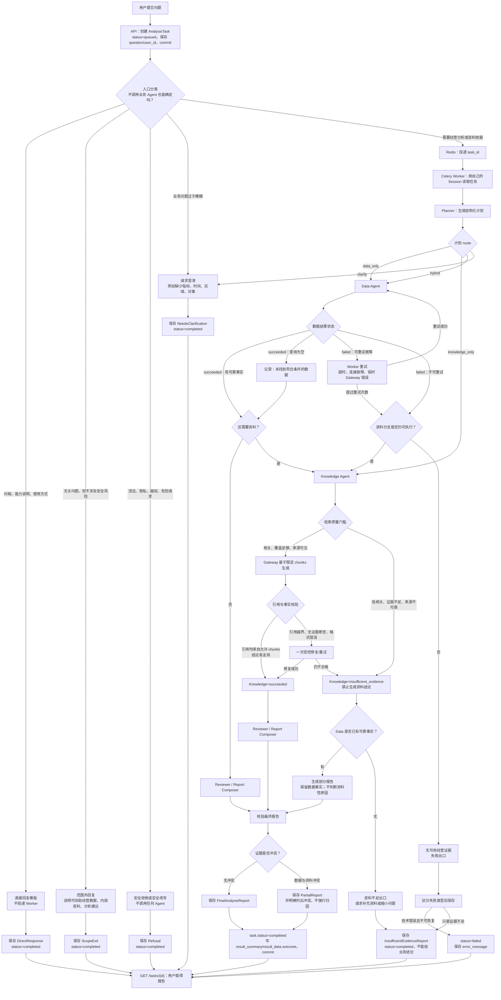

# 多 Agent 分析主链路：状态机与分支规则

本文记录企业经营助手的多 Agent 分析主链路。目标不是在证据不足时生成看似合理的答案，而是在不同结果组合下，稳定地产生完整回答、部分回答、证据不足说明或系统失败说明。

核心规则：**证据不足时，不编造；已有可靠事实时，不因另一支失败而丢弃事实。**

## 1. 全局流程图



## 2. 任务执行状态与报告结果分类

不要把所有“不能完整回答”都标为失败，也不要混淆任务执行状态和报告结果。

`AnalysisTask.status` 表示 Worker 是否完成了任务执行，应继续使用：

```text
queued / running / retrying / completed / failed / cancelled
```

只有 Worker 重试后仍无法完成、或发生不可恢复技术错误时，任务才是 `failed`。如果 Worker 正常执行并得出“证据不足”或“部分结论”，任务执行是成功的，因此 `AnalysisTask.status` 应为 `completed`。

报告质量与回答边界应保存在 `result_data.outcome` 中：

| 结果 | 含义 | 是否给用户业务结论 |
| --- | --- | --- |
| `completed` | 证据充分，分析完成。 | 可以。 |
| `partial` | 只有部分可靠证据，或证据之间有未解决冲突。 | 可以，但必须写清边界。 |
| `insufficient_evidence` | 系统正常，但没有足够依据。 | 不给结论，只说明缺什么。 |
| `failed` | 系统或依赖真正故障，且重试后仍失败。此时通常没有 `result_data`，错误写入 `error_message`。 | 不给分析结论。 |

`资料不足` 不等于 `failed`。它是一个诚实、可预期的业务结果。

## 3. 入口分类：不需要调用业务 Agent 的情况

| 场景 | 处理 | 是否投递 Worker |
| --- | --- | --- |
| 问候、能力说明、使用方式 | 使用受控模板直接回复。 | 否。 |
| 与企业经营助手范围无关，但安全 | 说明产品能协助经营数据、内部资料和分析建议。 | 否。 |
| 违法、隐私、越权或危险请求 | 拒绝，或提供安全替代方向。 | 否。 |
| 业务问题过于模糊 | 请求补充指标、时间、区域、对象或资料范围。 | 否。 |

即使不投递 Worker，也建议保存一个统一任务结果，便于前端展示和后续审计。

## 4. RAG 质量与幻觉控制

只需要 RAG 的问题不能走“检索到几个 chunk 就让模型自由总结”的路线。正确链路是：

```text
检索
→ 检索质量判断
→ 质量合格才允许生成
→ 生成后校验引用与事实边界
```

检索质量判断至少包括：

- 是否检索到真正相关的 chunk；
- 相似度、覆盖度是否达到最低门槛；
- 文档是否属于当前用户；
- 资料是否足以回答当前问题；
- 最终回答中的每个引用是否来自本次允许的 `chunk_id`。

如果资料不足，返回 `insufficient_evidence`，并说明缺少什么资料；禁止让模型对原因作推测。示例：

> 我未在现有资料中找到足以支持该结论的依据，因此不能据此判断。请补充相关的会议纪要、合同、客户反馈或明确资料范围。

如果模型生成了引用越界、无证据断言或不符合结构的结果，最多进行一次受控修复或重试。仍不合格时，将 Knowledge 结果降级为 `insufficient_evidence`。

## 5. 双 Agent 结果组合

### 5.1 Data 成功，Knowledge 资料不足或失败

不能丢弃数据事实，也不能把原因写成确定结论。

例如，Data Agent 已确认：

```text
2025-08 销售额：184 万
2025-07 销售额：210 万
环比下降：12.4%
```

而 Knowledge Agent 未找到下降原因的资料。正确输出是 `partial`：

```text
已确认的事实：
- 华东区 2025 年 8 月销售额较 7 月下降 12.4%。

无法确认的部分：
- 当前资料不足以确认下降的具体原因。

下一步核查建议：
- 核查重点客户续约、订单延期、线索转化和区域人员变动；
- 补充 8 月客户拜访记录、销售周报与重点客户反馈。
```

此处的建议是“核查建议”，不能表达为“下降一定由客户续约导致”。

### 5.2 Knowledge 成功，Data 失败

保留带引用的资料事实，但必须明确经营数据不可用，不能把资料描述伪装成已验证的经营结论。

示例：

> 资料显示，某重点客户续约延期可能影响华东区当期订单推进；但经营数据查询暂不可用，因此尚不能确认该事项对销售额下降的实际影响。

如果 Data Agent 是临时故障，应先按错误类型由 Worker 重试；只有超过重试次数后才进入这个降级分支。

### 5.3 两个 Agent 都没有可用证据

需要区分两类情况：

| 情况 | 示例 | 结果 |
| --- | --- | --- |
| 两边都是证据不足 | 未找到符合条件的数据，且无相关或充分资料。 | `insufficient_evidence`。请求补充范围或资料。 |
| 两边都是技术故障 | 业务库连接失败，向量库或 Gateway 超时。 | 先重试；超过上限后为 `failed`。 |

证据不足时可以回复：

> 现有经营数据和内部资料都不足以支持这项分析，因此暂不提供原因判断。请补充时间范围、区域、指标口径或相关资料。

技术故障且不可恢复时可以回复：

> 本次分析暂未完成，原因是数据与资料服务均不可用。系统未生成任何业务结论，请稍后重试。

### 5.4 两个 Agent 都成功但证据冲突

Reviewer 不能自行选择“看起来更对”的结论，也不能自行解释冲突。应生成 `partial` 报告，分别展示证据、指出可能的口径或时间范围差异，并建议核对。

示例：

```text
- 数据显示华东区销售额环比下降 12.4%。
- 现有月度总结中存在“销售保持增长”的表述。
- 两类证据的统计口径或时间范围可能不同，暂不据此确认下降原因。
- 建议核对报告统计周期、区域范围和指标口径。
```

## 6. 结果结构与保存边界

每个 Agent 都应能表达统一的执行状态：

```python
{
    "status": "succeeded",  # succeeded / partial / failed / skipped
    "payload": {},
    "evidence": [],
    "warnings": [],
    "error": {
        "code": "INSUFFICIENT_EVIDENCE",
        "message": "未检索到足以解释下降原因的文档依据",
        "retryable": False,
    },
}
```

最终报告至少应具备：

```python
{
    "outcome": "completed",  # completed / partial / insufficient_evidence
    "summary": "华东区 2025 年 8 月销售额环比下降 12.4%。",
    "findings": [],
    "recommendations": [],
    "limitations": [],
    "evidence_refs": [],
}
```

保存规则：

```text
WorkflowState
→ FinalAnalysisReport
→ 结构校验
→ AnalysisTask.result_data
→ 更新 task.status=completed、stage、result_summary，并在必要时清空 error_message
→ commit
```

不要把整个 `WorkflowState` 原样保存为 API 返回结果。它是 Worker 内存中的运行中间态；`FinalAnalysisReport` 才是用户可查询、可展示和可追溯的产物。

## 7. 对现有代码的最小改造方向

现有 Planner、Data、Knowledge、Reviewer 四个 Agent 可以保留。优先调整它们之间的结构化契约：

```text
Planner：从两个布尔值升级为可路由的计划。
Node：每次写入标准化 status、证据、警告和错误分类。
Graph：根据 plan + status 路由，而不是只根据 plan 路由。
Reviewer：只综合已验证证据，不生成新事实。
Worker：把终态 FinalAnalysisReport 保存到 AnalysisTask。
```
