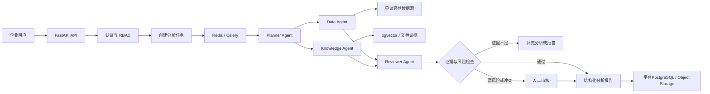

# Enterprise Insight Agent：项目实施与工程能力学习指南

| 项目 | 内容 |
|---|---|
| 文档状态 | 当前执行版 |
| 当前实现快照 | 2026-07-02 |
| 适用范围 | 当前仓库的实施、教学、验收和能力评估 |
| 更新原则 | 需求变化、架构决策或实现状态变化后同步更新 |

## 1. 文档定位

本文档是当前项目唯一的实施与教学主线，用来回答四个问题：

1. 当前代码已经实现了什么。
2. 项目最终要实现什么。
3. 按什么顺序开发，才能避免堆功能和失控。
4. 如何在开发过程中真正掌握工程能力，而不是复制代码。

本文档描述的目标能力不等于当前已经实现的能力。任何完成状态必须以源码、
数据库迁移、自动化测试和实际运行结果为依据。

两份原始设计文档的用途如下：

- `enterprise_style_multimodal_multi_agent_system.md`：提供主要工程骨架。
- `full_enterprise_ai_multi_agent_platform_design.md`：提供长期生产能力参考。
- 本文档：根据当前代码、学习目标和可控范围筛选后的实际执行方案。

## 2. 项目目标

项目名称：

> Enterprise Insight Agent

项目定位：

> 面向企业内部经营分析场景的知识与数据决策 Multi-Agent 平台。

目标用户可以上传业务文档、连接受控的只读经营数据库并提交分析问题。系统通过
可恢复的工作流协调多个 Agent，获取文档证据和结构化数据，核验数字与引用，
最后生成可追溯的分析报告。证据不足、结果冲突或风险较高时，系统拒绝给出确定
结论或进入人工审核。

第一版的目标是“具备部署和内部试运行条件的生产就绪 V1”，不是已经经过大规模
真实用户验证的商业 SaaS。

## 3. 项目范围

### 3.1 第一版必须实现

- FastAPI 分层后端
- PostgreSQL、SQLAlchemy 和 Alembic
- 统一 API 输入、输出和异常格式
- 用户登录与简单 RBAC
- 文档上传、解析、分块和生命周期管理
- Embedding、向量检索和带引用 RAG
- 可复现经营数据、KPI 定义和安全只读 SQL 工具
- Model Gateway 和 Tool Registry
- Planner、Data、Knowledge、Reviewer 四个核心 Agent
- LangGraph 状态工作流
- Redis + Celery 异步任务
- 超时、分类重试、幂等、checkpoint 和取消
- 证据核验、数字核验、拒答和人工审核
- 结构化日志、指标、评测和成本记录
- Docker、CI、备份、恢复和回滚验证
- 能支持实际操作的最小前端
- Git分支、提交、审查和回退
- 可复现的依赖锁定与环境分层

### 3.2 第一版明确不做

- 完整多租户 SaaS
- Control Plane 与 Execution Plane 物理拆分
- Event Sourcing
- 复杂模型路由平台
- API 计费和商业配额
- 大量外部系统连接器
- 完整企业管理后台
- Kubernetes
- Terraform
- Vault
- 灰度发布平台
- 独立 Vision、Repair、Delivery Agent

这些能力可以讨论设计，但未实现前不能写入“已完成功能”。

### 3.3 多模态边界

核心版本优先支持：

- 普通文本
- Markdown
- PDF
- PostgreSQL 查询结果

图片、OCR 和 Vision Agent 属于后续增强项。核心工程链路没有稳定前，不进入开发
范围。

## 4. 当前代码基线

以下状态来自当前仓库的源码和测试，不代表目标状态。

| 模块 | 当前状态 | 代码依据 |
|---|---|---|
| FastAPI 应用 | 已有应用入口、生命周期和路由注册 | `backend/app/main.py` |
| 配置管理 | 已有 Pydantic Settings 和 `.env.example` | `backend/app/core/settings.py` |
| PostgreSQL | 已有连接池、Session和健康检查 | `backend/app/db/` |
| 数据库迁移 | 已有 Alembic 和三份迁移 | `backend/migrations/` |
| 文档 CRUD | 已实现基础增删改查 | `backend/app/api/document.py` |
| 文件保存 | 已有大小、类型、空文件和 SHA256 校验 | `backend/app/services/file_storage_service.py` |
| 上传入库服务 | 已编写服务，但尚未接入 HTTP API | `backend/app/services/document_ingestion_service.py` |
| 文档分块表 | 已有 ORM 模型和迁移 | `backend/app/models/document_chunk.py` |
| 文档解析与分块 | 尚未实现 | `backend/app/utils/document_chunk.py` 为空 |
| 上传响应结构 | 存在待修复冲突：ORM允许`content=None`，当前`DocumentOut`要求字符串 | `backend/app/models/documents.py`、`backend/app/schemas/document.py` |
| 聊天回答 | 仍为 mock | `backend/app/services/chat_service.py` |
| RAG | 尚未形成解析、Embedding、检索和生成闭环 | 尚无对应实现 |
| 向量存储配置 | 当前仅有FAISS目录配置，尚未实现FAISS或pgvector | `backend/app/core/settings.py` |
| 数据分析 | 尚无经营数据模型和安全 SQL 工具 | 尚无对应实现 |
| Multi-Agent | 尚未实现 | 尚无对应实现 |
| Workflow | 尚未实现 | 尚无对应实现 |
| 日志 | 已有 request ID、控制台日志和 JSON 文件日志 | `backend/app/core/` |
| 自动化测试 | 当前有健康检查和文档 CRUD 集成测试 | `backend/tests/integration/` |
| Git基线 | 仓库尚无提交，当前源码和文档均未跟踪 | `git status`显示`No commits yet` |

当前测试基线：

```text
3 passed
```

后续每个阶段都必须保持已有测试通过，并新增能够证明本阶段行为的测试。

## 5. 最终业务链路



核心原则：

- Agent 不直接拥有无限权限。
- 数字由 SQL 或确定性工具计算，LLM 不负责心算。
- 文档事实必须关联真实 chunk。
- 工作流状态必须持久化。
- 暂时性故障才能自动重试。
- 最终结论必须能够追溯到证据和执行记录。

## 6. 技术选择

| 领域 | 选择 | 原因 |
|---|---|---|
| API | FastAPI | 当前项目已经使用，类型和依赖注入清晰 |
| 平台数据库 | PostgreSQL | 保存用户、文档、任务状态、工作流和审计记录 |
| 经营数据源 | 独立只读PostgreSQL连接 | 与平台数据隔离，供安全SQL工具分析 |
| ORM与迁移 | SQLAlchemy + Alembic | 当前项目已经建立基础 |
| 向量检索 | pgvector | 与PostgreSQL统一管理，便于元数据过滤 |
| 工作流 | LangGraph | 表达有状态、多节点和条件分支工作流 |
| 异步任务 | Celery + Redis | 避免长时间阻塞HTTP请求 |
| 数据校验 | Pydantic | 限制API、Agent和Tool输入输出 |
| 对象存储 | 本地适配器后切换MinIO/S3 | 先理解接口，再完成生产化替换 |
| 测试 | pytest | 当前项目已经使用 |
| 代码检查 | Ruff | 当前项目已经配置 |
| 本地基础设施 | Docker Compose | 在Windows上提供一致的Redis、pgvector和对象存储环境 |
| 部署 | Linux容器起步 | 第一版不引入Kubernetes复杂度 |

技术选择不是永久不变。任何替换都必须先说明问题、候选方案、迁移成本和验证
方法，不能因为“更流行”随意改动。

### 6.1 Agent上下文管理目标

当前代码尚未实现Agent上下文。项目采用逐层演进方案：

> 先完成可观察的内存上下文，再逐步增加证据引用、Agent隔离、持久化、Token控制、
> 安全治理和可重放能力；每一层通过验证后再进入下一层，不在第一版提前创建完整
> “记忆平台”。

最小Demo只是第一个可验证纵切面，不是最终架构。演进过程中保持以下边界稳定：

- PostgreSQL保存业务事实和长期执行记录。
- LangGraph State保存当前工作流需要的状态。
- LangGraph checkpoint保存节点恢复状态。
- pgvector保存可检索的文档证据。
- 对象存储保存原始文档和大型结果。
- Redis只承担消息队列、短期协调状态和必要的锁，不作为长期上下文数据库。
- 每个Agent只接收完成当前职责所需的上下文。

### 6.2 上下文类型

| 上下文类型 | 内容 | 生命周期 | 主要存储 |
|---|---|---|---|
| 请求与安全上下文 | user_id、task_id、request_id、权限范围 | 单次请求/任务 | 请求对象、平台数据库 |
| 工作上下文 | 问题、计划、证据ID、结果ID、当前状态 | 单次工作流 | LangGraph State/checkpoint |
| 语义上下文 | 文档chunk、页码、相似度、来源 | 文档生命周期 | PostgreSQL/pgvector |
| 执行上下文 | Agent、Tool、模型调用和验证结果 | 按审计策略保留 | 平台数据库 |
| 对话上下文 | 最近消息、确认事实、任务摘要 | 会话生命周期 | 后续按真实需求建立 |

第一版不实现跨任务的自动长期记忆。只有出现明确业务需求并能定义权限、纠错和删除
规则后，才增加用户偏好或跨会话记忆。

### 6.3 Workflow State

内存Demo可以从少量字段开始：

```python
class DemoState(TypedDict):
    question: str
    evidence: list[str]
    answer: str | None
    errors: list[str]
```

进入持久化Multi-Agent阶段后，State演进为保存引用而不是大型原始内容：

```python
class WorkflowState(TypedDict):
    task_id: int
    user_id: int
    question: str
    plan: list[dict]
    evidence_ids: list[int]
    data_result_ids: list[int]
    draft_answer: str | None
    validation_result: dict | None
    review_result: dict | None
    errors: list[dict]
    status: str
```

State中不保存：

- 完整PDF或图片
- 全部文档chunk
- 大型SQL结果集
- 无限制历史对话
- 每个节点的完整重复Prompt

大型内容进入平台数据库或对象存储，State只保存ID、必要摘要和当前节点所需字段。

### 6.4 证据引用

文档和SQL结果使用可验证引用：

```python
class EvidenceRef(BaseModel):
    evidence_id: int
    source_type: str
    document_id: int | None
    chunk_id: int | None
    data_result_id: int | None
    page_number: int | None
    score: float | None
```

要求：

- 每个引用能够追溯到原始文档chunk或已执行SQL结果。
- 引用进入Prompt前再次检查用户权限。
- 文档删除、数据源撤销或结果过期后，相关证据必须失效。
- 模型生成的证据ID不能直接采信，必须由CitationValidator验证。

### 6.5 每个Agent的上下文边界

所有Agent共享同一个工作流，但不能直接接收完整State。每个节点使用明确的输入模型：

```python
class PlannerContext(BaseModel):
    question: str
    allowed_tools: list[str]


class KnowledgeContext(BaseModel):
    question: str
    plan: list[dict]
    allowed_document_ids: list[int]


class DataContext(BaseModel):
    question: str
    plan: list[dict]
    allowed_tables: list[str]


class ReviewerContext(BaseModel):
    draft_answer: str
    evidence_ids: list[int]
    data_result_ids: list[int]
```

第一版不提前创建通用Context工厂。先用每个节点一个小型组装函数；只有出现稳定重复
逻辑后再提取共享组件。

| Agent | 可以接收 | 不应接收 |
|---|---|---|
| Planner | 问题、任务约束、允许工具 | 原始密钥、全部文档和全部SQL数据 |
| Knowledge | 问题、计划、文档权限范围 | 经营数据库凭据和无权限文档 |
| Data | 问题、计划、表字段白名单和指标定义 | 原始文档和平台数据库表 |
| Reviewer | 草稿、有效证据、SQL结果摘要和校验结果 | 数据源凭据和未经授权原始数据 |

### 6.6 上下文组装生命周期

```text
读取task_id
→ 从平台数据库加载任务
→ 校验用户和资源权限
→ 加载当前节点需要的证据或结果
→ 执行脱敏和有效性检查
→ 应用Token预算
→ 组装当前Agent输入
→ 调用Agent或Tool
→ Pydantic校验
→ 大型结果入库
→ State保存引用
→ 保存checkpoint
```

任何必要上下文缺失时，不允许让模型猜测。节点应进入：

- `waiting_input`：需要用户补充输入
- `waiting_review`：需要人工判断
- `failed`：确定性错误且无法继续

### 6.7 Token预算和压缩

上下文优先级：

```text
系统安全规则
> 用户和资源权限
> 当前问题
> 已验证工具结果
> 文档证据
> 历史对话
```

压缩顺序：

1. 删除重复chunk。
2. 去掉低相关证据。
3. 将大型SQL结果转换为由代码生成的统计摘要。
4. 压缩较早且未被引用的对话。
5. 上下文仍超限时，请用户缩小问题范围。

不能因为Token不足删除安全规则、权限信息和证据来源。每次模型调用记录：

- 原始与最终Token量
- 删除或压缩的内容类型
- 截断原因
- 上下文策略版本
- 为模型输出预留的Token

### 6.8 多轮对话

只有单轮分析链路稳定后才增加多轮对话。多轮上下文由以下内容组成：

```text
最近必要消息
+ 已确认事实
+ 当前任务摘要
+ 当前有效证据
```

规则：

- 用户消息是请求或陈述，不自动成为已验证事实。
- LLM回答不能自动进入`confirmed_facts`。
- 已确认事实必须记录来源消息或工具结果。
- 用户修改前提后，依赖旧前提的摘要和结果需要失效或重建。
- 不把`chat_records`全部历史直接塞入Prompt。

进入该阶段后再建立`conversations`、`messages`和`conversation_summaries`，当前
`chat_records`只作为已有问答记录，不作为Agent长期记忆。

### 6.9 信任和安全边界

| 内容 | 默认信任级别 |
|---|---|
| 系统安全规则 | 可信 |
| 服务端权限结果 | 可信 |
| 通过Validator的工具结果 | 可信 |
| 用户输入 | 不可信 |
| 上传文档 | 不可信数据 |
| 外部数据库文本字段 | 不可信数据 |
| 模型输出 | 未校验前不可信 |

生产要求：

- 权限过滤发生在检索和数据加载之前。
- 文档中的“忽略系统规则”等内容只能作为资料，不能成为系统指令。
- 敏感字段进入模型前脱敏。
- 日志默认不保存完整敏感上下文。
- 不同用户不能共享未按权限隔离的上下文缓存。
- 删除数据时同步处理chunk、向量、摘要和证据引用。

### 6.10 版本、失效和可重放

需要记录：

```text
task_id
agent_name
context_policy_version
prompt_version
model
evidence_ids
data_result_ids
input_hash
token_usage
latency
validation_result
```

默认不永久保存完整Prompt。优先保存Prompt版本、输入哈希、证据ID和脱敏后的必要
执行摘要。只有排障或合规确实需要时才保存完整上下文，并设置加密、权限和保留期限。

以下变化会触发上下文失效或重建：

- 文档删除或更新
- 数据源权限撤销
- 用户修改问题前提
- Prompt或上下文策略发生不兼容变化
- checkpoint引用的证据已失效

### 6.11 上下文演进与项目阶段映射

| 上下文阶段 | 项目阶段 | 交付能力 |
|---|---|---|
| 内存上下文Demo | 阶段0～1的独立练习 | 理解字段在节点间流动 |
| 请求与权限上下文 | 阶段2 | user_id、资源归属和权限范围 |
| 文档证据引用 | 阶段3～4 | 文档、chunk、页码和生命周期 |
| 持久化任务上下文 | 阶段6～7 | task_id、数据库状态和异步恢复 |
| 向量检索上下文 | 阶段8～9 | evidence_id、Top-K和权限过滤 |
| 单Agent可靠上下文 | 阶段10～11 | Model Gateway、Token和拒答 |
| 数据分析上下文 | 阶段12～14 | KPI、只读SQL结果和Tool输出 |
| Multi-Agent上下文 | 阶段15 | 每个Agent独立输入模型 |
| Workflow上下文 | 阶段16 | State、checkpoint、resume和cancel |
| 校验与审核上下文 | 阶段17 | 引用、数字、覆盖率和人工审核 |
| 安全与失效治理 | 阶段18～19 | 重试、脱敏、注入和删除 |
| 可观测与评测 | 阶段20 | Token、成本、泄漏和恢复评测 |
| 生产运行上下文 | 阶段21～22 | 前端状态、部署、备份和回滚 |

### 6.12 上下文专项评测

至少验证：

- 无权限文档和数据是否泄漏。
- 低相关chunk是否挤占高价值证据。
- Token不足时安全规则是否仍被保留。
- Prompt注入是否传播到其他Agent。
- SQL结果是否被错误压缩或总结。
- 对话摘要是否丢失关键前提。
- checkpoint恢复后的上下文是否一致。
- 文档删除后旧证据是否仍可使用。
- 同一任务重试是否复用了已过期上下文。

## 7. 教学目标

完成项目不等于掌握项目。掌握程度分为五层：

1. **能运行**：能够配置环境、启动服务和运行测试。
2. **能解释**：能够说明模块职责、调用链和设计原因。
3. **能修改**：能够按需求增加接口、字段、迁移和测试。
4. **能排错**：能够根据日志、Traceback、数据库和任务状态定位故障。
5. **能重建**：不复制当前源码，也能实现一个简化的同类系统。

项目毕业要求达到第五层。

## 8. 高效教学规则

### 8.1 每一课的固定流程

每一课只处理一个清晰目标：

1. 说明本课业务问题。
2. 阅读与本课直接相关的现有文件。
3. 画出输入、输出和数据流。
4. 解释所需知识和关键术语。
5. 给出接口约束、伪代码或测试要求。
6. 学习者先独立编写代码。
7. 运行正常路径测试。
8. 主动制造至少一个异常场景。
9. 根据实际代码进行审查和修改。
10. 学习者用自己的语言复述实现。
11. 完成独立实现、故障排查和迁移练习。
12. 将验证证据同步到`docs/learning_notes.md`。
13. 通过掌握度验收后进入下一课。

### 8.2 每一步的掌握验证

每一步完成后必须依次进行四项验证：

1. **解释验证**：不照抄文档，用自己的语言说明目标、调用链、关键参数和设计原因。
2. **实现验证**：只根据接口或需求，独立补写一个同类小功能。
3. **排错验证**：面对一个故意制造的错误，通过日志、Traceback、测试或数据库证据定位原因。
4. **迁移验证**：不复制原实现，在另一个接口、数据表、工具或Agent中完成一个更小
   的同类改动，并运行对应测试。

掌握状态只能使用：

| 状态 | 判定标准 |
|---|---|
| 未开始 | 尚未学习 |
| 学习中 | 能在较强提示下完成，但不能独立解释或实现 |
| 待补强 | 主流程基本掌握，但排错或迁移验证未通过 |
| 已掌握 | 四项验证全部通过，并有实际证据 |

仅满足以下情况不能标记为“已掌握”：

- 代码能够运行，但无法解释。
- 跟随完整答案复制成功。
- 只通过正常路径，没有验证异常。
- 测试通过，但不知道测试验证了什么。
- 能复述概念，但不能独立修改代码。

### 8.3 学习情况同步规则

每完成一课，必须在`docs/learning_notes.md`中记录：

- 学习日期和阶段
- 本课目标
- 阅读和修改的文件
- 自己编写的内容
- 运行过的验证命令及真实结果
- 遇到的错误、证据和根因
- 对数据流和设计原因的个人复述
- 四项掌握验证结果
- 当前掌握状态
- 尚未理解的内容
- 下一步补强动作

记录必须基于实际学习过程，不能预先填写“已掌握”，也不能使用没有运行过的测试
结果。每次进入新阶段前，先检查上一阶段的学习记录和遗留问题。

### 8.4 帮助强度逐步下降

- 初期：逐段解释，每次只写少量代码。
- 中期：只提供接口、伪代码、测试和提示。
- 后期：只提供业务需求，由学习者设计实现。
- 毕业阶段：学习者独立完成需求、测试、部署和故障排查。

如果学习记录显示长期依赖完整代码答案，后续不能继续增加功能，必须先回到同类小
练习，直到可以在减少提示的情况下完成。

### 8.5 禁止低效学习方式

- 不一次性生成整个模块让学习者复制。
- 不同时引入多个陌生框架。
- 不在测试失败时绕过测试。
- 不通过删除数据库替代迁移。
- 不只验证成功路径。
- 不在没有证据时宣称性能、准确率或用户规模。
- 不为了目录看起来“企业级”创建大量空文件。

## 9. 项目变更规则

为防止随意修改项目，后续所有改动遵循以下协议。

### 9.1 修改前

必须先说明：

- 当前问题是什么。
- 为什么需要修改。
- 将修改哪些文件。
- 数据流会发生什么变化。
- 是否需要迁移。
- 可能影响哪些已有功能。
- 如何验证。

### 9.2 修改中

- 只修改本课列出的文件。
- 不顺手重构无关代码。
- 不覆盖学习者未确认的改动。
- 不删除数据、迁移或测试来让结果通过。
- 密钥、密码和真实用户数据不能进入Git。

### 9.3 修改后

必须提供：

- 具体修改说明。
- 正常路径验证。
- 异常路径验证。
- 自动化测试结果。
- 尚未解决的问题。
- 学习者需要能够回答的面试问题。
- 掌握验证结果和`docs/learning_notes.md`更新。

### 9.4 当前事实与目标需求的判断规则

判断“当前已经实现什么”时：

1. 实际运行结果、数据库结构和自动化测试
2. 当前源码和迁移
3. 当前状态文档

判断“下一步应该实现什么”时：

1. 用户明确确认的需求和范围
2. 本实施与学习指南
3. 已确认的ADR
4. 推荐实现版设计文档
5. 完整平台参考文档

源码可能存在Bug，测试也可能验证了错误行为，因此它们只能证明当前行为，不能
自动覆盖已经确认的目标需求。发现冲突时先记录证据，再决定修改代码、测试或文档。

## 10. 分阶段实施与学习计划

每个阶段都有明确的依赖、开发内容和完成门槛。未通过门槛不能继续堆叠后续模块。
每个阶段结束时还必须完成第11节中的专项掌握验证。

### 阶段0：工程基线、Git和现有调用链

学习内容：

- PowerShell、解释器、虚拟环境、依赖和退出码
- Git工作区、暂存区、提交、分支、diff和回退
- FastAPI分层、SQLAlchemy Session和pytest

实践内容：

- 运行现有测试并记录真实结果。
- 跟踪`POST /documents`完整调用链。
- 检查`.gitignore`，确认密钥和生成物不会入库。
- 在用户确认后建立首个可回退的Git基线；默认采用`main + feature/*`工作流。
- 选择一种依赖锁定方式并写ADR；后续依赖变更必须同步锁文件。

完成门槛：

- 能区分代码、解释器、依赖、配置和数据库问题。
- 能阅读diff并撤销自己的未提交修改。
- 当前三项测试通过。
- Git基线只包含应进入版本控制的文件。

### 阶段1：HTTP契约、Schema和异常

学习内容：

- HTTP状态码、Pydantic、领域异常、全局异常处理和API版本

实践内容：

- 修复当前`Documents.content`允许为空而`DocumentOut.content`不允许为空的冲突。
- 区分手工创建文档与上传文档的请求、响应结构。
- 增加输入边界校验和统一错误响应。
- 为已有接口补充正常与异常测试。

完成门槛：

- 用户输入错误不返回500。
- 服务端Traceback不直接暴露。
- 错误可通过request ID定位日志。

### 阶段2：用户身份、资源归属和最小RBAC

这一阶段提前完成，避免后续给所有文档、任务和审批记录返工增加所有者。

实践内容：

- 建立用户、角色和资源归属模型。
- 为文档和后续任务预留`owner_id`及访问范围。
- 实现登录、密码安全存储和JWT。
- 建立admin、analyst、reviewer最小权限。

完成门槛：

- 未登录访问受保护接口会被拒绝。
- 用户不能读取无权限文档。
- 权限查询条件在Repository层得到验证。
- 越权测试通过。

### 阶段3：文件上传闭环

学习内容：

- 流式读取、文件名安全、SHA256、事务和跨存储补偿

实践内容：

- 接入`POST /documents/upload`。
- 复用现有文件保存和上传入库服务。
- 建立`StorageProvider`接口，第一版实现本地存储。
- 映射空文件、超大文件、格式错误和重复文件。

完成门槛：

- 文件记录、所有者和存储状态一致。
- 失败时不残留半成品文件。
- 重复文件策略有明确范围，例如按用户或全局去重。

### 阶段4：文档解析、分块和生命周期

实践内容：

- 实现TXT、Markdown、PDF解析。
- 实现Token分块、overlap、页码和chunk序号。
- 实现`pending → processing → completed/failed`。
- 删除文档时同步删除chunk；向量删除在阶段8补齐。

完成门槛：

- 损坏、空白和重复处理有明确结果。
- 重复处理不产生重复chunk。
- 处理中断后状态可以识别和修复。

### 阶段5：本地基础设施与环境分层

在首次使用Redis和pgvector之前建立基础设施，不把完整部署拖到最后。

实践内容：

- 使用Docker Compose启动Redis和带pgvector扩展的PostgreSQL。
- 明确development、test、production配置边界。
- 为依赖服务增加健康检查。
- 记录Windows宿主开发与Linux容器运行的差异。

完成门槛：

- 新环境能够按文档启动依赖服务。
- 测试数据库与开发数据库严格分离。
- pgvector扩展和Redis连接可以通过独立健康检查验证。

### 阶段6：持久化任务模型和状态职责

先定义状态事实来源，再引入Celery和LangGraph。

平台数据库至少规划：

- `analysis_tasks`
- `workflow_runs`
- `agent_runs`
- `tool_calls`
- `evidence`
- `approvals`

基础任务状态：

```text
queued
→ running
→ waiting_input / waiting_review
→ completed
→ failed / cancelled
```

职责边界：

- PostgreSQL是业务任务状态的唯一事实来源。
- Celery负责消息投递和Worker执行，不作为最终任务状态来源。
- LangGraph checkpoint负责工作流节点恢复。
- Redis只保存队列、短期协调状态和必要的锁。

完成门槛：

- 服务重启后任务记录仍存在。
- 状态迁移有约束，非法跳转被拒绝。
- API查询状态只读取平台数据库。

### 阶段7：Celery异步执行

学习内容：

- 消息队列、Worker、at-least-once执行、重试和幂等

实践内容：

- 上传后创建持久化任务，再发送Celery消息。
- 将Linux容器中的Worker作为标准执行环境；Windows宿主直接运行仅用于临时调试。
- 提供状态查询、取消和手工重试接口。
- 使用幂等键和数据库约束防止重复执行。
- 明确消息发送失败时数据库任务如何补偿。

完成门槛：

- HTTP请求不等待完整处理流程。
- Worker重复消费不会重复写入。
- Worker异常退出后任务可恢复或明确失败。

### 阶段8：pgvector和Embedding

实践内容：

- 用ADR确认pgvector为第一版唯一向量存储。
- 删除未使用的`faiss_dir`配置，避免双方案并存。
- 增加pgvector依赖、扩展检查和数据库迁移。
- 抽象EmbeddingProvider并批量生成向量。

完成门槛：

- 重复处理不重复写向量。
- 删除文档时chunk和向量同步删除。
- Embedding模型版本和维度可追踪。

### 阶段9：检索与增量评测

学习内容：

- 余弦相似度、Top-K、阈值、元数据过滤和Recall@K

实践内容：

- 实现按用户权限和文档范围过滤的检索。
- 返回文档、chunk、页码、分数和模型版本。
- 建立第一批文档问题、预期证据和不可回答问题。

完成门槛：

- 固定问题能检索到预期证据。
- 低相关问题返回空结果。
- 越权文档不会出现在结果中。

### 阶段10：Model Gateway和数据发送策略

实践内容：

- 封装模型客户端、超时、限流错误、Token和成本记录。
- 定义哪些字段可以发送给模型，哪些必须脱敏或禁止发送。
- 保存模型和Prompt版本，不保存密钥。
- 对暂时性错误和确定性错误采用不同策略。

完成门槛：

- 业务代码不直接依赖具体模型SDK。
- 日志和模型请求不泄漏受保护字段。
- 模型不可用时任务进入可解释状态。

### 阶段11：可靠RAG

实践内容：

- 使用真实检索证据生成回答。
- 输出回答、引用和限制说明。
- `is_sufficient`由服务根据检索阈值、有效证据数量和校验结果计算，不采信模型自报。
- 保存问题、证据、回答、模型和Prompt版本。

完成门槛：

- 无证据时明确拒答。
- 引用必须对应真实chunk。
- 模型编造的证据编号会被确定性代码拒绝。

### 阶段12：独立经营数据源、KPI和标准场景

平台数据库与经营数据源必须使用独立连接和权限。

标准场景：

1. 销售额下降原因分析
2. 客诉率上升原因分析
3. 证据不足时拒绝给出确定结论

实践内容：

- 建立客户、产品、订单、订单明细和客诉数据。
- 使用固定随机种子生成数据并注入已知异常。
- 定义销售额、订单量、客单价、复购率和客诉率。
- 为每个场景保存标准SQL、预期证据和预期结论。

完成门槛：

- 数据可复现，异常有已知原因。
- 学习者能手写SQL解释至少一个指标变化。
- 经营数据账号不能访问平台任务和用户表。

### 阶段13：安全只读SQL工具

实践内容：

- 使用独立只读账号。
- 使用SQL AST限制单条SELECT。
- 实现表字段白名单、超时和最大返回行数。
- 保存SQL、参数、执行状态和结果摘要。
- 对敏感字段脱敏。

完成门槛：

- DELETE、UPDATE、多语句和越权表无法执行。
- 不存在字段、超时、NULL和除零有明确处理。
- 每次查询可以审计和复现。

### 阶段14：Tool Registry

实践内容：

- 定义Tool协议、结构化输入输出和注册表。
- 注册RAG、SQL和确定性计算工具。
- 配置权限、超时、错误类型和版本。

完成门槛：

- 工具可以独立测试。
- 非法输入在执行前被拒绝。
- Agent只能调用授权工具。

### 阶段15：四个核心Agent

实现顺序：

1. Knowledge Agent
2. Data Agent
3. Planner Agent
4. Reviewer Agent

边界：

- Planner只拆解任务，不直接生成最终结论。
- Data Agent只使用数据工具。
- Knowledge Agent只使用知识工具。
- Reviewer Agent负责语义冲突和建议合理性审查，不替代确定性校验器。

完成门槛：

- 每个Agent可以独立测试。
- 工具权限隔离测试通过。
- 非法结构化输出被拒绝。

### 阶段16：LangGraph状态工作流

核心状态至少包含：

```text
run_id
question
plan
data_results
knowledge_evidence
draft_answer
validation_result
review_result
errors
status
```

实践内容：

- Data与Knowledge节点并行。
- 保存workflow run和agent run。
- 实现条件分支、checkpoint、resume和cancel。
- 将LangGraph节点状态映射到平台任务状态。

完成门槛：

- 可以查询当前节点和历史步骤。
- 服务重启后能够从checkpoint恢复。
- 取消后的任务不会继续产生最终结果。
- Celery状态、工作流状态和数据库状态不存在互相覆盖。

### 阶段17：确定性校验、拒答和人工审核

确定性校验器：

- SchemaValidator：检查结构。
- CitationValidator：检查证据ID和权限。
- NumericValidator：核对报告数字与SQL结果。
- CoverageCalculator：计算证据覆盖率。

Reviewer Agent只补充语义冲突、推断边界和建议风险审查。

完成门槛：

- 编造引用和错误数字会被代码拦截。
- 证据不足正确拒答。
- 冲突或高风险结果进入人工审核。
- 审核人、意见、时间和后续状态完整记录。

### 阶段18：可靠性和故障恢复

实践内容：

- 建立异常分类表。
- 实现超时、指数退避、最大重试次数和熔断边界。
- 完成幂等、checkpoint、失败任务查询和手工重跑。
- 注入数据库中断、Redis中断、Worker退出和模型超时。

完成门槛：

- 暂时性异常和确定性异常策略不同。
- 重试不会产生重复结果。
- 每个失败任务都有最终状态和恢复路径。

### 阶段19：安全和数据治理

实践内容：

- 密钥与数据源凭据保护。
- Prompt注入和工具越权防护。
- 文件安全、请求限流和敏感数据脱敏。
- 数据保留、删除和模型发送策略。
- 依赖漏洞扫描和升级流程。

完成门槛：

- 密钥不进入Git、日志和模型请求。
- 删除文档会清理对象、chunk、向量和相关引用。
- 安全测试覆盖越权、注入和危险SQL。

### 阶段20：可观测性、评测和SLO

统一关联：

```text
request_id → task_id → workflow_run_id → agent_run_id → tool_call_id
```

实践内容：

- 统计API、队列、工作流、模型和工具的延迟与错误。
- 合并文档、SQL、混合任务、拒答、注入和故障恢复数据集。
- 记录Recall@K、SQL正确率、引用有效率、数字一致率、拒答正确率、
  工作流完成率、P50/P95耗时和成本。
- 先测基线，再根据实测结果制定容量目标和SLO；不预先编造数字。

完成门槛：

- Prompt、模型或代码变化后可以重复评测。
- 能通过日志和指标定位失败节点。
- 每个公开指标都有查询或测试证据。

### 阶段21：最小前端

实现：

- 登录
- 文档管理
- 数据源配置
- 分析任务提交
- 工作流时间线
- SQL与文档证据
- 人工审核
- 失败任务
- 质量与成本看板

完成门槛：

- 权限和错误状态在页面上可见。
- 页面不直接持有数据库或模型密钥。
- 核心业务链路可以由非开发用户完成。

### 阶段22：可复现构建、部署和运维验收

实践内容：

- 锁定生产与开发依赖，CI使用同一锁文件。
- 构建API、Worker和前端Linux容器。
- 使用Docker Compose运行Redis、PostgreSQL/pgvector和MinIO。
- 将StorageProvider从本地实现切换到MinIO并验证兼容性。
- 配置HTTPS、健康检查、迁移、备份、恢复和回滚。
- 编写运维Runbook，覆盖队列积压、数据库故障、模型不可用和回滚。
- 使用虚拟用户做容量测试，明确这是压测而不是真实用户量。

完成门槛：

- 按README可从零启动。
- CI可复现本地测试和构建。
- 备份可以实际恢复，旧版本可以实际回滚。
- 已实现、规划和实测能力明确区分。

## 11. 分阶段掌握验证矩阵

所有阶段都执行“解释、实现、排错、迁移”四项验证。下表规定每个阶段至少完成的
专项验证，结果记录在`docs/learning_notes.md`。

| 阶段 | 解释验证 | 独立实现 | 排错验证 | 迁移验证 |
|---|---|---|---|---|
| 0 | 画出当前请求链 | 独立运行和检查项目 | 定位导入或解释器错误 | 在新分支完成小改动并回退 |
| 1 | 解释Schema与ORM区别 | 增加一个校验规则 | 定位响应校验错误 | 为另一接口增加同类校验 |
| 2 | 解释认证与授权区别 | 增加一个受保护接口 | 定位一次越权问题 | 为另一资源增加所有权限制 |
| 3 | 解释文件与数据库一致性 | 增加一种上传异常 | 定位残留文件原因 | 为另一文件操作加入补偿 |
| 4 | 解释分块与状态机 | 实现一种解析器 | 定位重复chunk | 为新格式复用解析协议 |
| 5 | 解释各容器职责 | 增加一个健康检查 | 定位服务连接失败 | 在测试环境复现配置 |
| 6 | 解释四种状态存储职责 | 增加一次合法状态迁移 | 定位非法状态跳转 | 为新任务类型复用状态机 |
| 7 | 解释at-least-once | 实现一个幂等任务 | 定位重复消费 | 为另一任务加入异步执行 |
| 8 | 解释向量维度和版本 | 写入一批向量 | 定位维度不匹配 | 替换测试Embedding实现 |
| 9 | 解释Top-K与阈值 | 增加一个检索过滤条件 | 定位漏检或越权结果 | 为新文档集建立评测 |
| 10 | 解释模型错误分类 | 接入一个测试模型实现 | 定位超时或限流 | 替换Provider不改业务层 |
| 11 | 解释证据到回答的数据流 | 实现一个拒答规则 | 定位伪造引用 | 为新问答场景复用RAG |
| 12 | 解释KPI口径 | 手写一个分析SQL | 定位脏数据导致的偏差 | 新增一个可复现异常 |
| 13 | 解释SQL安全边界 | 增加一条AST规则 | 定位危险SQL绕过 | 为新表配置白名单 |
| 14 | 解释Tool协议 | 注册一个确定性工具 | 定位Schema不匹配 | 为工具增加版本 |
| 15 | 解释四个Agent边界 | 独立实现一个Agent节点 | 定位越权工具调用 | 为新任务复用Agent协议 |
| 16 | 解释Celery与LangGraph边界 | 增加一个条件分支 | 定位checkpoint恢复失败 | 为新工作流复用状态 |
| 17 | 解释确定性校验与LLM审查 | 增加一个Validator | 定位错误数字未拦截 | 为新输出结构复用校验 |
| 18 | 解释异常分类 | 增加一种恢复策略 | 排查一次故障注入 | 为新节点配置重试策略 |
| 19 | 解释数据最小化 | 增加一项安全限制 | 定位越权或注入问题 | 为新数据源应用相同策略 |
| 20 | 解释指标计算来源 | 增加一个可复现指标 | 定位指标采集缺口 | 比较两个版本评测结果 |
| 21 | 解释前后端状态流 | 独立完成一个页面流程 | 定位错误状态展示 | 为新任务类型复用组件 |
| 22 | 解释发布与回滚 | 完成一次部署变更 | 完成备份恢复或回滚 | 在干净环境重新部署 |

## 12. 数据与用户不足时的验证方案

没有大规模真实数据和用户不妨碍工程能力验证，但不能伪造生产成绩。

数据策略：

- 使用固定随机种子生成经营数据。
- 主动注入已知异常、NULL、重复和缺失。
- 保存标准问题、预期证据和预期结论。
- 生成器进入版本控制，大型生成结果不进入Git。

用户策略：

- 使用admin、analyst、reviewer等测试账号验证权限。
- 使用Locust或k6模拟并发，仅用于性能测试。
- 有条件时邀请少量真实试用者完成指定任务。

允许的表述：

> 项目通过可复现数据、标准评测集、故障注入、并发压测和备份恢复验证生产就绪能力。

禁止的表述：

- 已服务大量企业用户。
- 已处理真实企业百万级数据。
- 未经评测就声明准确率达到某个数字。
- 未经真实部署就声明长期稳定运行。

## 13. 每项功能的完成定义

一项功能只有同时满足以下条件才算完成：

- 业务需求清晰。
- 输入输出有类型约束。
- 数据库变化有Alembic迁移。
- 正常路径测试通过。
- 关键异常路径测试通过。
- 日志能够定位问题。
- 不泄漏密钥和敏感数据。
- 文档只描述实际行为。
- 学习者能够解释实现和取舍。
- 学习者能够在提示减少后完成相似修改。
- 四项掌握验证全部通过。
- 学习记录包含真实测试、错误和独立完成证据。

## 14. 工程能力毕业考核

### 14.1 独立新增需求

示例：

> 为分析任务增加取消、重新执行和权限限制。

学习者需要独立完成需求分析、数据设计、迁移、API、业务逻辑、测试、文档和异常
处理。

### 14.2 独立故障排查

在不知道故障位置的情况下，排查：

- 数据库连接失败
- Worker执行中退出
- 模型超时
- SQL错误
- 文档解析失败
- 重复任务执行

必须使用日志、Traceback、数据库和任务状态获得证据，不能只靠猜测。

### 14.3 从零重建简化项目

新建仓库，不复制当前源码，独立实现：

- FastAPI接口
- PostgreSQL表和迁移
- 一个文档或数据工具
- 两个Agent
- 一个状态工作流
- 异常处理
- 自动化测试
- Docker启动

### 14.4 完整口头讲解

能够解释：

```text
用户请求
→ 权限校验
→ 创建任务
→ Worker消费
→ 工作流调度
→ Agent调用工具
→ RAG/SQL获取证据
→ Reviewer核验
→ 人工审核
→ 保存和返回报告
```

并说明每一步可能出现的异常和处理方法。

## 15. 文档资产

文档随代码逐步建立，不提前创建空壳：

```text
docs/
├── project_implementation_learning_guide.md
├── architecture.md
├── learning_notes.md
├── error-handling.md
├── security.md
├── evaluation.md
├── deployment.md
├── operations-runbook.md
├── requirements-traceability.md
├── failure-cases.md
├── interview-notes.md
└── adr/
```

其中：

- `architecture.md`只描述当前已经实现的架构。
- `learning_notes.md`记录每课知识、错误和复述。
- `adr/`记录有实际取舍价值的技术决策。
- `evaluation.md`中的数字必须来自实际评测。
- `operations-runbook.md`记录故障处理、备份恢复和回滚步骤。
- `requirements-traceability.md`把需求关联到代码、迁移、测试和验证结果。

## 16. 第一课

第一课不新增Agent和框架，只完成现有工程理解。

目标：

- 确认解释器和测试基线。
- 检查Git未提交状态、忽略规则和敏感文件边界。
- 阅读`POST /documents`调用链。
- 解释API、Schema、Service、Repository、Model和数据库的职责。
- 解释一次请求的输入、输出、事务和异常路径。
- 识别`Documents.content`与`DocumentOut.content`的类型冲突，但本课只记录，不修改。
- 将自己的理解记录到`docs/learning_notes.md`。

第一课通过后，再进入“统一API和异常处理”，不直接跳到RAG或LangGraph。
